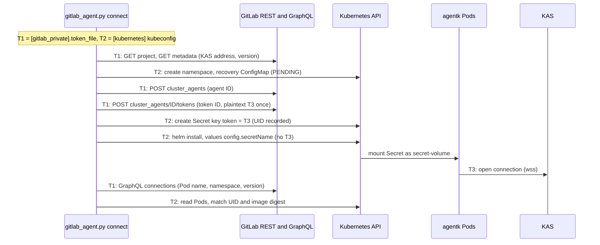

# GitLab Agent for Kubernetes: connectivity and attach

Status: no command uses this yet. `gitlab_agent.py` is planned and not implemented; its name and flags are not
settled. This page tells the caller of this skill, without network access, when a cluster can attach to a GitLab
project, what each side needs, and which target value each input comes from. No command attaches ci-skills itself
to a cluster; the attach connects the project owner's GitLab project to the project owner's cluster.

Words used here: "caller" is the program that runs this skill's commands; "project owner" is the team that owns the
GitLab project and the cluster; "GitLab Agent" is the GitLab feature, and "agentk" is its program running in the
cluster.

## Who opens the connection

agentk, installed in the cluster, opens the connection to the GitLab agent server, KAS (the docs now call it GitLab
Relay), at `config.kasAddress`. The install is one Helm release:

```bash
helm upgrade --install <name> gitlab/gitlab-agent \
  --namespace <namespace> --create-namespace \
  --set config.token=<agent token> \
  --set config.kasAddress=<kas address>
```

The default chart's service account has cluster-admin. Source: docs.gitlab.com `user/clusters/agent/install`.

## KAS address

- GitLab.com: `grpcs://kas.gitlab.com`. Agents installed with `wss://kas.gitlab.com` still work. Sources:
  `user/clusters/agent/install`; GitLab 19.5 release notes.
- Self-managed: `grpcs://<gitlab host>`, or `wss://<gitlab host>/-/kubernetes-agent/` on an instance without HTTPS or
  with a relative URL root. Source: `administration/clusters/kas`.

On a self-managed GitLab the administrator sets up KAS; the Linux package installs it by default. From 19.5, new Linux
package and Helm chart installations advertise `grpcs://`. The planned command will read the address from the selected
GitLab at run time and will not derive it from the target key or host.

## What the cluster side needs

- Egress from the cluster to the KAS address. No inbound path into the cluster is needed, so a privately hosted
  cluster can attach to GitLab.com when it can open an outbound connection to `kas.gitlab.com`.
- Behind a proxy, `HTTPS_PROXY` set through the chart's `extraEnv`.
- For `grpcs://`, HTTP/2 end to end. A WAF or TLS-inspecting proxy that speaks HTTP/1.1 breaks it; use the `wss://`
  address there.

Source: `user/clusters/agent/install`.

## When an attach is possible

| Network between cluster and GitLab | Self-managed GitLab | GitLab.com |
| --- | --- | --- |
| Cluster can open a connection to KAS | normal agent | normal agent via `grpcs://kas.gitlab.com` |
| Only GitLab can reach the cluster | receptive agent (Ultimate, from 17.4) | not possible: no receptive agents |
| Neither direction | not possible | not possible |

A receptive agent is one GitLab connects to, at a URL configured through the cluster agents API. Source:
`user/clusters/agent` (Receptive agents) and `user/clusters/agent/install`.

## What the project defines, and how its CI uses it

The project that registers the GitLab Agent is its configuration project. Its file
`.gitlab/agents/<agent-name>/config.yaml` lists the projects whose CI jobs may use the GitLab Agent. Example, in
`group/app`, file `.gitlab/agents/lab/config.yaml`:

```yaml
ci_access:
  projects:
    - id: group/svc
```

A job in an authorized project gets `$KUBECONFIG` with one context per shared GitLab Agent, named
`<configuration project path>:<agent-name>`. Example, `.gitlab-ci.yml` in `group/svc`:

```yaml
deploy:
  script:
    - kubectl config use-context group/app:lab
    - kubectl get pods
```

Authorized projects must share the configuration project's top-level group unless instance-level authorization is
enabled; `ci_access.projects` and `ci_access.groups` hold up to 500 entries each. Whether GitLab.com allows
instance-level authorization is not verified here. Source: `user/clusters/agent/ci_cd_workflow`.

## Attach flow (planned)

The flow follows the existing confirmed-action pattern: `--describe`, `--live-plan`, then `--apply --confirm-plan`.

```mermaid
sequenceDiagram
    participant Owner as Project owner
    participant Caller
    participant Skill as gitlab_agent.py (planned)
    participant Target as ~/.ci-skills/target.toml
    participant GL as GitLab (instance chosen by --gitlab)
    participant K8s as Kubernetes (table named by the routing row)
    Owner->>Caller: attach group/app to the lab cluster
    Caller->>Skill: --describe (flags, modes, result schema; no credentials)
    Caller->>Skill: attach --gitlab private --project group/app --agent-name lab --live-plan
    Skill->>Target: [gitlab_routing] row -> instance table + kubernetes table
    Skill->>GL: read KAS address, existing agents (read only)
    Skill->>K8s: preflight: can the cluster reach that KAS address (read only)
    Skill-->>Caller: plan + digest, or BLOCKED <missing prerequisite>
    Caller->>Owner: show plan; Owner confirms
    Caller->>Skill: same command --apply --confirm-plan <digest>
    Skill->>GL: POST /projects/:id/cluster_agents {"name":"lab"} -> token
    Skill->>GL: commit .gitlab/agents/lab/config.yaml (ci_access.projects)
    Skill->>K8s: helm upgrade --install gitlab/gitlab-agent (config.token, config.kasAddress)
    Skill->>GL: read back: agent connected; context group/app:lab visible to authorized CI
    Skill-->>Caller: one result: PASS | BLOCKED <reason> | PARTIAL <what exists> + routing + agent context
```

Where each value comes from:

| Value | Source | Example | Used as |
| --- | --- | --- | --- |
| Instance | `--gitlab`, else `[gitlab_routing].default`, else `gitlab_private` | `private` | API host: its `url` |
| Cluster | `kubernetes` of the selected `[gitlab_routing]` row | `kubernetes` | where agentk runs |
| Configuration project | `--project` | `group/app` | holds `.gitlab/agents/lab/config.yaml` |
| Agent name | `--agent-name` (PROPOSED) | `lab` | registration name and config directory |
| Authorized projects | `--ci-access-project`, repeatable (PROPOSED) | `group/svc` | `ci_access.projects[].id` |
| KAS address | read live from the selected GitLab | `grpcs://kas.gitlab.com` | `config.kasAddress` |
| CI context | derived | `group/app:lab` | `$KUBECONFIG` context in authorized jobs |

## When a `[gitlab_routing]` row names a cluster

Whether a `[gitlab_routing]` row ([access reference](access.md#gitlab-private-and-public-targets)) should name a
cluster and a registry for a GitLab depends on where the work runs:

- A GitLab.com project plus a lab cluster works for a GitLab Agent, or for a self-managed runner in that cluster,
  when the cluster has egress to GitLab.com.
- GitLab.com hosted runners cannot pull from a Harbor behind a private DMZ, so the template leaves
  `gitlab_public = {}` for that case.
- An empty row, `gitlab_public = {}` in the template, names no cluster and no registry; a command that needs them
  returns BLOCKED `target is missing required authority tables` (access reference). Fill the row only for the first
  case above.

Whether the cluster reaches KAS is an infrastructure fact. The planned command checks it live before any
registration and returns BLOCKED naming the missing egress.

## Token path

Three credentials take part in connect. Only the Agent token is new, and its plaintext exists in exactly one place:
the owned Secret key `token`.



| Token | Source | Used for | Stored |
| --- | --- | --- | --- |
| T1 GitLab token | `[gitlab_private]`/`[gitlab_public]` `token_file` | Project, KAS, register, token, GraphQL | File |
| T2 Kubernetes credential | `[kubernetes]` kubeconfig | Namespace, Secret, ConfigMap, Helm, Pod reads | File |
| T3 Agent token | `POST /projects/ID/cluster_agents/AGENT_ID/tokens` | agentk connection to KAS | Secret key `token` |

T3 never appears in argv, Helm values, Helm release storage, reports, receipts or logs. The result records only the
token ID (`registration_credential_id`), the Secret name and UID (`credential_resource_name`,
`credential_resource_uid`) and the connected Pods. GraphQL `clusterAgents.tokens.lastUsedAt` and active
`connections` prove that agentk used T3.

Live read on 2026-11-21, project `hott/test`, run `efc9e7db47ff427bbc53df1978834563`:

| Item | Value |
| --- | --- |
| Agent | `test`, ID `1`; token ID `1`, `ACTIVE`, last used `2026-11-21T11:49:37Z` |
| Secret | `test-agent-token-64d9936f4e4c4c64`, UID `af4643c3-8637-4ff3-afdb-cce10f545673`, key `token` |
| Helm values | `config.kasAddress`, `config.secretName`, `fullnameOverride`, `image.tag`; `glagent-` count `0` |
| Connection `4355863225129730728` | Pod `…-v2-fcc7b988c-b2v55`, UID `436878ac-1cd3-4077-b220-65f5f6dd48c1` |
| Connection `5964489850388898347` | Pod `…-v2-fcc7b988c-tf77w`, UID `47c956b5-ea02-4507-ae9f-8594edd8f1f5` |
