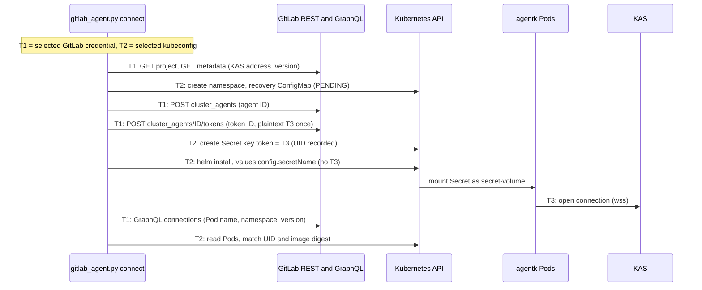

# GitLab Agent for Kubernetes: connectivity and attach

Use `gitlab_agent.py connect|verify|delete` to register and install an owned Agent, prove selected-project CI access,
or remove that owned run. The [D2/D3 contract](../../docs/phases/CI14-GITLAB-CONNECTIONS.md#contracts-and-open-decisions)
defines ownership and proof; the [active plan](../../docs/exec-plans/completed/ci14-gitlab-connections.md) tracks qualification.
Caller naming connects the actual consumer project to its selected cluster; it does not connect this skill's repository.

Words used here: "caller" is the program that runs this skill's commands; "project owner" is the team that owns the
GitLab project and the cluster; "GitLab Agent" is the GitLab feature, and "agentk" is its program running in the
cluster.

## Who opens the connection

agentk, installed in the cluster, opens the connection to the GitLab agent server, KAS (the docs now call it GitLab
Relay), at `config.kasAddress`. The installation pins official chart 2.20.1/app `v18.5.2` and verifies its archive
hash; the [phase contract](../../docs/phases/CI14-GITLAB-CONNECTIONS.md) defines exact provenance. Resolve the
official image digest at runtime and verify the rendered image and observed Pod image IDs. A token Secret, created by
confirmed connect, has key `token` and is passed through `config.secretName`. Never pass token plaintext through Helm
argv or `config.token`.

Equivalent nonsecret Helm inputs after the owned token Secret exists:

```bash
helm upgrade --install <release> <verified-chart-archive> \
  --namespace <namespace> \
  --set-string config.secretName=<owned-token-secret> \
  --set-string config.kasAddress=<metadata-kas-address> \
  --set-string image.tag=<version>@sha256:<resolved-digest>
```

Preserve the chart's existing cluster-admin role; own only newly created bindings/accounts. Helm retains chart-object
ownership. Successful connect retains the installation; failure compensates only run-created objects.

## KAS address

- GitLab.com: `grpcs://kas.gitlab.com`. Agents installed with `wss://kas.gitlab.com` still work. Sources:
  `user/clusters/agent/install`; GitLab 19.5 release notes.
- Self-managed: `grpcs://<gitlab host>`, or `wss://<gitlab host>/-/kubernetes-agent/` on an instance without HTTPS or
  with a relative URL root. Source: `administration/clusters/kas`.

On a self-managed GitLab the administrator sets up KAS; the Linux package installs it by default. From 19.5, new Linux
package and Helm chart installations advertise `grpcs://`. The command reads the address from the selected
GitLab at run time; it never derives it from the target key or host.

## What the cluster side needs

- Egress from the cluster to the KAS address. No inbound path into the cluster is needed, so a privately hosted
  cluster can attach to GitLab.com when it can open an outbound connection to `kas.gitlab.com`.
- Behind a proxy, `HTTPS_PROXY` set through the chart's `extraEnv`.
- For `grpcs://`, HTTP/2 end to end. A WAF or TLS-inspecting proxy that speaks HTTP/1.1 breaks it; use the `wss://`
  address there.

Source: `user/clusters/agent/install`.

## When an attach is possible

| Network between cluster and GitLab | Self-managed GitLab | GitLab.com |
| --- | --- | --- |
| Cluster can open a connection to KAS | normal agent | normal agent via `grpcs://kas.gitlab.com` |
| Only GitLab can reach the cluster | receptive agent (Ultimate, from 17.4) | not possible: no receptive agents |
| Neither direction | not possible | not possible |

A receptive agent is one GitLab connects to, at a URL configured through the cluster agents API. Source:
`user/clusters/agent` (Receptive agents) and `user/clusters/agent/install`.

## What the project defines, and how its CI uses it

The project that registers the GitLab Agent is its configuration project; its own CI has access by default.
The initial command proves this same project's access without a sharing flag or config commit. Additional sharing
remains outside this slice. Its file
`.gitlab/agents/<agent-name>/config.yaml` lists the projects whose CI jobs may use the GitLab Agent. Example, in
`group/app`, file `.gitlab/agents/lab/config.yaml`:

```yaml
ci_access:
  projects:
    - id: group/svc
```

A job in an authorized project gets `$KUBECONFIG` with one context per shared GitLab Agent, named
`<configuration project path>:<agent-name>`. Example, `.gitlab-ci.yml` in `group/svc`:

```yaml
deploy:
  script:
    - kubectl config use-context group/app:lab
    - kubectl get pods
```

Authorized projects must share the configuration project's top-level group unless instance-level authorization is
enabled; `ci_access.projects` and `ci_access.groups` hold up to 500 entries each. Whether GitLab.com allows
instance-level authorization is not verified here. Source: `user/clusters/agent/ci_cd_workflow`.

## Attach flow

Offline/dry-run makes no API calls. Live-plan reads selected KAS metadata, Kubernetes authority and exact identities;
it reports fresh-namespace egress UNPROVEN. No extra probe Pod is created. Connect/delete apply requires the fresh
plan digest through existing `--apply --confirm-plan` controls.

1. Connect creates an owned namespace if needed and one PENDING nonsecret native recovery ConfigMap.
2. Register the Agent; independently read and persist its native ID. Create its token in a separate REST call and
   retain its native token ID before delivering plaintext only to the owned token Secret.
3. Install the verified pinned chart with `config.secretName` and the immutable official image. Keep Helm ownership.
4. Read native GraphQL active connections and independently match Pod metadata to the owned Pod UID and image.
   Only then may connect PASS; CI access remains NOT_VERIFIED.
5. Run one bounded real consumer proof job in the selected project using its GitLab-provided KUBECONFIG.
6. `verify --run-id RUN_ID --job-url JOB_URL` independently compares native job/pipeline/consumer SHA/artifact,
   selected Agent context/KAS proxy, cluster/namespace UIDs and producer bytes to the installed candidate.
7. `delete --run-id RUN_ID --agent-name AGENT_NAME` removes only confirmed owned identities. Use the same selectors
   for the identical repeat. Borrowed namespaces and every pre-existing object remain.

A pre-existing Agent/release without proven run ownership is BLOCKED and preserved; no credential adoption or rotation.
NO_OP reuses only the same fully verified owned run, without another token or Helm revision. After record removal,
repeat delete proves logical Agent/release/run-marker absence; unexpected presence blocks. Unknown former IDs are not
claimed absent. Qualification separately repeats exact original receipt IDs/UIDs. No tombstone remains.

| Value | Source | Invariant |
| --- | --- | --- |
| GitLab/cluster | Existing target/profile/binding resolution | Actual selected authorities |
| Project | `--project`, else selected target project | Real configuration project identity |
| Naming base | Optional `--project-name`, else consumer repository | New names only; never skill-name defaults |
| Agent | Optional `--agent-name` on connect | Required on every delete |
| Namespace | Explicit `--namespace`, else new consumer namespace | Existing namespace is borrowed |
| Run | `--run-id` returned by connect | Required for verify/delete; binds release identity |
| Job | `verify --job-url` | Actual selected-project native proof job |
| KAS | Selected GitLab metadata | Never constructed from a hostname |

The selected configuration project's own CI already has access; this slice adds no `--ci-access-project` or sharing
configuration commit. Additional project sharing remains outside this command.

## CI access proof job

`verify` trusts three files of the installed skill, in `lib/python/core/gitlab/cluster_agent/`. We stage byte copies
at the root of a branch in the configuration project and run one pipeline there. Verify hashes the installed files
and requires the same bytes at the job's commit and in the job artifact.

| Installed file | Path in the consumer commit | Role |
| --- | --- | --- |
| `ci_access_job.yml` | `.gitlab-ci.yml` | Job `ci-agent-access`; artifact `agent-access.json` |
| `ci_access_probe.py` | `ci_access_probe.py` | Runs the proof with the Agent ID |
| `ci_access_proof.py` | `ci_access_proof.py` | Reads the Agent context, cluster UID and namespace UID |

The job definition has no environment value in it. The pipeline supplies every value as a pipeline variable; the
job runs only when the first four are set:

| Variable | Value | Source |
| --- | --- | --- |
| `CI_AGENT_ID` | Native Agent ID | connect result `records[0].ownership.agent_id` |
| `CI_AGENT_RUN_ID` | Run ID | connect result `records[0].ownership.run_id` |
| `CI_AGENT_PROBE_IMAGE` | Image with `python3` 3.11 or newer and `kubectl` | Our choice |
| `CI_AGENT_RUNNER_TAG` | Tag of a Docker or Kubernetes executor runner | Our choice |
| `CI_AGENT_NAME` | Agent name | connect result `records[0].ownership.agent_name` |
| `CI_AGENT_NAMESPACE` | Installation namespace | connect result `records[0].ownership.namespace` |
| `CI_AGENT_EXPECTED_REVISION` | Installed revision | `skill.revision.value` in a result of the verifying copy |
| `CI_AGENT_EXPECTED_FUNCTIONAL_DIGEST` | Installed functional digest | `skill.functional_digest` of the same result |

Example, project `hott/test` (ID 123), from a clone of it, with the installed skill at `$SKILL`:

```bash
KIT="$SKILL/lib/python/core/gitlab/cluster_agent"
git switch -c agent-ci-proof
cp "$KIT/ci_access_job.yml" .gitlab-ci.yml
cp "$KIT/ci_access_probe.py" "$KIT/ci_access_proof.py" .
git add .gitlab-ci.yml ci_access_probe.py ci_access_proof.py
git commit -m "Stage the Agent CI access proof"
git push origin agent-ci-proof
```

A shell executor ignores `image`. On `hott/test`, job 126713 on shell runner 106 failed with
`python3: command not found`; job 126724 on Docker runner 75 ran the image and passed. Setting the variables needs
our role at or above the project's `ci_pipeline_variables_minimum_override_role` (`developer` on `hott/test`).

The push starts no job because the variables are unset. `POST projects/123/pipeline` with `ref` `agent-ci-proof`
and the eight variables starts it. When job `ci-agent-access` succeeds, pass its URL:

```bash
gitlab_agent.py verify --project hott/test --run-id RUN_ID \
  --job-url https://gitlab.example/hott/test/-/jobs/JOB_ID --receipt-out agent-verify.json --json
```

Verify reads the job, its pipeline and commit, the artifact and the three files at that commit through the GitLab API,
then compares them with the run record, the KAS proxy URL from GitLab metadata, the cluster and namespace UIDs read
with T2, and the installed revision and functional digest. Any difference is BLOCKED with one reason code, for example
`agent_ci_producer_blob_mismatch` when a staged file differs from the installed one.

## Runtime objects and delete

After agentk connects, the Agent workload has created two objects that the chart does not list: the ReplicaSet that
controls the agentk Pods, and agentk's leader-election Lease `agent-<agent_id>-lock`. Connect records the ReplicaSet
that the Pod correlation proved is owned by the recorded Deployment, and the Lease when a connected Pod holds it
within half of the remaining connect time. Delete removes each by UID when present and accepts it when already gone;
the pre-delete namespace inventory then accepts events about them. The inventory reads only namespaced types that
support `list` and `delete`, because deleting a namespace cannot destroy a read-only projection such as
`packagemanifests`.

A record without a Lease row (written before Lease recording, a PENDING record under compensation, or a connect
whose Lease was not held in time) gets one rule in a run-owned namespace: after the namespace UID reads back
unchanged, delete removes the Lease named after the recorded Agent ID by its UID.

## Token path

Three credentials take part in connect. Only the Agent token is new, and its plaintext exists in exactly one place:
the owned Secret key `token`.



| Token | Source | Used for | Stored |
| --- | --- | --- | --- |
| T1 GitLab token | `access_protocol.gitlab` ([access](access.md)) | Project, KAS, register, token, GraphQL | Source |
| T2 Kubernetes credential | `access_protocol.kubernetes` | Namespace, Secret, ConfigMap, Helm, Pod reads | Source |
| T3 Agent token | `POST /projects/ID/cluster_agents/AGENT_ID/tokens` | agentk connection to KAS | Secret key `token` |
| T4 CI job credential | Job `KUBECONFIG` from GitLab, context `<project>:<agent>` | Proof job via KAS | Job only |

T4 authenticates to KAS with a token built from the job's `CI_JOB_TOKEN`. Source:
`user/clusters/agent/ci_cd_workflow`.
The command never reads T4. The job artifact records `kubeconfig_source` `gitlab_ci`, `agent_context` and
`kas_proxy_url`, and a verify record carries that artifact under `ci_access.proof`.

T3 never appears in argv, Helm values, Helm release storage, reports, receipts or logs. `gitlab_agent.py --help`
lists the same path under `Credentials`, and `--describe` returns it as field `credentials`.

Each result record carries `credentials`, built from this invocation's observations:

| Field | Content |
| --- | --- |
| `gitlab.calls` | Every request sent with T1, in order: method and path without query string |
| `kubernetes.created_objects` | Objects this invocation created with T2: kind, name, namespace, UID |
| `agent_credential` | T3 `state`, ID, Secret `storage`, `consumers` |

`state` is `PLANNED` for a fresh connect plan, `ABSENT` without an ownership record or after a confirmed delete,
`PRESENT` when the command read an active connection, and `RECORDED` when only the ownership record names the token.

Repeat connect (`NO_OP`) on `hott/test`, run `efc9e7db47ff427bbc53df1978834563`:

```json
{
  "gitlab": {"calls": [
    {"method": "GET", "endpoint": "user"},
    {"method": "GET", "endpoint": "projects/hott%2Ftest"},
    {"method": "GET", "endpoint": "projects/123"},
    {"method": "GET", "endpoint": "metadata"},
    {"method": "GET", "endpoint": "projects/123/cluster_agents/1/tokens/1"},
    {"method": "GET", "endpoint": "projects/123/cluster_agents/1/tokens"},
    {"method": "GET", "endpoint": "projects/123"},
    {"method": "GET", "endpoint": "projects/123/cluster_agents/1"},
    {"method": "POST", "endpoint": "graphql"}]},
  "kubernetes": {"created_objects": []},
  "agent_credential": {"state": "PRESENT", "id": 1, "name": "test-agent-token-64d9936f4e4c4c64", "created": false,
    "storage": {"kind": "Secret", "namespace": "test-64d9936f4e4c4c64a9f7",
      "name": "test-agent-token-64d9936f4e4c4c64", "uid": "af4643c3-8637-4ff3-afdb-cce10f545673", "key": "token"},
    "consumers": [
      {"connection_id": "5964489850388898347", "pod_name": "test-agent-64d9936f4e4c4c64-v2-fcc7b988c-tf77w",
        "pod_uid": "47c956b5-ea02-4507-ae9f-8594edd8f1f5"},
      {"connection_id": "4355863225129730728", "pod_name": "test-agent-64d9936f4e4c4c64-v2-fcc7b988c-b2v55",
        "pod_uid": "436878ac-1cd3-4077-b220-65f5f6dd48c1"}]}
}
```

Live read on 2026-11-21, project `hott/test`, run `efc9e7db47ff427bbc53df1978834563`:

| Item | Value |
| --- | --- |
| Agent | `test`, ID `1`; token ID `1`, `ACTIVE`, last used `2026-11-21T11:49:37Z` |
| Secret | `test-agent-token-64d9936f4e4c4c64`, UID `af4643c3-8637-4ff3-afdb-cce10f545673`, key `token` |
| Helm values | `config.kasAddress`, `config.secretName`, `fullnameOverride`, `image.tag`; `glagent-` count `0` |
| Connection `4355863225129730728` | Pod `…-v2-fcc7b988c-b2v55`, UID `436878ac-1cd3-4077-b220-65f5f6dd48c1` |
| Connection `5964489850388898347` | Pod `…-v2-fcc7b988c-tf77w`, UID `47c956b5-ea02-4507-ae9f-8594edd8f1f5` |

## When a `[gitlab_routing]` row names a cluster

Whether a `[gitlab_routing]` row ([access reference](access.md#gitlab-private-and-public-targets)) should name a
cluster and a registry for a GitLab depends on where the work runs:

- A GitLab.com project plus a lab cluster works for a GitLab Agent, or for a self-managed runner in that cluster,
  when the cluster has egress to GitLab.com.
- GitLab.com hosted runners cannot pull from a Harbor behind a private DMZ, so the template leaves
  `gitlab_public = {}` for that case.
- An empty row, `gitlab_public = {}` in the template, names no cluster and no registry; a command that needs them
  returns BLOCKED `target is missing required authority tables` (access reference). Fill the row only for the first
  case above.

A fresh namespace has no workload with which to prove KAS egress during a read-only plan. Report UNPROVEN, preserve
KAS prerequisite discovery and selected Kubernetes authority, then require actual GraphQL/owned-Pod connection
before confirmed connect can PASS. Compensate only run-created objects on failure. This corrects the planned
preflight promise; it removes no implemented check or selected-project CI requirement.
