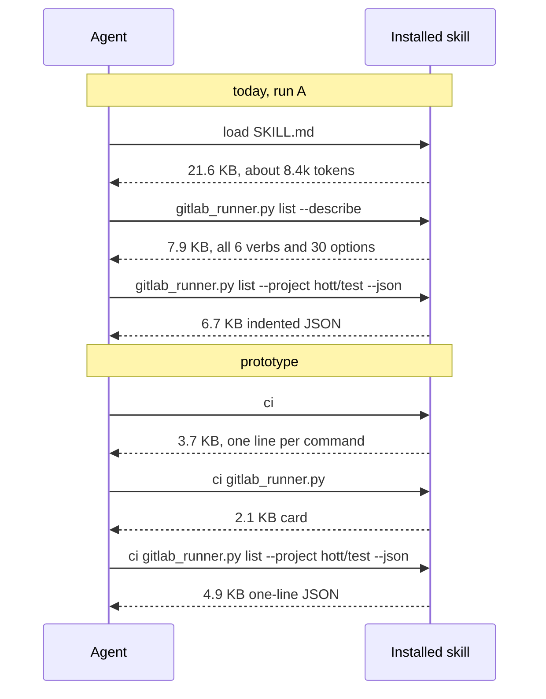

# Agent context load of installed ci-skills: measurement and proposal

Status: proposal, not approved. Measured 2026-11-21 on the installed copy `~/.claude/skills/ci-skills`, revision
`fa7063c8`, package digest `63bdb745…` (`INSTALLATION.json`, written by `tools/install_ci_skills.py`). That copy
differs from `main` `c4e98bc` in five files, all runner-manager code (`diff -rq`); help, contract and navigator
output are otherwise the same.

## What we asked

Can a small agent run a ci-skills command from one simple invocation, without reading our code, and how many
context tokens does that cost today?

## Answer

- No agent read our code. In four baseline runs, zero calls opened a file under `lib/` or a `bin/*.py` source.
- The cost is the instructions, not the code. Each task added 18.9k to 27.6k tokens to the agent's context.
  `SKILL.md` is about 8.4k of that, one `--describe` is 2.2k to 2.9k, and the requested result is 0.2k to 3k.
- No agent called `reference.py` or `--help`. All four went `SKILL.md` → `<command> --describe` → run.
- A prototype replaced `SKILL.md` with a one-line-per-command index, `--describe` with a 1.2 to 2.1 KB card, and
  indented JSON with one-line JSON. On the runner-list scenario the growth fell from 18,931 to 11,094 tokens:

  | Replaced | Tokens |
  | --- | --- |
  | `SKILL.md` by the index | −6,482 |
  | `--describe` by the card | −2,104 |
  | indented JSON by one-line JSON | −621 |
  | three wrong command names (a prototype defect, finding 11) | +1,370 |

- Fewer tokens in context is not fewer tokens paid. Every call re-sends the whole context. The first prototype
  runs made more calls (A: 4 → 7, D: 6 → 12), so their summed input rose (A: 316k → 516k, D: 433k → 679k). A
  wrong first guess costs more than a long help text.
- Run A3 repeated the runner-list scenario with no wrong name: 4 calls, growth 9,588 tokens (−49% against A),
  summed input 291k against 316k (−8%).

## Method

The consumer is a fresh Claude Haiku 5.5 agent (`claude-haiku-5-5`, read from the transcripts). Its brief holds
the request, the fixture, and "ci-skills is installed at this path". It holds no command sequence. This is
the procedure of [CI11, End-to-End Test](../phases/CI11-TOOLS.md#end-to-end-test), steps 2 to 4. Token numbers are
the `usage` values the API returned for each turn, read from each agent's transcript. Byte numbers are the size
of each tool result. The transcripts are session files and are not kept. The parsed call lists, the parser and
the prototype are not committed; this document holds the numbers taken from them.

| Run | Request | Fixture | Mode |
| --- | --- | --- | --- |
| A | Which runners can `hott/test` use: id, description, tags, online | dcloud `hott/test` (123) | read |
| B | Create milestone `ctx-probe-20261121-a7`, due 2026-12-15, confirm it | GitLab.com `88575800` | plan, apply |
| C | Default branch, visibility and runner count of the GitHub repository | `spyroot/test-self-runner` | read |
| D | Did the newest pipeline of `hott/test` pass; which job failed and why | dcloud `hott/test` (123) | read |
| A2 | Same as A, through the prototype | dcloud `hott/test` (123) | read |
| D2 | Same as D, through the prototype | dcloud `hott/test` (123) | read |
| A3 | Same as A2, after the prototype accepts names without `.py` | dcloud `hott/test` (123) | read |

Run B created milestone id `7766751` in GitLab.com project `88575800`. We deleted it by that id (HTTP 204), read
back `RESOURCE_NOT_FOUND` and an empty milestone list, and repeated the delete (HTTP 404). Every run returned a
correct answer.

## Measured load

"First" is the context before any ci-skills call: the agent host's own prompt, tool schemas and rule files. It
is not ci-skills. "Growth" is what the task added. "Summed input" is the input the host sent over all turns.

| Run | Tool calls | First | Peak | Growth | Summed input | Failed ci-skills calls | Source files read |
| --- | --- | --- | --- | --- | --- | --- | --- |
| A | 4 | 67,174 | 86,105 | 18,931 | 315,607 | 0 | 0 |
| B | 8 | 67,207 | 87,840 | 20,633 | 578,582 | 0 | 0 |
| C | 9 | 67,190 | 86,388 | 19,198 | 404,840 | 1 | 0 |
| D | 6 | 67,202 | 94,758 | 27,556 | 432,887 | 0 | 0 |
| A2 prototype | 7 | 67,260 | 78,354 | 11,094 | 516,463 | 3 | 0 |
| D2 prototype | 12 | 67,271 | 81,932 | 14,661 | 679,309 | 5 | 0 |
| A3 prototype | 4 | 67,268 | 76,856 | 9,588 | 291,479 | 0 | 0 |

"Tool calls" includes each agent's final report call. Run C's failed call is `ci-api get --paginate` on an
endpoint that returns an object (`BLOCKED`, exit 65). The failed calls of A2 and D2 are wrong command names.

Growth by step, in tokens (the bytes are the tool result that step returned):

| Run | Learn the skill | Learn the command | Run and read back |
| --- | --- | --- | --- |
| A | `SKILL.md` 21,563 B: +12,326 | `list --describe` 7,901 B: +3,328 | list result 6,695 B: +3,277 |
| B | `SKILL.md` 23,049 B: +13,133 | `--describe` 5,706 B, `target.toml`: +3,385 | plan, apply, read: +3,843 |
| C | `SKILL.md` 23,049 B: +13,885 | `ci-api --describe` 5,843 B, `target.toml`: +3,245 | 4 reads: +2,068 |
| D | `SKILL.md` twice, 43,827 B: +20,987 | `get --describe` cut to 4,000 B: +2,813 | 2 reads: +3,756 |
| A2 | index 3,706 B: +5,844 | 3 wrong names: +1,370; card 2,072 B: +1,224 | list result 4,905 B: +2,656 |
| D2 | index 3,706 B: +5,866 | 7 wrong names: +2,213; 3 cards 4,263 B: +2,588 | 3 reads: +3,994 |
| A3 | index 3,706 B: +5,853 | card 2,061 B: +1,113 | list result 4,894 B: +2,622 |

Three estimates, inferred from differences between runs, not measured directly:

- `SKILL.md` is about 8.4k tokens. Run D loaded it a second time with `cat` and grew 8,661 tokens more than run A.
- About 3.5k to 4k tokens of host attachments arrive with the first tool result in every run, baseline and
  prototype alike. They are inside the "Learn the skill" column and are not ci-skills.
- Run D's baseline holds that double load. Against a single load (about 18.9k), D2's 14,661 is about −22%, not
  the −47% the table shows.



## Static sizes

| What an agent can load | Bytes | Note |
| --- | --- | --- |
| `ci-skills/SKILL.md` | 21,673 | 12,501 on 2026-10-06 ([CI08](../phases/CI08-ROUTING.md#why)): +73% |
| `ci-skills/tools.json` | 59,756 | 26,432 on 2026-10-06: +126% |
| `--help`, median of 29 entrypoints | 3,896 | largest 8,190 (`gitlab_runner_manager.py`); all 29: 123,821 |
| `--describe`, median of 29 | 4,815 | largest 9,152 (`ocp_node_onboard.py`); all 29: 147,960 |
| `reference.py` root | 2,246 | command node: median 669, largest 2,859 |

Where the `--help` bytes go, summed over the 29 entrypoints:

| Section | Bytes | Share |
| --- | --- | --- |
| Options | 63,259 | 51.1% |
| References | 18,988 | 15.3% |
| Usage | 16,022 | 12.9% |
| Description | 12,738 | 10.3% |
| Examples | 4,627 | 3.7% |
| Output modes | 3,764 | 3.0% |
| Summary | 2,184 | 1.8% |

Nine options appear in every command's help (`--describe`, `--dry-run`, `--json`, `--yaml`, `--log-file`,
`--log-format`, `--log-level`, `--run-id`, `-h`): 22,774 B, 18.4% of all help bytes, about 785 B per command.

## Findings

Each finding names the observation it rests on.

1. **Agents do not read code today.** Runs A to D: no `Read`, `cat` or `grep` on `lib/` or `bin/*.py`.
2. **`SKILL.md` is the largest single load.** It is read whole in every run: 21.6 KB, about 8.4k tokens, 40% to
   45% of the growth of runs A to C. Run D read it twice (the skill load, then `cat SKILL.md`).
3. **The navigator is bypassed.** `reference.py` was called zero times in runs A to D. Our reading, not a
   measurement: `SKILL.md` section 2 (`ci-skills/SKILL.md:102-136`) already holds a 23-row routing table, so the
   agent has its command before it reaches `reference.py`.
4. **`--help` is not used; `--describe` is.** Four of four agents called `--describe`. Zero called `--help`.
5. **`--describe` is not scoped to the verb.** `gitlab_runner.py list --describe` and `gitlab_runner.py
   --describe` return the same 7,901 B: 6 verbs and 30 options. In the installed `tools.json`, 0 of the 43
   declared verbs carry their own `options`; a verb carries only `required_options`. The agent cannot tell which
   of the 30 options apply to `list`.
6. **The contract prints its least useful part first.** Keys are alphabetical: `access_protocol` first,
   `subcommands` and `use_when` last. Run D cut the output with `head -c 4000` and lost the verb list.
7. **Help spends 3.7% of its bytes on examples** and 34% on text it repeats: the nine shared options (18.4%),
   the `Usage:` dump of every option (12.9%), and `Output modes:` (3.0%).
8. **Results are indented JSON.** The runner list is 6,695 B as printed and 4,894 B on one line (−27%). Each call
   also returns one `INFO … result=PASS run_id=` log line of about 85 B.
9. **A command does not run by its own path.** `bin/gitlab_job.py --help` and `bin/ci-api --help` exit 1 when
   `python3` on `PATH` is 3.10.13 (`ImportError: cannot import name 'Self'`). Through the `ci-skills` conda
   interpreter both exit 0. Every agent call therefore carries
   `conda run -n ci-skills python "$CI_SKILLS_ROOT/bin/…"`, learned from `SKILL.md`. The example root in
   `ci-skills/SKILL.md:23` is the Codex path, also in a Claude install.
10. **Agents read `~/.ci-skills/target.toml` to learn which GitLab instances exist.** Three of four baseline
    runs printed the file (906 B); none tried a command first. We then ran three offline forms. `gitlab_access.py
    check --dry-run` returns `BLOCKED` without `--project`. With `--project hott/test` it returns 459 B and names
    no host. `access_check.py --dry-run` returns 1,115 B and names the default host only. The live forms were not
    run.
11. **Agents name commands without `.py`.** With the first prototype, Haiku typed `gitlab_runner`, `runner`,
    `gitlab-runner`, `gitlab_pipeline`, `gitlab_job`, `pipeline` and `job` before the listed names such as
    `gitlab_runner.py`. Ten wrong names in two runs cost 3,583 tokens of growth and eight extra calls.
12. **Four old copies are listed as skills.** `~/.claude/skills/.ci-skills.previous-<id>` (kept by the
    installer's upgrade) each hold a `SKILL.md` with `name: ci-skills`, at revisions `5793c240`, `e5b40eb3`,
    `931b1887` and `fb8b5acf`. The agent host lists all four beside the current one with the same description.

## Proposal

| ID | Change | Fixes | Effect |
| --- | --- | --- | --- |
| P1 | `SKILL.md` becomes a router of at most 4 KB | 2, 3 | measured in A2: −6,482 tokens (index for `SKILL.md`) |
| P2 | Kept previous copies do not carry a `SKILL.md` an agent host can list | 12 | 4 stale entries removed |
| P3 | One launcher: index, card, run; it finds its own interpreter | 4, 9, 11 | measured in A2: −2,104 (card) |
| P4 | Options declared per verb in the catalogue | 5 | card and contract scoped to one verb |
| P5 | `VERB --describe` returns that verb only; keys ordered by use | 5, 6 | expected 7.9 KB → about 1.5 KB |
| P6 | Help layout: per-verb usage, own options, one example per verb | 7 | expected median 3.9 KB → about 2 KB |
| P7 | One-line JSON when stdout is not a terminal | 8 | measured in A2: −621; −27% bytes |
| P8 | The index header names the configured authorities | 10 | one 906 B file read removed |

Which changes need new live receipts: the functional digest covers `ci-skills/bin`, `lib` and `schemas`. P2
changes `tools/install_ci_skills.py` only and needs none. Shrinking `SKILL.md` alone needs none. Moving its
sections into new references does: `reference.py get <name>` resolves names through `PROPOSITION_REFERENCES`
(`ci-skills/lib/python/core/catalog.py:1585`), so each new reference adds a row under `lib`. P3 to P8 change
`bin` or `lib`.

### P1: `SKILL.md` as a router

Today `SKILL.md` is 370 lines: invocation, a routing table, the option tiers, status reading, correlation,
evidence, node reads, MTU, API reads, Podman and the runner workflows. [CI08, Changes to
ci-skills](../phases/CI08-ROUTING.md#changes-to-ci-skills), item 3, already specifies the change: the router
keeps access, the `reference.py` sentence, the routing table, the option tiers, the `references/access.md` link
and four safety rules; the other sections move unchanged into `references/`. CI08 has status "proposed"; since
it was written the file grew from 12.5 KB to 21.7 KB.

We propose to deliver CI08 item 3 first and to give it a number: `wc -c ci-skills/SKILL.md` reads back at most
4,096 B, the bound [CI09, Loading, measured](../phases/CI09-REFERENCE.md#loading-measured) already sets for one
navigator answer. The byte bound is a new check and needs approval.

### P2: previous copies

Today an upgrade leaves `~/.claude/skills/.ci-skills.previous-<id>/SKILL.md` in the directory the agent host
scans. Proposed: the kept copy stays for recovery but its `SKILL.md` is not discoverable, by keeping the copy
outside the scanned directory or by renaming that one file. The choice of location is a team decision.

### P3: one launcher

Today the first useful call is `conda run -n ci-skills python "$CI_SKILLS_ROOT/bin/gitlab_runner.py" list
--describe`. Proposed: one installed entrypoint with three forms, rendered from `core/catalog.py`, the one
command catalogue, with no second inventory.

```text
ci                  one line per command: name, read or write, verbs, purpose
ci CMD              card: verbs with their required inputs, own options, one example, exit codes
ci CMD VERB ARGS    run the command with the right interpreter
```

It accepts `gitlab_runner.py`, `gitlab_runner` and a unique short name such as `pipeline`. A name that matches
several commands answers "which one?" with those commands. The prototype's index for the 29 commands is 3,707 B.
Its three header lines and three of its 29 command lines, verbatim:

```text
ci-skills commands. `ci CMD` = verbs, inputs, example. `ci CMD [VERB] ARGS --json` = run it.
Target: ~/.ci-skills/target.toml. GitLab instance: --gitlab private|public (omitted = the target's default).
A write verb plans first and changes nothing: it prints plan_digest; repeat with --apply --confirm-plan DIGEST.
access_check.py                read   Prove access to every selected authority and emit one receipt.
bin/ci-api                     read   [check|get] Read one caller-selected GitHub or GitLab API endpoint with bounded output.
gitlab_pipeline.py             write  [get|start|watch] Read, start, or watch an exact GitLab CI pipeline.
```

The prototype's whole card for `gitlab_pipeline.py`, verbatim, is 1,577 B, against 5,876 B for `--describe` and
6,008 B for `--help`:

```text
gitlab_pipeline.py: Read, start, or watch an exact GitLab CI pipeline.
needs: gitlab; returns: Get returns one validated pipeline and bounded jobs. Start returns an offline or live plan, or a verified new or existing plan identity. Wa…
verbs:
  get    read   Read one exact pipeline and its bounded jobs.  needs --pipeline-id
  start  write  Resolve an exact ref and commit, then start one confirmed pipeline.
  watch  read   Watch one bounded pipeline graph to settlement or timeout.  needs --pipeline-id
inputs:
  --expected-sha           require the ref to resolve to this full lowercase commit SHA
  --gitlab                 GitLab instance: private or public reads [gitlab_private] or [gitlab_public]; omission reads [gitla…
  --interval               positive watch polling interval in seconds (default 10)
  --pipeline-id            numeric pipeline ID for get or watch
  --project                exact project path or numeric ID; otherwise use gitlab.project
  --ref                    start ref; otherwise the live project default branch
  --related-name           watch newer same-ref pipelines whose names match this regex
  --require-protected-ref  require the resolved start branch to be protected
  --variable               pipeline variable as KEY=VALUE; CI_SKILLS_PIPELINE_PLAN_DIGEST is managed by start
example: ci gitlab_pipeline.py get --pipeline-id VALUE --json
write verbs: run once to get plan_digest (nothing changes), then add --apply --confirm-plan DIGEST.
exit: 0 = PASS, DRY_RUN or PLANNED; 2 = BLOCKED or PARTIAL (read errors[] in the result).
```

Decisions this needs before any code:

- **D1, the name and home.** [CI02, Open decisions](../phases/CI02-CLI.md#open-decisions) already proposes one
  `bin/ci-k8s` command with short verbs (`job`, `storage`, `events`). Finding 11 supports short names. The
  launcher can be that command or a new one.
- **D2, the index and the proposition.** The version 3.0 proposition of
  [CI11](../phases/CI11-TOOLS.md#proposition-schema) shows a tool as a filename mapped to `{}` and is locked.
  The index above adds verbs and a purpose per tool. Either the index is a separate text view, or the tool
  object gains optional `purpose` and `verbs` as a MINOR version. We do not propose to change the locked shape
  without that approval.

### P4 and P5: verb-scoped contract

Today:

```text
$ gitlab_runner.py list --describe | wc -c
7901        # same bytes as gitlab_runner.py --describe: 6 verbs, 30 options, access_protocol first
```

Proposed: `subcommands[verb]` declares its own `options`.
[CI09, Declarations](../phases/CI09-REFERENCE.md#declarations-exactly-what-corecatalogpy-gains) specifies this
for `gitlab_pipeline.py watch`; the installed manifest has it for no verb (finding 5). `CMD VERB --describe` then
returns that verb's purpose, inputs with required ones first, whether it writes, one example and its result
schema name. `CMD --describe` keeps today's fields, ordered `command`, `purpose`, `use_when`, `subcommands`,
`options`, `returns`, `exit_codes`, then the protocol blocks. This is an added optional view of the
`command-contract` record: a MINOR change under [CI07, Versions](../phases/CI07-SCHEMA.md#versions).

### P6: help layout

Proposed order: summary; one usage line per verb with its required inputs; the command's own options; one
example per verb; one line that names the shared options and where to read them; reference names. The
restrictions [CI11, Pre-use help](../phases/CI11-TOOLS.md#pre-use-help-two-explicit-gaps) added for
`--receipt-out`, `--output-dir` and `--log-file` stay, on one line. The `Usage:` dump and `Output modes:` go.
[CI12, Agent discovery control check](../phases/CI12-NODE-ONBOARDING.md#agent-discovery-control-check) already
holds a four-line help summary of this kind for `ocp_node_onboard.py`.

### P7: one-line JSON

Today `--json` prints an indented document. Proposed: when stdout is not a terminal, print one line, as
[CI09, Contract values](../phases/CI09-REFERENCE.md#contract-values) already specifies for the navigator, and log
at `warning` unless `--log-level` is given. Fields and their meaning do not change.

### P8: configured authorities in one line

Proposed index header, computed from the selected target at run time, with no credential value:

```text
Target ~/.ci-skills/target.toml: gitlab private (default) gitlab.dcloud.run, public gitlab.com; github; kubernetes; harbor
```

## Prototype

The prototype is one file of about 120 lines. It reads the installed `tools.json` and each command's
`--describe`, prints the index and cards above, and runs the installed command, printing its JSON on one line.
It changes nothing in the skill. In runs A2 and D2 it rejected a name without `.py`; that defect produced finding
11 and is inside the A2 and D2 numbers. We then made it accept `gitlab_runner`, `gitlab-runner`, `pipeline`, `job`
and `ci-api`, and answer "which one?" for `runner`; we checked those six by hand. In run A3 the agent typed the
listed `gitlab_runner.py`, so no agent run has exercised the corrected matching.

## Conflicts between documents

| Where | Says | Against |
| --- | --- | --- |
| `docs/phases/CI16-OLM-OPERATOR.md:21-22` | the agent finds the command in `ci-skills/tools.json` | CI09 line 79 |
| `ci-skills/SKILL.md:5`, `:104-108` | `manifest: tools.json`; `tools.json` is the contract to read | CI09 line 634 |
| `docs/phases/CI12-NODE-ONBOARDING.md:59` | standards pinned at revision `56a579c` | binding line 11 |
| `docs/phases/CI09-REFERENCE.md:483` | pinned standards revision `56a579c` | binding line 11 |

CI09 is `docs/phases/CI09-REFERENCE.md`: line 79 says the agent "never reads `tools.json`", and lines 634-636 say
`tools.json` is an input of the tool, "never reading material". The binding is `standards-binding.yaml`, which
pins `5bd31f1…`.

## Limits of this measurement

- One run per scenario, one model, one machine. The numbers show where the load is, not its variance.
- Each brief named the installed path, so routing from the skill listing was not tested.
- The prototype runs were given the launcher path and no `SKILL.md`. A router of P1's size would add its own
  bytes to them.
- No Kubernetes or Harbor command was run.
- The prototype reused the read-only scenarios only. The plan-then-apply scenario ran once, on today's skill.

## Traceability

| Requirement | Where it is answered | Evidence | Status |
| --- | --- | --- | --- |
| Run Haiku agents on the test repositories | Method | seven transcripts, parsed call lists | done |
| Measure the context load | Measured load, Static sizes | per-turn `usage`, per-call bytes | done |
| Agent does not read our code | Finding 1 | zero source reads in seven runs | holds today |
| `--help` and the spec are tight | Findings 4 to 7, P3 to P6 | section shares, prototype sizes | proposed |
| One simple invocation is enough | Finding 9, P3 | exit 1 by path; A2, D2, A3 | proposed |
