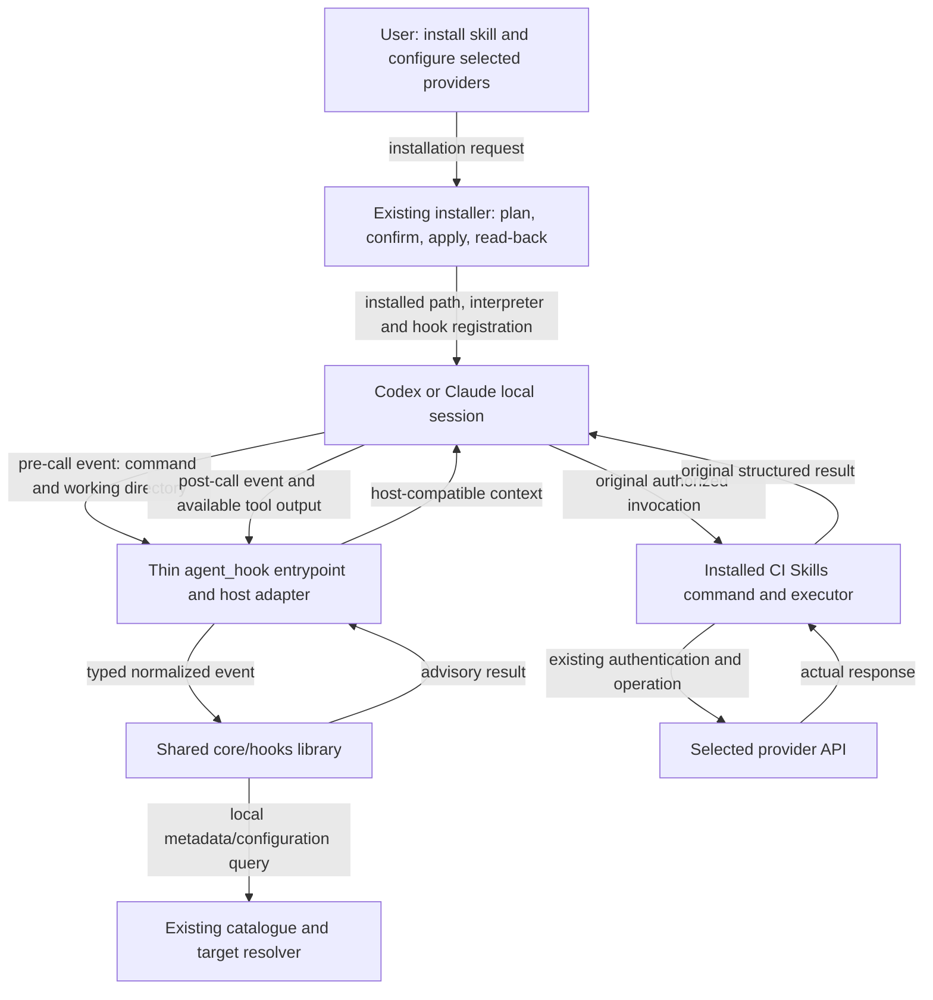

# NOT_IMPLEMENTED: CI11-TOOLS — Installed agent lifecycle hooks

- grounding: GROUNDED
- implementation: NOT_IMPLEMENTED
- verification: UNVERIFIED
- planningStage: PROPOSED
- workClass: EXTENSION

## Authority

This is the hook delivery within [CI11-TOOLS](../../phases/CI11-TOOLS.md), positioned after
installer/callback polish and before runner/pipeline delivery. It expands the existing
hook design; it does not replace the CI11 catalogue or introduce another delivery plan.

The originating requirements are:

- A1: the [existing installed-hook design][baseline-hooks], including registration,
  advisory pre/post behavior and both-client live proof.
- A2: the requested phase revision of 15 October 2026: clear motivation and diagram,
  Claude/Codex user journeys, installation, concrete library placement and needed schemas;
  the subsequent request adds event-driven behavioral specification and six illustrative
  combos without limiting the generic contract to those examples.
- A3: [CI11-TOOLS][baseline-ci11], which owns shared abstractions, small workflow
  composition, discovery pointers and capability acceptance.

A2 authorizes this proposed design amendment. H1–H6 below trace to A1–A3; the proposal
does not claim that its new implementation has already been approved or delivered.
The existing advisory boundary remains: the command performs the operation; the hook
provides prerequisite or result context without repeating API calls, rewriting commands
or retrying mutations.

The [project binding](../../../standards-binding.yaml) at `56a579c2d86addb7bae0591f8fc1750561b168d7`
continues to select the mandatory Standards contracts. This document uses the requested
[System Architecture format][architecture] and [Work Classification vocabulary][classification]
from Standards revision `cae52b2d50bf056b92dd65037d3f2f55301806dc`. Those documents are outside
the current project pin. Applying their format does not claim that the binding has been
updated or that the architecture checker has passed.

The implementation snapshot assessed below is main `e5fb154410027e4222c60a6b7772c105200f4002`.
Requirement IDs H1–H6 in Gates belong to this CI11 delivery. Planning PR IDs in PR Order
are dependencies, not GitHub PR numbers or approvals.

## Consumer

The consumer is a user running an installed CI Skills command through a local Codex or
Claude session. The user installs the skill, configures only the providers they use in
`~/.ci-skills/target.toml`, and asks their agent to perform a CI task.

For example, a user with only GitLab configured asks the agent to check GitLab access.
The agent discovers the command and its input/reference pointers, then invokes the
installed `gitlab_access.py check --json`. Before execution, the hook can identify missing
GitLab configuration. After execution, it can summarize the actual command result.
Neither step requires Harbor, Kubernetes or GitHub configuration.

A user who has only Kubernetes follows the same path with a Kubernetes capability.
A combo that needs another provider continues to report that missing requirement through
the existing command/executor interface. Hook advice does not replace that check.

The user receives the original command output plus a short agent-context hint, where
supported by the host. A hook's UI label is not proof of command success. Installation
and update steps are specified under Implementation Plan; the live journey is below.

## Motivation

Agents currently inspect help, configuration and large outputs repeatedly to establish
what to call and whether it worked. CI Skills already reduces that work through atomic
operations, short combos, structured results and reference pointers.

Hooks add context at the point the agent calls an installed capability. The intended
benefit is fewer repeated inspections: identify the relevant configuration gap before
the call, or point directly to the result and its existing reference after the call.
The acceptance evidence must show this useful information in both supported clients.

The current installer copies the skill but registers no lifecycle adapter. The current
hook document is a configuration sketch without implementation or live evidence.
This phase closes that integration gap using existing command and installation contracts.

## Diagram

The labels distinguish host control flow from event/result data. Only the installed
command owns provider operations.



The same installed library processes each independent event. It does not keep a
cross-event session file or store credentials. Host settings persist registration;
the existing command report persists only when its caller requests output.

The existing validation topology remains:

```text
PR candidate ─► validate.static / validate.unit ────────────┐
             ├► test-install.tests ───────────────────────┤
             └► other existing required jobs ─────────────┤
                                                          ▼
Known provider receipts ─► validate.live_acceptance ─► required-result
                              │ success                    │ all required success
                              ▼                            ▼
                    live-acceptance deployment       ci-skills/required
                              │                            │
                              └──── existing protection ──┘

Failed validation/evaluation → failed required result; no successful publication.
Installed client run → command receipts above + host activation artifact → PR review.
```

The live command runs through the installed user path on the approved test bench,
not inside GitHub. GitHub evaluates submitted evidence through the existing checks.

## Implementation Plan

### Current state and intended outcome

- **IMPLEMENTED: installation and discovery infrastructure.** Reuse
  [the installer](../../../tools/install_ci_skills.py), its plan/fingerprint/recovery paths,
  [catalogue](../../../ci-skills/lib/python/core/catalog.py), target resolution,
  strict JSON decoding and installed schema loading.
  Classification: grounding GROUNDED; implementation IMPLEMENTED; verification
  UNVERIFIED for this phase's combined journey. Evidence: A3 and the assessed source
  snapshot; no new installer run is claimed.
- **NOT_IMPLEMENTED: installed hook processing and registration.** At the assessed
  snapshot there is no `bin/agent_hook.py`, no `core/hooks/` package and no installer
  hook registration. Classification: grounding GROUNDED; implementation NOT_IMPLEMENTED;
  verification UNVERIFIED; planningStage PROPOSED. Evidence: A1 and the assessed source.
  This phase adds those bounded responsibilities. No both-client acceptance evidence
  exists for this delivery; examples cannot establish host activation.

### Behavioral specification

This contract applies to every recognized installed command through its catalogue
metadata and existing result contract. The six journeys below are examples, not an allowlist,
six special handlers, or a commitment to implement their unfinished provider features.
A later combo using those same interfaces receives the same behavior. A new provider
or result shape extends its owning shared contract; it does not add a named-combo
branch to either client adapter.

#### Events, decisions and effects

The client supplies the lifecycle. CI Skills registers only the events needed for the
existing advisory integration: `PreToolUse`, `PostToolUse`, and Claude's
`PostToolUseFailure`. Native fields and event availability follow the linked
[Claude][claude-hooks] and [Codex][codex-hooks] references. Codex's post event can include
a nonzero command exit; a host event name alone never establishes command success.

```text
Session/prompt: host loads the installed skill; agent chooses a command
  → PreToolUse: recognize invocation; inspect only relevant local prerequisites
  → host permission handling: unchanged
  → command: its executor runs atomic callbacks in the declared order
  → PostToolUse or supported failure event: summarize observed result/error
  → agent: consume the original result and advice; choose the next authorized action
```

A combo invoked once produces one outer tool-call observation. Its internal GET/POST/PUT
operations and callbacks do not each become client hook events. Their evidence remains
in the command's report and requested trace artifact. Separate command invocations each
have their own event/result pair; the hook does not invent a cross-command transaction.

The following cases define observable behavior for H1, H2 and H5:

- **Unrelated or unsupported invocation:** emit hook `NO_OP`, encoded as `{}`; do not
  read target/credential files, call a provider, or alter the invocation. The same applies
  to an event outside the registered set if the adapter is invoked with one directly.
- **Recognized offline/help/discovery mode:** resolve its catalogue/schema/reference
  metadata without requiring provider credentials. Do not turn a plan or dry-run into
  an applied result. Requirements come from the selected operation and mode, not the
  union of all providers named anywhere in its command group.
- **Recognized pre-call, local requirements satisfied:** emit `{}`. There is no
  authentication-success claim and no need to repeat the capability's help text.
- **Recognized pre-call, required configuration missing or invalid:** emit
  `CONFIGURATION` advice naming the selected operation, the existing resolver's
  diagnostic and its access/schema pointer. The original invocation remains unchanged;
  normal host permission handling and the command's own configuration check still run.
  Unused providers are irrelevant. Never print credential contents.
- **Completed call with a complete, valid command report:** emit `RESULT` advice,
  preserving the report's mode/status, relevant observed outcome, read-back and cleanup
  facts. Include existing schema/reference or artifact pointers when present; do not
  reproduce the full records or log. Keep the original tool output available unchanged.
- **Failed/interrupted call:** retain the host-observed failure. If a complete valid
  report is available, summarize its partial effects and cleanup alongside that failure;
  otherwise emit `UNAVAILABLE` advice with a sanitized diagnostic. No automatic retry,
  rollback, cleanup invocation or permission decision is performed by the hook.
- **Missing, truncated, malformed or schema-invalid result:** emit `UNAVAILABLE`, not
  a guessed command status. Decode only the supported host response projection;
  do not search mixed logs for a JSON fragment that happens to look successful.
- **Malformed hook input:** emit `INVALID_INPUT` through the supported nonblocking
  diagnostic path, or log and emit `{}` when the event cannot be identified safely.
  This describes adapter input failure; it does not manufacture a command result.

Hook `RESULT` means that a report was understood, not that the requested work succeeded.
Hook `NO_OP` means no advice; a command's `NO_OP` can instead mean the requested state
already existed and was verified. Keep these two outcome domains distinct.

The source owns the meaning of its statuses. For example, `core/report.py` uses `PASS`
for a complete collection even when the collected pipeline is failed or a PVC is Pending.
`sys/status.py` also gives plans and dry-runs exit zero. Therefore host success, process
exit, report status, applied action, resource health and cleanup are separate facts.
If they conflict, report the observed conflict without resolving it into success.

Post events identify their own invocation through native `tool_use_id`, command inputs
and output/error. Retain that identifier as normalized `call_id`; concurrent calls must
not share a "last command" slot or session state file. A repeated event yields the same
advice for the same metadata/input snapshot and causes no provider side effects.
A post event does not depend on a preceding hook process still existing. Changes of cwd
or configuration are resolved afresh for each relevant invocation; the command remains
responsible for validating its inputs again when it executes.

#### Disposition of the other lifecycle events

The broader event catalogue supplied with this request describes host capabilities.
It is not a requirement to register all of them. For this phase, no CI Skills handler
is registered for the following groups; this does not disable the client's normal behavior:

- `SessionStart`, `Setup`, `UserPromptSubmit`, `UserPromptExpansion`, `InstructionsLoaded`:
  existing skill discovery and installer behavior remain responsible for availability;
  the hook does not plan a task, install dependencies or execute a combo on startup/prompt.
- `PermissionRequest`, `PermissionDenied`, `Elicitation`, `ElicitationResult`:
  retain the existing client/user/provider decision path without granting or retrying access.
- `PostToolBatch`, `SubagentStart`, `SubagentStop`, `TaskCreated`, `TaskCompleted`,
  `TeammateIdle`, `Stop`, `StopFailure`: no batch/task/session completion assertion;
  tool events observed inside a subagent use the same per-call contract.
- `ConfigChange`, `CwdChanged`, `DirectoryAdded`, `FileChanged`:
  no watcher or cached readiness; read the effective configuration for the next call.
- `WorktreeCreate`, `WorktreeRemove`: no Git/worktree lifecycle ownership.
- `PreCompact`, `PostCompact`, `PreModelSwitch`, `PostModelSwitch`, `Notification`,
  `MessageDisplay`, `SessionEnd`: no transcript persistence, message rewrite, background
  workflow or automatic provider cleanup.

This disposition is scoped to the installed-command hook delivery, not a claim that
Codex implements every event in Claude's catalogue. Additional event behavior needs its
own concrete consumer benefit and specification; merely adding an enum is insufficient.

#### Six worked journeys, not a closed specification

The examples use the assessed source snapshot and [existing combo catalogue](../../combos.md).
Entrypoints below identify capabilities, not complete copy/paste mutation commands:
callers still supply their selected inputs and existing plan/apply confirmation.
Expected hints illustrate meaning, not fixed strings or a requirement to recover a
report from every host error. If the host
does not supply a complete decodable report, the same case yields `UNAVAILABLE` plus the
observed failure; it never claims the illustrated success.

1. **GitLab pipeline progress — existing read combo.**
   `gitlab_pipeline.py --project PROJECT --pipeline-id ID` binds GitLab, reads the
   pipeline/jobs and aggregates progress. Given GitLab-only configuration, pre-call
   advice must not demand Kubernetes, Harbor or GitHub. After a complete read, report
   collection `PASS` separately from the actual pipeline/job status. A failed pipeline
   is still failed; partial pagination remains `PARTIAL` with its diagnostic/reference.
   Expected hint: "Collection PASS; pipeline failed; consult the returned job records."
   Grounding: `core/gitlab/gitlab_pipelines.py`.

2. **Create and verify a milestone — existing mutation combo.**
   `gitlab_milestone.py create` plans, performs the confirmed create if needed, and
   reads back the milestone. On the plan call, advice says planned, not created.
   On confirmed apply, summarize `APPLIED` only if the command reports its verified
   result. A repeated identical request may report command `NO_OP`; preserve that fact.
   Conflicting matches or failed read-back remain `BLOCKED`; the hook never retries POST.
   Expected hint: "PASS; milestone APPLIED; read-back verified" only with those facts.
   Grounding: `core/gitlab/gitlab_milestones.py` and shared GitLab action reporting.

3. **Kubernetes storage diagnosis — existing read combo.**
   `storage_report.py` reads claims, volumes, attachments, Pods and controllers, then
   joins their relationships. A Kubernetes-only target is sufficient. Given a complete
   read containing a Pending claim, summarize collection `PASS` and the Pending record
   without calling storage healthy. If a source read fails, preserve `PARTIAL` and the
   returned error; do not drop the records collected successfully or demand GitLab setup.
   Expected hint: "Collection PARTIAL; source read failed; available records retained."
   Grounding: `core/kubernetes/storage.py` and `core/report.py`.

4. **Pull and prove a Harbor toolbox — existing execution combo.**
   `harbor_pull.py pull` uses Kubernetes and Harbor: resolve a digest-pinned image,
   create temporary pull credentials/doctor Job, read its actual result and clean up
   owned helpers. Given no Harbor configuration, pre-call advice identifies that gap;
   a readable Kubernetes configuration is insufficient. After apply, distinguish
   verified image execution from cleanup. If the doctor succeeds but cleanup fails,
   retain the command's `BLOCKED`/cleanup failure rather than summarize "all done".
   Expected hint: "BLOCKED; toolbox verification recorded; cleanup failed."
   This command is not a local registry-copy operation. Grounding:
   `bin/harbor_pull.py` and `core/kubernetes/runner.py` (`PullImage`).

5. **Build, publish and register a GitHub runner — existing cross-provider combo.**
   `create_selfhosted_runner.py create` uses Kubernetes, Harbor and GitHub to build,
   publish, doctor-check, deploy/register and verify the runner online. Given a valid
   applied result, summarize the reported image/runner verification and evidence pointer.
   If publication fails, do not claim deployment or registration happened. A reused
   stage's `NO_OP` does not erase later failure. An online runner does not prove a job ran.
   Expected hint: "PASS; runner online and labels verified; no test-job result reported."
   Grounding: `bin/create_selfhosted_runner.py`, `core/toolbox_actions.py` and
   `core/github/runner.py`.

6. **Build a GitLab runner and prove it with a real job — planned full chain.**
   Toolbox build → Harbor push → runner record/manager configuration → start/watch
   pipeline → read job/runner identity and tool results → cleanup. The aggregate and
   pipeline mutation verbs remain planned in CI11/toolbelt block 7; this hook phase
   does not deliver or advertise them as installed. Once delivered through the normal
   catalogue/result contract, the same handler consumes their evidence without a
   sixth special case. Required proof belongs to that capability: linked image digest,
   online runner, pipeline/job IDs, actual job runner ID, successful checks and cleanup.
   Expected hint for a record-only result: "Runner record verified; online/job execution
   not demonstrated." A `never_contacted` record never becomes a working runner claim.

### Behavioral acceptance

Extend H1–H6's existing test/review paths with event-driven assertions.
A test provides a native event, selected command metadata and a report;
it asserts the emitted advice, unchanged tool input/output and absence of extra operations.
Cover pre/post/failure, offline mode, missing selected provider, failed/partial read-back,
cleanup failure, malformed/truncated output and interleaved calls. Also use a newly
registered in-memory/test-only catalogue fixture to show the generic path does not
depend on the six names; do not ship a synthetic capability for this test.

For live proof, select installed examples with applicable authorized targets and observe
both the real command result and the host-visible advice. The planned sixth chain is a
future acceptance example, not a runnable live case now. Reuse functional command proof
when its checksum is unchanged; collect new host-activation/advice evidence where behavior
changed. No extra provider calls are needed just to generate a hook summary.

### Library placement and dependency direction

Proposed additions are marked below. Existing provider modules remain responsible
for provider behavior.

```text
ci-skills/
  bin/
    agent_hook.py                 new: stdin/arguments/stdout boundary only
  lib/python/core/
    hooks/                        new: agent lifecycle integration
      models.py                   typed events, invocation, advice and enums
      recognition.py              installed command recognition
      lifecycle.py                shared prerequisite/result inspection
      codex.py                    Codex event/output projection only
      claude.py                   Claude event/output projection only
    catalog.py                    existing command declarations and pointers
    project_binding.py            existing target-directory precedence
    target.py                     existing selected-provider configuration
    cli_api.py                    existing strict response decoder
    json_types.py                 existing JSON types and narrowing
    schema.py                     existing installed schema registry
    logging.py                    existing logging interface
    runtime.py                    existing sanitization/redaction
    report.py                     existing result meaning and rendering
  schemas/hooks/                  new: CI Skills-owned normalized documents
    event.schema.json
    advice.schema.json
tools/
  install_ci_skills.py             existing installer orchestration
  agent_hooks.py                  new: registration plan/apply/read-back
tests/python/
  test_agent_hooks.py              new: shared and host adapter cases
  test_installer.py                existing: installation/recovery cases
  test_installed_package.py        existing: packaged schema/entrypoint cases
```

Runtime dependency direction is `bin → host adapter/shared hooks → existing core utilities`.
Installer mutation stays in `tools/agent_hooks.py`, called by the existing installer.
The runtime package must not import installer code, provider transports or concrete
GitLab/Kubernetes/Harbor callbacks. It observes the command boundary; it does not
construct another executor or bypass the executor used by the real command.

The two host adapters share recognition and advice but own their different wire formats.
This existing variation justifies the shared package; no new provider abstraction is needed.

Use `core.paths.SKILL_ROOT` for the installed root. Register the callable entrypoint and
its input/output references through the existing catalogue and generated `tools.json`
mechanism. Reuse `add_log_arguments()`; retain exactly `--log-level`, `--log-format`
and `--log-file`. The installer generates the hook invocation with an explicit host,
for example `agent_hook.py --host codex`; lifecycle event selection comes from stdin.

### Interfaces, types and failure behavior

Proposed library interfaces:

```python
def decode_event(document: JSONObject) -> HookEvent:
    """Normalize one host event; raise HookInputError for an invalid used field."""

def recognize(event: HookEvent, skill_root: Path) -> Optional[Invocation]:
    """Return the supported installed invocation; None means no recognized call."""

def inspect_prerequisites(invocation: Invocation) -> HookAdvice:
    """Return configuration advice for this operation without authenticating."""

def inspect_result(invocation: Invocation, result: JSONValue) -> HookAdvice:
    """Summarize available output without claiming an unobserved result."""

def encode_advice(advice: HookAdvice) -> JSONObject:
    """Return host-compatible context; return {} when no advice is needed."""
```

Each host module owns its decoder/encoder; the other functions have one shared
implementation. These are proposed interfaces, not executable stubs to copy into source.

`HookEvent` is a typed union of pre-call, completed-call and host-supported failure
events. Event-specific fields belong to their concrete type. `Invocation` contains
the resolved installed command, verb/arguments and effective consumer working directory.
`HookAdvice` is always a concrete result with an outcome, a short summary and a
`Sequence` of existing reference pointers. Empty collections use empty defaults.
Read-only inputs use `Mapping`/`Sequence`; mutable builders use the corresponding
mutable types. `JSONValue` is the existing decoded-JSON boundary type: the result
parameter is host tool output, which shared code narrows to an available command report.
Retain the native invocation identity as `HookEvent.call_id` for event/result association.
There is no `Any` escape or nullable callback result. Provider identities reuse
`SkillPluginType`; host/event enums belong to `hooks/models.py`.

The one `Optional` above means recognition did not identify a supported invocation.
It is not missing callback state. Existing provider callbacks, bounded action/state
types and state serialization remain unchanged.

Recognition initially covers direct installed executable calls and Python-interpreter
calls with literal, shell-quoted paths. It uses the catalogue identity, not a substring
such as "gitlab" or "ci-skills". It never evaluates shell text. An unrelated command or
a compound/dynamic expression it cannot resolve receives no hint and still runs normally.
The final help must state this coverage rather than promise interception of every shell form.

Prerequisite inspection uses the operation's selected providers. For example,
`command_authorities("bin/ci-api")` lists alternative Git providers; it must not
require both. Extract selection with the existing command parsing/selection facility;
share that facility if it is currently trapped in a CLI. Do not write a second flag parser.

Extend `project_binding.target_candidates()` and `resolve_target_file()` with one
optional `working_directory: Path` input. Omission preserves current `Path.cwd()` behavior;
hooks supply the concrete effective cwd normalized from the event and any explicit
command-directory override. Keep this directory injection in the shared resolver:
do not change process cwd or duplicate target search in either adapter.

Preserve the existing precedence: explicit `CI_SKILLS_TARGET` selection, then project,
then home. Relative credential files remain relative to the selected target file.
A missing/unusable event cwd is an input error handled nonblockingly; a shell expression
with an unresolved directory change is unrecognized.

An unrelated call exits before configuration or credential access. An offline command
such as `reference.py` has no provider requirement and skips target loading too.
For a recognized provider command, reuse selected-provider `load_target()` and existing
diagnostics; do not run authentication probes. Missing configuration produces advice,
not a new permission decision. A readable token file is not proof that authentication works.

Post-call processing follows Behavioral specification. If the catalogue declares a
result schema, validate against that schema. Existing pipeline and storage commands have
no registered result schema at the assessed snapshot: narrow their versioned `report()`
envelope through a shared reader in `core/report.py`, reusing the existing strict JSON
shape readers. This checks the established kind/version/status/records/errors/summary
contract; absence of a schema pointer alone must not turn their reports into `UNAVAILABLE`.
Reuse or extract the existing rendering projections for operation-specific observations;
unknown or invalid fields are not evidence. Emit a schema pointer only where one exists.

Keep operation/read-back/cleanup meaning in its owning library. Reuse a compact
projection rather than the full `human()` output; neither host adapter interprets
provider-specific records.

The entrypoint catches expected input/decoding/configuration failures and uses existing
sanitized logging. It dispatches supported events before validating their normalized
variants. No permission grants, denials, command replacements or exit code 2 are emitted.
It does not crawl transcripts, follow arbitrary report paths or repeat provider GETs.

### Schemas and protocol boundaries

The requested schemas validate CI Skills-owned normalized data, not a new policy.
Both are proposed Draft 2020-12 documents with stable unique `$id` values and
`schema_version: "1.0"`. Their exact JSON accompanies implementation review.

- **`schemas/hooks/event.schema.json`:** requires `schema_version`, `kind`,
  `host`, `event`, `call_id`, `cwd`, `tool_name` and `tool_input`.
  Completed calls add `tool_result`; failure calls add `error`.
  The host decoder validates the normalized event before shared inspection.
- **`schemas/hooks/advice.schema.json`:** requires `schema_version`, `kind`,
  `outcome`, `summary`, `findings` and `references`.
  Collections can be empty; the shared library validates advice before host encoding.

The event kind is `agent_hook_event`; `host` selects `codex` or `claude` and `event`
selects `pre`, `post` or `failure`. The host decoder maps its supported native events
to those variants and preserves native `tool_use_id` as `call_id`. `call_id`, `cwd` and
`tool_name` are nonempty strings; `tool_input` is an object.
A `pre` event carries no result. A `post` event carries the available JSON tool value;
a failure event carries a diagnostic string. These are transport data, not proof.

The advice kind is `agent_hook_advice`. Outcomes are `NO_OP`, `CONFIGURATION`, `RESULT`,
`UNAVAILABLE` or `INVALID_INPUT`. They classify the hook's observation, not the provider's
success. `summary` is a string; `findings` is a sequence of sanitized messages and
`references` uses existing summary/pointer shapes. A `NO_OP` has empty summary/collections
and encodes to `{}` for the host.

For example, this is normalized advice, not native hook stdout:

```json
{
  "schema_version": "1.0",
  "kind": "agent_hook_advice",
  "outcome": "CONFIGURATION",
  "summary": "This command requires GitLab configuration.",
  "findings": ["The selected target has no GitLab configuration."],
  "references": [
    {"summary": "Configure access", "pointer": "references/access.md"}
  ]
}
```

Use event variants rather than making every field nullable. Wrong types, missing variant
fields, duplicate JSON keys and unsupported owned-document versions use the existing
strict decoding/schema error path. A valid unrelated event yields concrete no-op advice.

Native event field names and host output envelopes are defined by
[Codex hooks][codex-hooks] and [Claude hooks][claude-hooks].
Decode only the supported projection and tolerate unrelated upstream fields.
CI Skills does not add its `schema_version` to native host output or invent a
complete replacement schema for either client's settings.

Command results keep their existing contracts: registered schemas where present,
or the common versioned report envelope described above. Advice carries existing pointers
rather than copies and invents none. `core/schema.py` already discovers installed
`*.schema.json` files and
registers their `$id` values for offline references. Extend installed-package and
catalogue parity coverage; add no parallel registry or schema-only delivery PR.

### Installation, update and user use

The existing installer remains the single entrypoint. It must include hook registration
in its dry-run plan, confirmation fingerprint, apply result and read-back. Extend its
current `PreparedInstall`, `_prepare_install()` and `_apply_confirmed()` paths by delegating
host settings work to `tools/agent_hooks.py`.

These are the existing invocation forms; hook registration is the proposed behavior
of the delivery, not functionality available today:

```bash
# Select a supported Python 3.11+ environment first.
CI_SKILLS_CHECKOUT="/path/to/cloned/ci-skills"
cd /path/to/consumer-git-repository

python "$CI_SKILLS_CHECKOUT/tools/install_ci_skills.py" --dry-run --json
python "$CI_SKILLS_CHECKOUT/tools/install_ci_skills.py" \
  --apply --confirm-install "<plan fingerprint>" --timeout 600s --json

# Claude destination: obtain and apply its own plan fingerprint.
python "$CI_SKILLS_CHECKOUT/tools/install_ci_skills.py" \
  --skills-dir "$HOME/.claude/skills" --dry-run --json
python "$CI_SKILLS_CHECKOUT/tools/install_ci_skills.py" \
  --skills-dir "$HOME/.claude/skills" \
  --apply --confirm-install "<Claude plan fingerprint>" --timeout 600s --json
```

For existing installations, retain the documented `--upgrade` and
`--confirm-upgrade` path in the [installer reference](../../../README.md#installer-reference).
Run from the consumer Git repository: `tools/agent_profile.py` uses that repository
for the bundled `glab-stack` skill and requires `glab`. The existing installer handles
the declared dependency profile; its plan must identify missing prerequisites before apply.
A direct skill download through a client's separate installer does not run this repository
installer and therefore does not register these hooks.
Use the repository install/upgrade path for this phase's complete experience.

The installer records and uses the actual selected interpreter and installed skill path;
a clean machine must not depend on this repository's development environment name,
shell aliases, `PYTHONPATH` or checkout location.

Host selection for this delivery uses a documented canonical-destination mapping in
`tools/agent_hooks.py`: the existing default `skills_directory()` selects Codex and
its corresponding `config.toml`; the exact standard `~/.claude/skills` destination
selects Claude and `~/.claude/settings.json`. The installer plan names the selected
host and settings file explicitly before confirmation. `--skills-dir` remains a
storage option; arbitrary destinations are not interpreted as client identities.

Preserve unrelated settings and hooks; back up an existing
settings file before its first write, plan exact changes, and read back the installed
entries. A repeat install must not append duplicates. Upgrade and interrupted-write
recovery must leave the report accurate about both skill and registration state.

Codex supports inline TOML hooks and requires review/trust of non-managed hooks.
Do not add a second `hooks.json` representation alongside the selected inline entries.
The user completes the host's own trust/reload step, then starts a fresh session.
See [Codex configuration][codex-config]; installation alone does not prove activation.

The normalized pre/post handling is shared. Claude additionally has a failure event;
the implementation must use only the events supported by each client.
The earlier `SessionStart`/`reloadSkills` observation is not an automatic updater:
this phase installs no updater and runs no provider work at session start.
See the [Claude hook reference][claude-hooks].

Inside either client, ask the agent to use the installed CI Skills access command.
The agent can inspect its help/schema and invoke it with JSON output. It receives the
actual command result and compact hook context. Users do not manually construct native
hook-event JSON. Diagnostics use the shared logging options when requested.

### Open decisions and scope boundary

- Automatic registration in this phase covers the two standard destinations mapped above.
  Custom `--skills-dir` installation remains supported for package copying. Report
  registration as not selected for other destinations, without failing the package install
  or editing guessed settings. A general custom host/settings selector is not in this phase.
- The architecture format is used under the requested phase design. Formal checker
  enforcement needs a separately reviewed Standards binding update: the current pin
  contains neither architecture nor classification schemas. This is not a reason to
  stop grounded design or to add a replacement checker.
- Hook removal must remove only the exact entries installed by this integration and
  preserve other settings. Include the removal procedure in the delivered user docs;
  do not invent a general agent-settings manager or uninstall unrelated components.

Git pre-commit hooks and repository validation policy are outside this phase.

## PR Order

The phase is delivery position 2 within CI11: installer/callback polish supplies the
portable installation and shared execution behavior; runner/pipeline work consumes the
completed installed-agent path later. No capability must wait for an unrelated provider.

- **H-01 / H-W1:** shared `core/hooks/` models, recognition and lifecycle; schemas,
  entrypoint, Codex adapter and installer registration. Depends on the preceding portable
  installer polish and existing catalogue/target/schema facilities. Delivers usable
  Codex integration and H1–H5 evidence.
- **H-02 / H-W2:** Claude adapter and registration, combined examples and client parity.
  Depends on H-01's shared processing and installer seam. Delivers usable Claude
  integration and H1–H6 evidence across both clients.

Host adapters may be developed in parallel after agreeing the shared interfaces.
Merge H-01 before H-02 consumes them. Each PR includes its own schema, tests, documentation
and live proof; neither is an unusable library-only increment. No provider capability,
general shell parser, background service or settings framework is part of these PRs.

## Gates

The following is the single requirement traceability map for this delivery.
[Behavioral acceptance](#behavioral-acceptance) defines the shared event-driven cases.
All rows are grounded in the Authority and assessed main snapshot above; implementation
is NOT_IMPLEMENTED and verification is UNVERIFIED for the hook-specific deliverables.

Existing check locations are in [`validate.yml`](../../../.github/workflows/validate.yml).
Dotted names below mean `job.step`, not additional jobs:

- G1: `validate.static` and `validate.unit` already run static checks and discover
  `tests/python` except explicitly routed suites. Add `test_agent_hooks.py` here;
  its assertions do not exist yet.
- G2: `test-install.tests` already runs `test_installer.py`,
  `test_agent_profile.py` and `test_installed_package.py`. Extend their existing
  installer/schema coverage; the hook cases are proposed.
- G3: `validate.live_acceptance` is the existing committed-receipt evaluation
  and publication step. It invokes [`check_live_acceptance.py`](../../../tools/check_live_acceptance.py)
  and publishes `live-acceptance` after success. It accepts existing provider receipt
  kinds, not hook-event/advice documents; it does not run live provider operations.
- G4: `required-result` aggregates existing required jobs and publishes
  `ci-skills/required`. This phase does not alter that enforcement.
- R1: implementation review checks boundaries and linked client activation artifacts.
  Neither G3 nor a new automated gate certifies host activation.

The locations above are observed in the assessed source, not execution results from this
planning task. Architecture format review is distinct from a passing bound architecture
checker. All hook-specific outcomes below remain UNVERIFIED.

- **H1 — installed recognition/advice.** Authority A1/A2; wiring `core/hooks` and
  `bin/agent_hook.py`. Depends on installer polish; delivered in H-01/H-W1 and H-02/H-W2.
  G1 covers generic catalogue-driven behavior; R1 requires actual host context.
  Gap: implementation and host proof.
- **H2 — shared inspection and command boundary.** Authority A1/A3; wiring the existing
  target/catalogue into shared lifecycle inspection. H-01/H-W1 supplies it.
  G1 proves operation/mode-specific provider selection and isolation of call identities.
  Gap: implementation and regression cases.
- **H3 — schemas and strict decoding.** Authority A2/A3; wiring two normalized schemas
  through the existing registry, declared result schemas and common report reader.
  H-01/H-W1 supplies it. G1/G2 cover both result paths, valid variants, invalid
  types/version/duplicates and offline references.
  Gap: schemas and assertions.
- **H4 — installation and client registration.** Authority A1/A2; wiring installer
  plan/apply/read-back to host settings. Depends on installer polish; both PRs/waves.
  G2/R1 prove clean install, repeat no-op, settings preservation, upgrade and recovery.
  Gap: implementation and installation evidence for the standard destinations.
- **H5 — optional providers and honest output handling.** Authority A1/A3; wiring
  selected configuration and unavailable/failure handling. Depends on H1–H4; both PRs/waves.
  G1 covers report interpretation and failure handling; G3/R1 prove the selected target
  and observed advice.
  Gap: per-client evidence.
- **H6 — candidate evidence and activation.** Authority A1/A3; wiring provider reports
  and linked client artifacts to the candidate. Depends on H1–H5; both PRs/waves.
  G3/G4 enforce accepted provider proof/hash; R1 checks hook activation and cleanup.
  Gap: final-candidate evidence.

These requirements extend evidence within existing checks and review. They add no job
or merge gate. No hook-only JSON is placed in G3's configured receipt directories.
Passing a mocked test does not demonstrate client activation.

## Integration

The installed package is the shared artifact for both clients. Installer registration
points to it; client adapters translate events into the same typed advice operation.
Provider-specific configuration, authentication and execution stay with the existing
CI Skills command libraries and their callback/state contracts.

Use the existing catalogue/manifest and installed schema mechanisms for discovery.
Installation must not add a command option that supplies provider passwords or bypasses
target resolution. A registration file contains paths and hook configuration, not
a copied runtime target or credential values.

## Live Smoke Evidence

After implementation and QA fixes, install the candidate as a user would, outside the
source checkout. For each supported client record its actual version, installed
interpreter/path, registration read-back and activation observation.

Run the installed `gitlab_access.py check --json` against the selected test target,
then a supported Kubernetes-only example using a target with only Kubernetes configured.
Capture actual command reports and the corresponding bounded hook context. Use the
Behavioral acceptance cases and installed journeys above to establish scope isolation,
plan/result interpretation and the difference between advice and authentication. Planned
provider workflows do not become implementation prerequisites for this hook phase.

Keep reports tied to the existing functional checksum over `bin/`, `lib/` and
`schemas/`; preserve the package checksum separately. Link bounded client activation
and hook-context artifacts from the PR evidence.
G3 evaluates the existing provider receipts only; review establishes the client-side
observations. Do not insert an unknown hook report kind into its receipt directories
or claim it parses session transcripts.
Do not rerun live proof for wording-only edits outside the functional checksum.

A hook-only event does not establish live provider behavior. The installed command's
real response and independent read-back supply that proof. The read-only access journey
creates no provider resources; restore any test-owned configuration/settings after the
test without deleting user configuration or other hooks.

## End-to-End Test

1. Use a clean consumer Git repository and supported Python 3.11+ runtime on a machine
   that does not rely on the developer's environment. Run the cloned installer from
   that consumer repository; the installed package must then work without the clone.
2. Plan installation for one client, review the paths/settings changes, apply its
   fingerprint, and read back the installed package and hook entries.
3. Complete the client's normal activation step and ask its agent to discover and run
   the installed access command. Observe the command result and compact hook context.
4. Confirm that configuration advice concerns only the providers selected by that
   command; prove successful authentication from the actual live command report.
5. Exercise unrelated, missing-configuration and command-failure cases. Preserve the
   command's real result and never turn a missing report into success.
6. Repeat installation without duplicate hooks; verify upgrade/recovery behavior through
   the existing installer test path. Repeat the user journey in the other client.
7. Link the resulting reports and trace artifacts to H1–H6 and the merge candidate.
   Close the phase only when both integrations and existing required checks have evidence.

[architecture]: https://github.com/spyroot/standards/blob/cae52b2d/docs/agents/contracts/system-architecture.md
[classification]: https://github.com/spyroot/standards/blob/cae52b2d/docs/agents/contracts/work-classification.md
[codex-hooks]: https://learn.chatgpt.com/docs/hooks
[codex-config]: https://learn.chatgpt.com/docs/config-file/config-advanced
[claude-hooks]: https://code.claude.com/docs/en/hooks

[baseline-hooks]: https://github.com/spyroot/ci-skills/blob/e5fb154/docs/skill-session-hook.md
[baseline-ci11]: https://github.com/spyroot/ci-skills/blob/e5fb154/docs/phases/CI11-TOOLS.md
