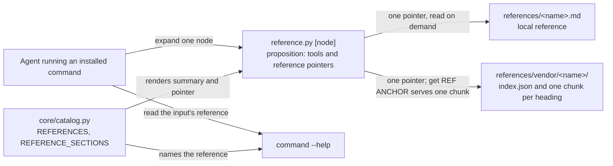
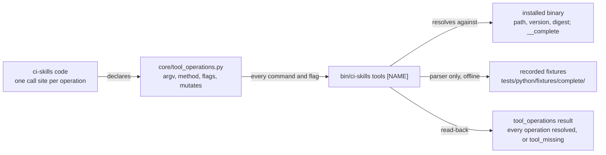

# PARTIALLY_IMPLEMENTED: CI09 — references, tool operations and upstream knowledge

- grounding: GROUNDED
- verification: PARTIALLY_VERIFIED
- planningStage: PLANNED

## Authority

The existing CI09 requirements below and the operator's approved proposition design govern this phase.
The operator requested this concrete remaining-delivery plan on 2026-10-20 and the binding update on 2026-10-21.
CI11 owns the command catalogue and proposition contract; CI09 owns reference knowledge, connections and lifecycle.
This update does not restore the deleted CI10 document or make it an implementation prerequisite.

A reference is something an agent consults before acting. This phase owns two
kinds, declared with the same `uses` pointers (CI07-SCHEMA):

- **operations** (section 1): what our code calls, one declared operation per
  tool invocation, checked against the installed binary;
- **knowledge** (section 2): what an agent reads, one upstream page vendored
  as verbatim chunks with a derived index, served on demand.

This document plans from:

- the proposition interface. [`CI11-TOOLS`](CI11-TOOLS.md#proposition-interface) and its schema define the node
  every call returns: `tools`, what the agent can run, the installed filenames, each chosen to say what the
  command actually does since that name is all the node shows for it, mapped to empty objects; and `reference`,
  what it can read, an ordered array of entries each with a name, a summary and a pointer to the next node,
  derived from `core/catalog.py`; a live offering never advertises a proposed command. Section 3 below
  specifies the graph: the nodes, the placement of every command, the verbs' purposes, the references and
  sections, and the compact output rules. Its renders use the 1.x `choices` envelope, one entry per verb with
  `available` and `next`; that envelope and the 2.0 reference mapping are retired, and the `choice`, `pointer`
  and `input` definitions stay in the reference-next schema only for the gitlab-pipeline-watch result schema;
  the node carries no verb entry and no planned verb. CI11 also supersedes section 3's forced walk through
  `run` and `read`: one answer per node carries `tools` and `reference` together, the agent expands a node
  only when it decides it needs more, and no call through `run`, `read` or `describe` is required before
  invoking a command; `get` remains for drilling into a reference's sections. A reference pointer resolves to
  a file ci-skills stores under `references/`, and a reference is itself a node of the same graph: it expands
  into its sections through `get REF ANCHOR`, so the graph continues past the command node, and expanding it
  is the agent's decision. Section 3 is retained as written; every capability registers into the node and none
  defines a second navigator or inventory; this is requirement `R-CI09-005` in the map;
- [`CI11-TOOLS`](CI11-TOOLS.md), recipe step 4: a capability extends the catalogue's placement declarations for
  its proposition nodes, and its read-back is that the proposition lists the installed tool and its reference
  pointers;
- [`CI07-SCHEMA`](CI07-SCHEMA.md) for `uses` pointers and record versions, [`CI08-ROUTING`](CI08-ROUTING.md) for
  the router and `SKILL.md`, [`CI02-CLI`](CI02-CLI.md) for the command contract, as the sections below cite them;
- the project motivation in [`README.md`](../../README.md#motivation): one go instead of N round trips;
- the shared standards: the phase format of `system-architecture.md` and the classification values of
  `work-classification.md` at the exact revision selected by [standards-binding.yaml](../../standards-binding.yaml),
  currently `5bd31f103621dcd7e49ec6e6af55583de7056d7d`.

Not on inspected main `69eea017`, although historical sections below cite them: the phase documents `CI03-GATES`, `CI05-VENDOR`
and `CI10-PHASES`, the gate wrapper `scripts/check.sh`, the root command `bin/ci-skills` and the D-SMOKE
executor. Those historical names do not authorize recreating them. The current delivery order and proof procedure
below replace those dependencies. The validate workflow remains the required gate (`ci-skills/required`).

## Consumer

The consumer is the agent acting for a user through installed ci-skills. It meets this phase in three ways. It
discovers what it can run and read through the navigator, one level per call, each command placed under its
node with its reference pointers, and its verbs' purposes through `--describe` (section 3). It reads one short
reference, one section of an upstream page and never the page, when a command's input needs it, reached through
that pointer or through the command's `--help` (section 2). And every operation ci-skills' own code runs against
`gh`, `glab`, `kubectl` and `oc` is declared and checked against the installed binary, so a renamed or removed
flag is found by the check, not by a failed run (section 1). The second consumer is a caller or a maintainer
adding a command, a verb or a reference: rows in `core/catalog.py` and, for an upstream page, one declaration and
one run of the update tool (sections 2 to 4).

Motivations, in the contract's categories: the capability it adds, discovery one level at a time, one upstream
fact per read and a declared, checked set of tool operations (`README.md#motivation`); the necessity it
addresses, today the agent reads `--help` text or upstream documentation to choose a command and its flags, and
nothing records which operations our code relies on or fails when an upgrade renames one (section 1, Context);
the remaining limitation in established code, reference nodes expose sections but not declared cross-document or
reference-to-tool connections, and external operations have no declared compatibility inventory. Command-scoped
references already exist (`core/catalog.py` and `core/navigate_references.py`, main `69eea017`).

## Motivation

Add three capabilities to ci-skills behind one entrypoint: the agent discovers what it can run and read one level
at a time and never reads `tools.json`, an index or a whole page; it reads the one upstream section a command
needs; and every external operation our code runs is declared once and checked against the installed binary.
They are a skill because the same discovery, the same lookup and the same compatibility check repeat for every
command in the catalogue; without them the agent reads `--help` text and upstream pages every time, makes
mistakes on keywords and flags it never had to compose, and nobody learns that an upgrade renamed an operation
until a run fails.

ci-skills declares all three as data in `core/catalog.py`, rows per command, verb, reference and section, and
renders the proposition from them. It ships each reference as a short file under `references/`, written by us or
vendored from the upstream page and chunked by heading, and keeps a vendored one current from a pinned or latest
upstream commit. It declares each tool operation with its exact arguments and `mutates` flag. Adding any of them
is rows in the catalogue and, for an upstream page, one `[references.<name>]` table in `vendor/vendor.toml` and
one run of `tools/update_reference.py` (sections 1 to 4).

## Diagram

How the agent reaches a reference, and where each pointer comes from; the node shape, `tools` as installed
filenames mapped to empty objects and `reference` as an ordered array of name, summary and pointer to the
next node under `schema_version` `3.0`, is the [Proposition interface](CI11-TOOLS.md#proposition-interface) and
[Proposition schema](CI11-TOOLS.md#proposition-schema) of CI11-TOOLS:



How a reference is collected, added, refreshed and retired; the stages are section 4's, in its order:

```mermaid
flowchart LR
    Declare["declare<br/>[references.&lt;name&gt;] in vendor/vendor.toml"]
    Fetch["fetch<br/>tools/update_reference.py, checkout only"]
    Structure["structure<br/>chunk, anchor, index, lock"]
    Verify["verify<br/>digests and index from the committed files"]
    Publish["publish<br/>journaled replace-tree transaction"]
    Serve["serve<br/>installed, offline, one chunk"]
    Check["check-upstream<br/>update --dry-run"]
    Refresh["refresh<br/>stages 2 to 5 at the new commit"]
    Retire["retire<br/>remove the declaration"]
    Declare -- "pinned sha or pin = latest" --> Fetch
    Fetch -- "page and schema bytes" --> Structure
    Structure -- "chunks, index.json, lock entry" --> Verify
    Verify -- "PASS" --> Publish
    Publish -- "committed tree" --> Serve
    Serve -. "max_age_days passed or upstream ahead" .-> Check
    Check -- "upstream_ahead" --> Refresh
    Refresh -- "new commit" --> Fetch
    Declare -. "declaration removed" .-> Retire
```



How a declared tool operation is checked against the installed binary (section 1):



The first diagram is the data flow the agent sees; control is one call per level and never a forced walk from the
root. A reference is a node of the same graph: its pointer is a file ci-skills ships, and `get REF ANCHOR` expands
it into one section when the agent decides to. The second is the construction path a caller or maintainer runs;
`fetch` is the only stage that uses the network and it never runs from the installed skill. The third is the
compatibility check; it reads the binary and writes nothing.

One walk, in CI11's node shape, for the command that builds a node ISO. The node answers with what the agent can
run, the installed commands, and what it can read, the references ci-skills stores, each read entry pointing at
the next node:

```json
{
  "schema_version": "3.0",
  "tools": { "ocp_node_onboard.py": {}, "prepare_tool_pod.py": {} },
  "reference": [
    {
      "name": "OpenShift node image",
      "summary": "Every flag oc adm node-image create accepts, and a nodes-config.yaml example.",
      "pointer": "get ocp-node-image"
    }
  ]
}
```

The agent runs the command from `tools` with its `--help`, or, when it decides it needs the upstream facts, expands
the reference. `reference.py get ocp-node-image flags` returns the one section the agent must get right to
produce a valid build: the one required flag on the flags route, `--mac-address`, and the thirteen OpenShift
leaves optional, `--hostname`, `--cpu-architecture`, `--network-config-path`, `--root-device-hint`,
`--ssh-key-path`, `--pxe`, `--output-name`, `--dir`, `--registry-config`, `--report`, `--skip-verification`,
`--insecure` and `--certificate-authority`, each with the upstream meaning. `reference.py get ocp-node-image
nodes-config-example` returns the one section holding a `nodes-config.yaml`: a `hosts` entry with `hostname`,
`interfaces` with `name` and `macAddress`, `rootDeviceHints` with `deviceName`, `networkConfig`,
`cpuArchitecture`, `sshKey` and `bootArtifactsBaseURL`, each marked required or optional as the upstream page
states, with pointers to its subsections (section 3, `get`). The reference is a node; the command node did not
have to carry any of that text, and nothing forced the expansion.

## Implementation Plan

### Current State and Intended Outcome

Inspected main: `69eea01700d16cc30dbc2005281e65a3580f6755` (2026-10-21). This is a source inventory;
the linked merged PRs and recorded receipts prove only their delivered portions. Remaining rows are not certified.

- **Implemented:** `reference.py` and `core/catalog.py` emit the existing version `3.0` proposition with ordered
  reference arrays. Command relations, per-command references, provider placement, root scoping and deduplication
  already exist. `core/navigate_references.py` implements local `get`, heading selection, own-text reads, search and
  bounded paging. Preserve these implementations and `tests/python/test_propositions.py` coverage.
- **Partially implemented:** references and sections expand only within their own document. Markdown `Related`
  links are text, not machine-readable connections. The current `reference_document()` supplies no tools;
  `section_document()` supplies only child sections. The existing section schema has no `tools` member.
- **Not implemented:** pinned upstream collection, generated index/lock, offline verification against expected
  bytes, update/refresh/retire transactions, and declared external-operation compatibility checks. Parsed `--card`
  and `--part` options currently report `tier_unavailable`; they do not prove indexed cards exist.

### Concrete remaining deliveries

These are subdivisions of the existing `PR-CI09-1` and `PR-CI09-2` delivery IDs, not a parallel roadmap.
Each subdivision lands as a bounded capability PR with its own proof. Existing requirements retain their IDs.

- **1a: connections; R-CI09-003/005.** Owner: `core/catalog.py`, `core/navigate_references.py`. Follow reference →
  related reference or installed tool at the selected node. Preserve ordered arrays and paging.
- **1b: knowledge; R-CI09-002/003.** Owner: Catalogue reference declarations and `ci-skills/references/`. Reach
  native keys, flags and usable examples for the selected task through short summaries and resolving pointers.
- **1c: pinned collection; R-CI09-002/004.** Owner: Existing HTTP, provenance and installer transaction facilities.
  Collect one pinned GitLab YAML source, write chunks/index/lock transactionally, and verify exact reassembly.
- **1d: lifecycle; R-CI09-002/004.** Owner: Reader plus the collection owner from 1c. Offline verification detects
  corruption; refresh changes the expected chunks; retire rejects dangling references.
- **2: operations; R-CI09-001.** Owner: Existing subprocess/API call sites; new shared operation declarations. List
  exact operations and prove their commands/flags against installed binaries without executing mutations.

**1a implementation and proof.** Add explicit ordered connections to the existing catalogue; do not infer all
Markdown links as graph edges or introduce a second registry. Render immediate connections through the existing
reader. Extend only the existing section schema as needed for tool offerings; keep proposition version `3.0` and
its renderer. Resolve pointers, deduplicate by registered identity and paginate using the existing limits.
The installed consumer must traverse runner configuration → feature flags and a second family such as OCP flags →
native YAML, then reach a related installed command. Reading must not recursively fetch documents or call providers.
Extend existing proposition tests for these paths and absent, repeated, cyclic and paged edges.

**1b implementation and proof.** Integrate the focused runner, Harbor, milestone and wiki knowledge already
prepared in [PR95](https://github.com/spyroot/ci-skills/pull/95), rather than authoring duplicate references.
Review [PR105](https://github.com/spyroot/ci-skills/pull/105)'s Harbor/Podman material as bounded sections before
integration. Every declared reference needs a central identity, task summary and executable `get` pointer.
Register the shipped `ocp-node-image.md` reference, currently omitted from `PROPOSITION_REFERENCES`, and connect
native input/flag examples to it. Inventory installed documents against registry reachability, not just already
registered roots. Preserve the locked CI11 cross-integration example byte-for-byte.
Knowledge entries state accepted names, meaning, units/defaults where relevant, an example, and the official
source/version. They can explain native provider capabilities beyond ci-skills' commands. Upstream text remains
distinct from authored distillation. Pointer reads stay bounded; reading a returned reference is the agent's choice.

**1c/1d implementation and proof.** Reuse `core/navigate_references.py` for serving, `protocol/http.py` for retrieval,
`core/provenance.py` for hashing and the installer's transaction/recovery implementation. Extract a shared transaction
only where both consumers need it; do not copy the installer. The existing chunk, index, licensing and lifecycle
requirements in sections 2 and 4 remain the acceptance specification. Prove one pinned tree's bytes and expected
file set, interrupted publication recovery, changed-source refresh and safe retirement. Existing local references
must still read without an index. `get --card/--part` must either serve a declared tier or retain its honest error.
The proposed `tools/update_reference.py` and `reference.py verify` remain unavailable until delivered.

**2 implementation and proof.** The planned `bin/ci-skills` root is absent. Expose the declared operation listing
through a descriptive installed main, proposed `tool_operations.py`, backed by `core/tool_operations.py`.
Reuse the current runtime and API adapters; declarations describe actual calls and do not replace authentication
or introduce another executor. Recorded completion fixtures cover parsing; installed-binary checks record path,
version and digest and resolve the declared command/flag combinations. Distinguish read calls from mutating calls;
compatibility inspection never invokes a mutation. Missing binaries identify the required tool and next action.

### Design and Decomposition

Sections 1 to 4 follow as written. Section 1 is the tool-operations design, section 2 the knowledge-reference
layout, index, declaration and algorithms, section 3 the proposition interface in full, its catalogue
declarations and its output contract, section 4 the lifecycle that collects, adds, refreshes and retires a
reference. The node every call returns has the shape and schema of the
[Proposition interface](CI11-TOOLS.md#proposition-interface) in CI11-TOOLS; its `reference` entries render from
the `REFERENCES` and `REFERENCE_SECTIONS` declarations of section 3, and a command's `--help` names the references
its inputs need.

#### 1. Tool operations

##### Block

| Part | Value |
| --- | --- |
| Capability | declare every external operation our code runs and check it against the installed binary |
| Owner | `ci-skills/lib/python/core/tool_operations.py` (the declarations, the `__complete` parser, the checks) |
| Entrypoint | `bin/ci-skills tools [NAME] [--describe ID] [--complete]` (the root maintenance command, CI05) |
| Result | `tool_operations` (`schemas/tool-operations.schema.json`, CI07-SCHEMA) |
| Read-back | `tests/python/test_tool_operations.py`, against fixtures and, on the D-SMOKE executor, the binaries |

The read-back test resolves every declared command and flag against the
recorded fixtures `tests/python/fixtures/complete/<tool>-<version>.txt` and,
on the D-SMOKE executor, against the installed binary; its `mutates`
assertion is the gate that no unbounded `api` or `exec` call is labelled
read-only.

##### Context

Our code calls `gh`, `glab`, `kubectl` and `oc`; the toolchain contract from
the shared standards (`bin/agent-tools.sh`) names 61 tools by full path. To
choose a command and its flags an agent today reads `--help` text or upstream
documentation. Two things are missing: a record of which operations our code
relies on, and a check that fails when an upgrade renames or removes one.

Measured on 2026-10-02 against the local binaries:

| Tool | Version | Top-level commands | Example |
| --- | --- | --- | --- |
| `glab` | 1.120.0 | 48 | `glab mr create`: 31 flags |
| `gh` | 2.98.0 | 35 | `gh help reference`: 94,244 bytes |
| `kubectl` | v1.36.4 | 45 | `kubectl get`: 53 flags |

##### What the code calls today

Derived on 2026-10-06 from every `run_command`, `kubectl_argv`, `oc_argv` and
`GlabAPIClient` call site under `ci-skills/lib/python/core/` (file:line beside each
row). A command name alone cannot say whether a call is read-only; the
operation (command, method, endpoint class, fixed arguments) can.

- `gh:auth.status`: `gh auth status --hostname H` (`access.py:168`); read.
- `gh:api.get`: `gh api --hostname H user` and `... repos/R` (`access.py:181,184`);
  read.
- `gh:api.protection`: `gh api ... branches/main/protection` and
  `repos/R --jq .permissions.admin` (`access.py:221,231`, publication only); read.
- `glab:auth.status`: `glab auth status --hostname H` (`access.py:344`); read.
- `glab:api.get`: `glab api user`, `runners/all?per_page=1` (`access.py:356,367`)
  and `glab api E --hostname H --method GET --output json --include`
  (`gitlab_api.py:303-313`); read.
- `glab:api.write`: the same argv with `--method POST`, `PUT` or `DELETE` and a
  0600 body file (`gitlab_api.py:287-294`, used by `gitlab_actions.py`); mutates.
- `kubectl:get`: `get daemonsets -A -o json`, `-n N get pods -o json`
  (`access.py:512,609`); `get R [-A] -o json`, `get events[.events.k8s.io] -A -o json`
  (`collect.py:96,390,407`); `get nodes -o json` (`mtu_consistency.py:165`);
  `-n N get pods -l S --field-selector spec.nodeName=X -o json`, `-n N get pod P`
  (`node_pod.py:195,29`); read.
- `kubectl:raw`: `get --raw=/version` (`access.py:701`);
  `get --raw=/apis/config.openshift.io/v1` (`mtu_consistency.py:202`); read.
- `kubectl:auth`: `auth whoami -o json`, `auth can-i ...` one per declared check,
  `config view --raw -o json` (`access.py:708,764,656`);
  `config view --minify -o jsonpath={..namespace}` (`mtu_consistency.py:226`); read.
- `kubectl:exec.cilium-health`: `-n N exec POD -- cilium-health status -o json`
  (`access.py:620`, `cilium.py:20`, `collect.py:686`); read, fixed argv.
- `kubectl:exec.node-local`: `-n N exec pod/P -c C --` followed by
  `cilium-dbg status --verbose --output json`, `cilium-health status --verbose
  --output json`, `journalctl --directory=D --list-boots --no-pager` or
  `journalctl -k --directory=D --utc --since ...` (`node_pod.py:56`,
  `node_local.py:105-106,177,186`); read, fixed argv.
- `oc:exec.ceph`: `oc -n N exec deploy/OP -- ceph --conf=F` with `-s --format=json`,
  `osd tree --format=json` or `pg dump_stuck inactive --format=json`, and
  `oc -n N get pods -l S -o json` (`ceph_cluster.py:236-242`; `oc_argv`,
  `access.py:75`); read, fixed argv.
- `oc:debug.node`: `oc debug node/X MARKER --quiet --to-namespace=N -- chroot /host
  ip -d -j addr show` (`mtu_consistency.py:373-387`); mutates (creates a debug Pod).

##### Names: tool, operation, option

- **Tool:** `name` (the binary); `version`, read from the tool's own version
  command (`glab --version`, `gh --version`, `kubectl version --client -o json`);
  `digest`, the SHA-256 of the resolved executable; `source`, how the record
  was collected.
- **Operation:** one way our code calls a tool: `id` as `<tool>:<operation>`
  (`glab:api.get`, `kubectl:exec.cilium-health`), `argv` (the fixed prefix),
  `method` (API calls), `flags` (the flags we pass), `mutates` (true unless the
  method is a read and the argument list is fixed; an unbounded `api` or `exec`
  call counts as mutating).
- **Option:** a `flag` and its `summary`.

Schema: `tool-operations` (CI07-SCHEMA).

```json
{
  "tool": "glab",
  "version": "1.120.0",
  "digest": "...",
  "operations": [
    {
      "id": "glab:api.get",
      "argv": ["glab", "api", "--method", "GET"],
      "flags": ["--hostname"],
      "mutates": false
    }
  ]
}
```

Commands and references name the operations they use in `uses`; `used_by`,
the closed-world rule and the example are CI07-SCHEMA, "Pointers between
references and tools".

##### Options considered

| Option | Rejected because |
| --- | --- |
| A, copy help text into the repository | 94 KB of prose per tool, stale on every upgrade, license duties |
| B, a generated registry, committed | commits what runtime can compute; matches one host only |
| C, runtime discovery through `__complete` | a hidden completion protocol; needs the binary; kept for `--complete` |
| E, an external search index | a service with network and credentials; breaks offline CI |

##### Decision

Proposed: **D, declared operations checked against the installed tool, with
C as optional navigation.**

- **Declare.** Every operation in the table above, with its exact `argv`,
  method, flags and `mutates`, in `ci-skills/lib/python/core/tool_operations.py`;
  the contract test asserts that no unbounded `api` or `exec` operation is
  labelled read-only.
- **Check against the real tool.** Every declared command and flag must
  resolve on the installed binary; the check records the binary's path,
  version and digest. Against recorded fixtures it tests only the parser;
  on the D-SMOKE executor, against the real binaries, it proves
  compatibility.
- **Navigate.** `bin/ci-skills tools [NAME]` lists tools and their declared
  operations; `--complete` walks `__complete` for a wider view: every query
  bounded in time and output, argument values never completed, directive and
  active-help lines dropped, the parser tested against recorded and hostile
  output.
- **Our own tools.** `ci-api` and `ci-binary-build` become Python mains
  (CI10-PHASES, Refactor); `--describe` arrives with the port (CI02-CLI).
- **Contract.** The `tools` verb follows CI02-CLI: bounded JSON, the shared
  exit codes, and `tool_missing` with a safe next step when a binary is
  absent.
- **Revisit** when a tool not built with cobra is added, or when upstream
  publishes a machine-readable reference.

#### 2. Knowledge references: upstream text read on demand

The first instance is the GitLab CI/CD YAML syntax reference
(<https://docs.gitlab.com/ci/yaml/>, for example `trigger:forward`). The
mechanism is generic: any upstream Markdown page with stable headings, from
any project, under any domain. It follows the Agent Skills layout:
`references/` beside `SKILL.md`, loaded only when required.

##### Block, knowledge kind

| Part | Value |
| --- | --- |
| Capability | vendor N upstream pages as verbatim chunks with a derived index; serve one chunk, part or card |
| Owner | `ci-skills/lib/python/core/reference.py` (chunk, anchor, index, verify, lookup) |
| Entrypoints | installed: `ci-skills/bin/reference.py next\|get\|verify`; checkout: `tools/update_reference.py` |
| Result | `reference_next` and `reference_section` (section 3), `reference_verify`, `reference_index`, lock entries |
| Read-back | `verify` recomputes every digest and the index from the committed files; `update` runs it last |

##### Upstream, measured 2026-10-06

- Source: `gitlab-org/gitlab`, `doc/ci/yaml/_index.md`, pinned at commit
  `9892f2e6cf006fa1acc3f4d744f707757111db58` (2026-10-02, the latest commit
  touching the page and its schema); the raw-by-ref URL answers 200; 7,511
  lines, 254,048 bytes.
- Headings: keyword headings carry backticks and run H2 to H5: 1 H2
  (`variables`), 40 H3, 111 H4, 15 H5 (`cache:key:files`, `spec:inputs:*`,
  `rules:changes:*`, `rules:exists:*`), 167 in all, no duplicates; 7 prose
  headings (the four section H2s, `Dynamic environments`, Job `variables`,
  Default `variables`). 15 heading-like lines sit inside fenced code and are
  not headings.
- Chunks (own-text rule, below): 167 keyword chunks, 7 section chunks and a
  1,635-byte preamble partition the file exactly. Keyword chunk sizes:
  smallest 93 bytes, median 1,236, p90 2,632, largest 5,000 (`after_script`);
  `trigger:forward` is 84 lines and 2,587 bytes (source lines 7031-7114).
- Sub-structure is usual, not fixed: **Keyword type** in 144 of 167 chunks,
  **Supported values** in 150, **Example** in 151, **Additional details** in
  101, **Related topics** in 55. 96 Hugo shortcodes (`history` 76, `details`
  16, `icon` 4) and `[!note]`, `[!warning]`, `[!flag]` alerts occur; example
  blocks hold literal `---` lines. A chunk keeps all of it byte for byte.
- Companion schema: `app/assets/javascripts/editor/schema/ci.json`, 128,126
  bytes, draft-07, 58 definitions, 120 `markdownDescription` nodes of which
  102 link to the page, 78 distinct anchors. `trigger.forward` is
  `{yaml_variables: boolean, default true; pipeline_variables: boolean,
  default false}` and appears under two `oneOf` branches.
- Anchor rule, verified against the rendered `<h4 id=triggerforward>` and the
  78 schema anchors: lowercase the heading text, drop every character outside
  `[a-z0-9_ -]` (backticks and `:` vanish, `_` stays), replace spaces with
  `-`. 77 of 78 reproduce; one dangles at this commit
  (`globally-defined-image-services-cache-before_script-after_script`) and is
  a recorded fixture, not a failure.
- License: everything under `doc/` is CC BY-SA 4.0; `ci.json` is MIT. The
  repository has no license file (D-LICENSE); each vendored tree carries its
  own notice stating that changes (chunking) were made.

##### Layout

The tree mirrors the keyword path, so the filesystem is a browsable index
(`ls` shows the sub-keywords) and the worst case an agent can read is one
5,000-byte chunk. The `vendor` segment matches the exclusion pattern of the
documentation contract at the pinned standards revision `56a579c`
(`standards-binding.yaml`), so doc gates skip upstream text; the same segment
is added to `.markdownlint-cli2.yaml`
`ignores` and to `.gitattributes` as `-whitespace` (chunks end with `---` and
a blank line).

```text
ci-skills/references/vendor/gitlab-ci-yaml/
├── LICENSE.md            CC BY-SA 4.0 notice, attribution, pinned commit; MIT note for ci.json fields
├── index.json            generated by update; kind reference_index; indented, validated by the schemas gate
├── _preamble.md          upstream bytes before the first heading (1,635 B)
├── _sections/            the 7 prose headings as section chunks (job-keywords.md, ...)
├── variables/_index.md   the H2 keyword; `_index.md` mirrors upstream's own naming
├── trigger/_index.md     the keyword's own text (keyword type, values, example, details)
├── trigger/forward.md    one H4 chunk, verbatim
└── cache/key/files.md    an H5 keyword; the path is the keyword path
```

Chunk bytes: the exact slice from a heading line to the line before the next
heading of any level (the own-text rule); the preamble is what precedes the
first heading. Concatenating `_preamble.md` and every chunk in document order
reproduces the upstream file byte for byte; `verify` checks this offline as a
byte-sum invariant. No local text inside a chunk; metadata lives only in
`index.json`, so a chunk's digest is reproducible from (commit, heading). The
lock's `file_count` for this tree is 177: 167 keyword chunks, 7 section
chunks, `_preamble.md`, `LICENSE.md` and `index.json`.

##### Index record

Schema `reference-index` (CI07-SCHEMA; version per its Versions section:
`0.1` while this phase is in review, `1.0` on merge).

```json
{
  "schema_version": "0.1",
  "kind": "reference_index",
  "reference": "gitlab-ci-yaml",
  "max_chunk_bytes": 65536,
  "upstream": {
    "project": "gitlab-org/gitlab", "path": "doc/ci/yaml/_index.md",
    "sha": "9892f2e6cf006fa1acc3f4d744f707757111db58", "sha256": "...", "bytes": 254048,
    "license": "CC-BY-SA-4.0", "link_base": "https://docs.gitlab.com/ci/yaml/",
    "schema": {"path": "app/assets/javascripts/editor/schema/ci.json", "sha256": "...", "license": "MIT"}
  },
  "entries": [
    {
      "keyword": "trigger:forward", "kind": "keyword", "level": 4, "parent": "trigger", "section": "job",
      "file": "trigger/forward.md", "sha256": "...", "bytes": 2587, "lines": 84,
      "anchor": "triggerforward", "url": "https://docs.gitlab.com/ci/yaml/#triggerforward",
      "description": "Specify what to forward to the downstream pipeline.",
      "schema_paths": ["/definitions/job_template/properties/trigger/oneOf/0/properties/forward",
                       "/definitions/job_template/properties/trigger/oneOf/1/properties/forward"],
      "subkeys": ["pipeline_variables", "yaml_variables"],
      "parts": {"values": [11, 22], "example": [23, 68], "details": [69, 83]},
      "tags": ["trigger", "forward", "job", "downstream-pipelines", "pipeline-variables"],
      "children": []
    }
  ]
}
```

Every field is derived, none is hand-written: `description`, `schema_paths`
(RFC 6901 pointers, every match listed) and `subkeys` from `ci.json`;
`section` from the enclosing H2 with `variables` as its own case; `parts`
from the labelled sub-sections when present; `tags` from the keyword path
tokens, the section and the slugs of the chunk's **Related topics** links;
`children` from the heading tree. Entries are sorted by keyword; the file is
written with sorted keys, two-space indentation and a trailing newline.

##### Declaration

One table per reference in `vendor/vendor.toml` (CI05-VENDOR owns the file;
this phase adds the `[references.<name>]` fields with a MINOR bump of the
`vendor-declarations` schema):

```toml
[references.gitlab-ci-yaml]
source = "gitlab-raw"                                  # a file at a commit from the GitLab raw endpoint
project = "gitlab-org/gitlab"
path = "doc/ci/yaml/_index.md"
sha = "9892f2e6cf006fa1acc3f4d744f707757111db58"
license = "CC-BY-SA-4.0"
link_base = "https://docs.gitlab.com/ci/yaml/"
schema_path = "app/assets/javascripts/editor/schema/ci.json"   # optional joiner input, MIT
chunker = "markdown-headings"                          # levels 2-5, backticked keyword paths
joiner = "gitlab-ci-schema"                            # optional
max_chunk_bytes = 65536
max_age_days = 90
```

Where a reference's sections appear in the graph is declared in `core/catalog.py` (section 3), not here.
`pin = "latest"` in place of `sha` makes `update` resolve the newest upstream version, record it as the pin
and serve only that copy; a source that is not a file at a commit, such as a specification site, needs the
second `ReferenceSource` implementation first.
`source`, `chunker` and `joiner` each have one implementation today; the
`ReferenceSource`, `Chunker` and `Joiner` seams are introduced with the second
source, not before (CI10-PHASES, Modularity: contract first only where two
implementations exist).

##### Algorithms

1. **Fetch** (checkout only, network). GET the page and the schema at
   `https://gitlab.com/gitlab-org/gitlab/-/raw/<sha>/<path>` with a timeout
   and a 1 MiB byte bound through `../../ci-skills/lib/python/protocol/http.py`, the bounded
   standard-library HTTP helper this phase adds (CI11-TOOLS reuses it);
   `<sha>` is `--sha`, never a branch name. Modes of `tools/update_reference.py`,
   defined once: the default run prints the plan (URLs, commit, expected
   bytes) offline and writes nothing; `--dry-run` performs the network reads
   and reports HTTP status, length and raw `sha256`, writing nothing;
   `--apply --confirm-plan DIGEST` (the digest the default run printed;
   CI02-CLI, item 6) fetches into staging and publishes.
2. **Chunk.** Scan lines, treating fenced code as opaque; a heading is
   `^(#{2,6}) (.+)$`; a keyword heading is one whose text is a backticked
   keyword path; anything else is a section heading. A chunk runs from its
   heading to the line before the next heading of any level. A repeated
   anchor takes `-1`, `-2` in document order (section 3, Anchors). Reject an
   anchor collision left after that, a duplicate file name, a chunk over `max_chunk_bytes`, heading
   depth 6, and a byte sum that does not equal the upstream size.
3. **Anchor.** The rule above. Oracle: the 78 schema anchors (77 must
   reproduce, one recorded as dangling) and the rendered `triggerforward` id.
4. **Index.** One record per chunk; join `ci.json` structurally (split on
   `:`, root by section, descend `properties/<segment>` through `oneOf`,
   `anyOf` and `$ref`); derive `parts`, `tags`, `children`; validate against
   `reference-index` before writing.
5. **Lock.** Per-file `sha256` and `origin` (`upstream` for chunks, `local`
   for `LICENSE.md` and `index.json`) plus the subtree digest from
   `core.provenance.tree_digest`, as one `references` entry of the one lock
   CI05-VENDOR defines, `vendor/vendor.lock.json`.
6. **Transaction.** The journaled replace-tree transaction extracted from the
   installer into `tools/skillkit/transaction.py` (CI05-VENDOR), not a second
   one: stage, swap, read back, recover; in-tree use keeps no backup and
   removes its lock so no residue enters the digest.
7. **Lookup** (installed, offline). `get REF ANCHOR`, its `--card` and `--part`
   tiers and `--search` are specified in section 3. This step checks the
   chunk's `sha256` against `index.json` before serving it; the card and part
   texts come from the entry's schema join and labelled sub-sections. Vendored
   text bypasses output redaction through a declared `verbatim` allowlist on
   the one emitter (`secrets:token` would otherwise be rewritten); `filters`
   and `errors` stay redacted.

Reason tokens are defined once each, in the lifecycle stage that produces
them (section 4); `tests/python/test_reference.py` produces every one.

##### Loading, measured

| Step | The agent runs | Cost |
| --- | --- | --- |
| L0 | nothing; the skill `description` names the reference and the navigator | about 100 tokens |
| L1 | `ci-skills/bin/reference.py next <path>` at any level, then one pointer (section 3) | under 4 KB each |
| L2 | `get REF ANCHOR`, or its `--card` or `--part NAME` tier (section 3) | one section, never the page |

`index.json` and `tools.json` are inputs of the tool, never reading
material; the `SKILL.md` sentence of section 3, Steps, says so, and CI08-ROUTING
owns the rest of the router.

#### 3. The navigator: one entrypoint for knowledge and tools

An agent discovers what the skill can do through one entrypoint, `ci-skills/bin/reference.py`. Each call returns
one level of the resource graph: a short summary and typed pointers to the next level. The agent follows a pointer
only when it needs what is behind it. It never reads `tools.json`, a reference `index.json`, the documentation tree
or a command's full `--help`; those files are the navigator's inputs.

##### Authority

This section is the only specification of the navigator, of `get` and `--search`, of the pointer every response
carries, and of how both render. Sections 2 and 4, CI08-ROUTING, CI11-TOOLS and `docs/README.md` point here and
restate none of it. Each combo's operations and completion evidence are specified once in CI11-TOOLS, Combos.
Versions, and how to add what we missed, follow CI07-SCHEMA, Versions. Acquiring and chunking a reference (source,
pin, license, chunker, tiers) follows section 2; where its sections appear in the graph is declared here. The
navigator needs CI10 block 0 (importable `bin/`, a working `tools/render_manifest.py`) and, for Renders 4 to 6, the
pipeline watch pull request (CI11-TOOLS, Pipeline watch, exact); the rest of this phase does not block it.

##### Grammar

Every call has the same shape, so an agent repeats it one segment deeper:

```text
reference.py next                              the root
reference.py next PATH                         one level: subresources, plus one run pointer and one read pointer
reference.py next PATH run                     what you can run here
reference.py next PATH run ID                  how to run it: command, required inputs, an options pointer
reference.py next PATH run ID options          every optional input, only if needed
reference.py next PATH read                    the references with sections here
reference.py next PATH read REF                that reference's sections here, and how they relate
reference.py next PATH read REF --search TEXT  the sections of the whole pinned reference that contain TEXT
reference.py get REF ANCHOR                    one section's own text, plus pointers to its subsections
reference.py get REF ANCHOR --card             one tier of it, where section 2 declares tiers (also --part NAME)
                                               every call also takes --page N, and --json, --yaml or --human
```

- `run`, `read` and `options` are reserved segments; no node takes those names.
- A path whose first segment is not a root group is looked up by name anywhere in the graph: one match answers that
  level, several answer "which one?" with one `expand` pointer each (Render 13).
- A pointer is listed only when its target is non-empty, so every pointer resolves.
- A verb a plan names but the installed skill cannot run is listed with `available: false` and no pointer (Renders 4
  and 7).
- `--json` prints one line, and the limits below apply to that line. The renders show it wrapped for reading.

##### The renders, in the order an agent meets them

Each render shows the call, what a person sees (`--human`, the default on a terminal) and what an agent parses
(`--json`, the default on a pipe). The human view is the JSON drawn by the rules that follow the renders; nothing
appears in one that is not in the other. Renders 1 to 7 and 14 come from the catalog once the pipeline watch pull
request and this task land. Renders 8 to 13 appear when section 2 vendors the references they read; their text is
as pasted on 2026-10-07, and their exact bytes come from the fetched copy. A combo result draws as CI11-TOOLS,
Combos shows for the pipeline watch.

###### Render 1. The root

Produced by: this task. One-line JSON: 851 bytes.

```text
$ reference.py next
Discover what ci-skills can inspect, run or read.

Available groups
  gitlab   GitLab pipelines, jobs, runners, issues, milestones and wikis.
           Expand: reference.py next gitlab

  k8s      Cluster, workload, storage and network operations.
           Expand: reference.py next k8s

Commands / combos
  run      1 capability to run.
           Expand: reference.py next run

References
  read     1 reference with sections here.
           Expand: reference.py next read
```

```json
{
  "kind": "reference_next",
  "schema_version": "1.0",
  "path": [],
  "summary": "Discover what ci-skills can inspect, run or read.",
  "choices": [
    {"id": "gitlab", "kind": "expand", "summary": "GitLab pipelines, jobs, runners, issues, milestones and wikis.",
     "next": {"action": "expand", "entrypoint": "bin/reference.py", "args": ["next", "gitlab", "--json"]}},
    {"id": "k8s", "kind": "expand", "summary": "Cluster, workload, storage and network operations.",
     "next": {"action": "expand", "entrypoint": "bin/reference.py", "args": ["next", "k8s", "--json"]}},
    {"id": "run", "kind": "expand", "summary": "1 capability to run.",
     "next": {"action": "expand", "entrypoint": "bin/reference.py", "args": ["next", "run", "--json"]}},
    {"id": "read", "kind": "expand", "summary": "1 reference with sections here.",
     "next": {"action": "expand", "entrypoint": "bin/reference.py", "args": ["next", "read", "--json"]}}
  ],
  "continuation": null
}
```

###### Render 2. Expand a group

Produced by: this task. One-line JSON: 1650 bytes.

```text
$ reference.py next gitlab
GitLab pipelines, jobs, runners, issues, milestones and wikis.

Subresources
  access     Prove GitLab access and read back the selected target.
             Expand: reference.py next gitlab access

  api        Read one caller-selected GitLab or GitHub API resource.
             Expand: reference.py next gitlab api

  issue      Create or reuse exact bug issues.
             Expand: reference.py next gitlab issue

  job        Inspect job state, output and failure evidence.
             Expand: reference.py next gitlab job

  milestone  Create or update milestones.
             Expand: reference.py next gitlab milestone

  pipeline   Inspect, watch and diagnose pipelines.
             Expand: reference.py next gitlab pipeline

  runner     Inspect or manage runners.
             Expand: reference.py next gitlab runner

  wiki       Create or update wiki pages.
             Expand: reference.py next gitlab wiki
```

```json
{
  "kind": "reference_next",
  "schema_version": "1.0",
  "path": ["gitlab"],
  "summary": "GitLab pipelines, jobs, runners, issues, milestones and wikis.",
  "choices": [
    {"id": "access", "kind": "expand", "summary": "Prove GitLab access and read back the selected target.",
     "next": {"action": "expand", "entrypoint": "bin/reference.py", "args": ["next", "gitlab", "access", "--json"]}},
    {"id": "api", "kind": "expand", "summary": "Read one caller-selected GitLab or GitHub API resource.",
     "next": {"action": "expand", "entrypoint": "bin/reference.py", "args": ["next", "gitlab", "api", "--json"]}},
    {"id": "issue", "kind": "expand", "summary": "Create or reuse exact bug issues.",
     "next": {"action": "expand", "entrypoint": "bin/reference.py", "args": ["next", "gitlab", "issue", "--json"]}},
    {"id": "job", "kind": "expand", "summary": "Inspect job state, output and failure evidence.",
     "next": {"action": "expand", "entrypoint": "bin/reference.py", "args": ["next", "gitlab", "job", "--json"]}},
    {"id": "milestone", "kind": "expand", "summary": "Create or update milestones.",
     "next": {"action": "expand", "entrypoint": "bin/reference.py", "args": ["next", "gitlab", "milestone", "--json"]}},
    {"id": "pipeline", "kind": "expand", "summary": "Inspect, watch and diagnose pipelines.",
     "next": {"action": "expand", "entrypoint": "bin/reference.py", "args": ["next", "gitlab", "pipeline", "--json"]}},
    {"id": "runner", "kind": "expand", "summary": "Inspect or manage runners.",
     "next": {"action": "expand", "entrypoint": "bin/reference.py", "args": ["next", "gitlab", "runner", "--json"]}},
    {"id": "wiki", "kind": "expand", "summary": "Create or update wiki pages.",
     "next": {"action": "expand", "entrypoint": "bin/reference.py", "args": ["next", "gitlab", "wiki", "--json"]}}
  ],
  "continuation": null
}
```

###### Render 3. Expand a subresource

Produced by: this task, after the pipeline watch pull request. One-line JSON: 345 bytes.

```text
$ reference.py next gitlab pipeline
Inspect, watch and diagnose pipelines.

Commands / combos
  run      2 capabilities to run; 6 planned.
           Expand: reference.py next gitlab pipeline run
```

```json
{
  "kind": "reference_next",
  "schema_version": "1.0",
  "path": ["gitlab", "pipeline"],
  "summary": "Inspect, watch and diagnose pipelines.",
  "choices": [
    {"id": "run", "kind": "expand", "summary": "2 capabilities to run; 6 planned.",
     "next": {"action": "expand", "entrypoint": "bin/reference.py", "args": ["next", "gitlab", "pipeline", "run", "--json"]}}
  ],
  "continuation": null
}
```

###### Render 4. What you can run

Produced by: this task, after the pipeline watch pull request. One-line JSON: 1246 bytes.

```text
$ reference.py next gitlab pipeline run
2 capabilities to run; 6 planned.

Commands / combos
  get       Read one pipeline: status, stages and job counts.
            Describe: reference.py next gitlab pipeline run get

  watch     Watch a pipeline and its linked downstream runs.
            Describe: reference.py next gitlab pipeline run watch

  list      Unavailable: planned in CI11-TOOLS.
            Unavailable

  logs      Unavailable: planned in CI11-TOOLS.
            Unavailable

  children  Unavailable: planned in CI11-TOOLS.
            Unavailable

  start     Unavailable: planned in CI11-TOOLS.
            Unavailable

  retry     Unavailable: planned in CI11-TOOLS.
            Unavailable

  cancel    Unavailable: planned in CI11-TOOLS.
            Unavailable
```

```json
{
  "kind": "reference_next",
  "schema_version": "1.0",
  "path": ["gitlab", "pipeline", "run"],
  "summary": "2 capabilities to run; 6 planned.",
  "choices": [
    {"id": "get", "kind": "execute", "summary": "Read one pipeline: status, stages and job counts.",
     "next": {"action": "describe", "entrypoint": "bin/reference.py", "args": ["next", "gitlab", "pipeline", "run", "get", "--json"]}},
    {"id": "watch", "kind": "execute", "summary": "Watch a pipeline and its linked downstream runs.",
     "next": {"action": "describe", "entrypoint": "bin/reference.py", "args": ["next", "gitlab", "pipeline", "run", "watch", "--json"]}},
    {"id": "list", "kind": "execute", "summary": "Unavailable: planned in CI11-TOOLS.", "available": false, "next": null},
    {"id": "logs", "kind": "execute", "summary": "Unavailable: planned in CI11-TOOLS.", "available": false, "next": null},
    {"id": "children", "kind": "execute", "summary": "Unavailable: planned in CI11-TOOLS.", "available": false, "next": null},
    {"id": "start", "kind": "execute", "summary": "Unavailable: planned in CI11-TOOLS.", "available": false, "next": null},
    {"id": "retry", "kind": "execute", "summary": "Unavailable: planned in CI11-TOOLS.", "available": false, "next": null},
    {"id": "cancel", "kind": "execute", "summary": "Unavailable: planned in CI11-TOOLS.", "available": false, "next": null}
  ],
  "continuation": null
}
```

###### Render 5. Describe one capability

Produced by: this task, after the pipeline watch pull request. One-line JSON: 1089 bytes.

```text
$ reference.py next gitlab pipeline run watch
Watch a pipeline and its linked downstream runs.

  command       bin/gitlab_pipeline.py watch
  kind          gitlab_pipeline_watch
  requires      gitlab
  tools         glab
  mutates       no
  side_effects  none
  returns       One record per pipeline in scope; complete and success reported separately; retrieve pointers to failures.
  read_back     Read-only; every pipeline in scope is re-read until it settles.

Commands / combos
  watch    Watch a pipeline and its linked downstream runs.
           Run: gitlab_pipeline.py watch --pipeline-id <pipeline-id>
           Needs: --pipeline-id  numeric ID of the pipeline to read

  options  4 optional inputs; append each as --name value.
           Expand: reference.py next gitlab pipeline run watch options
```

```json
{
  "kind": "reference_next",
  "schema_version": "1.0",
  "path": ["gitlab", "pipeline", "run", "watch"],
  "summary": "Watch a pipeline and its linked downstream runs.",
  "capability": {"command": "bin/gitlab_pipeline.py", "verb": "watch", "kind": "gitlab_pipeline_watch", "requires": ["gitlab"], "tools": ["glab"], "mutates": false, "side_effects": "none", "returns": "One record per pipeline in scope; complete and success reported separately; retrieve pointers to failures.", "read_back": "Read-only; every pipeline in scope is re-read until it settles."},
  "choices": [
    {"id": "watch", "kind": "execute", "summary": "Watch a pipeline and its linked downstream runs.",
     "next": {"action": "execute", "entrypoint": "bin/gitlab_pipeline.py", "args": ["watch", "--pipeline-id", "<pipeline-id>", "--json"], "inputs": [
       {"name": "pipeline-id", "summary": "numeric ID of the pipeline to read", "required": true}
     ]}},
    {"id": "options", "kind": "expand", "summary": "4 optional inputs; append each as --name value.",
     "next": {"action": "expand", "entrypoint": "bin/reference.py", "args": ["next", "gitlab", "pipeline", "run", "watch", "options", "--json"]}}
  ],
  "continuation": null
}
```

###### Render 6. Its optional inputs, only if needed

Produced by: this task, after the pipeline watch pull request. One-line JSON: 933 bytes.

```text
$ reference.py next gitlab pipeline run watch options
4 optional inputs; append each as --name value.

Commands / combos
  watch    Watch a pipeline and its linked downstream runs.
           Run: gitlab_pipeline.py watch --pipeline-id <pipeline-id>
           Needs: --pipeline-id  numeric ID of the pipeline to read
           Optional: --project  exact project path or numeric ID; otherwise use gitlab.project
           Optional: --related-name  also watch newer pipelines on the root's project and ref whose name matches this regex
           Optional: --interval  seconds between polls (default 10)
           Optional: --timeout  seconds for the whole watch (default 3600)
```

```json
{
  "kind": "reference_next",
  "schema_version": "1.0",
  "path": ["gitlab", "pipeline", "run", "watch", "options"],
  "summary": "4 optional inputs; append each as --name value.",
  "choices": [
    {"id": "watch", "kind": "execute", "summary": "Watch a pipeline and its linked downstream runs.",
     "next": {"action": "execute", "entrypoint": "bin/gitlab_pipeline.py", "args": ["watch", "--pipeline-id", "<pipeline-id>", "--json"], "inputs": [
       {"name": "pipeline-id", "summary": "numeric ID of the pipeline to read", "required": true},
       {"name": "project", "summary": "exact project path or numeric ID; otherwise use gitlab.project", "required": false},
       {"name": "related-name", "summary": "also watch newer pipelines on the root's project and ref whose name matches this regex", "required": false},
       {"name": "interval", "summary": "seconds between polls (default 10)", "required": false},
       {"name": "timeout", "summary": "seconds for the whole watch (default 3600)", "required": false}
     ]}}
  ],
  "continuation": null
}
```

###### Render 7. A planned verb is shown, never callable

Produced by: this task. One-line JSON: 996 bytes.

```text
$ reference.py next gitlab milestone run
3 capabilities to run; 1 planned.

Commands / combos
  create       Plan, then create, an exact milestone with independent read-back.
               Describe: reference.py next gitlab milestone run create

  update       Change an exact milestone's title, description, state or dates, with read-back.
               Describe: reference.py next gitlab milestone run update

  adjust-time  Change only an exact milestone's start or due date, with read-back.
               Describe: reference.py next gitlab milestone run adjust-time

  list         Unavailable: planned in CI11-TOOLS.
               Unavailable
```

```json
{
  "kind": "reference_next",
  "schema_version": "1.0",
  "path": ["gitlab", "milestone", "run"],
  "summary": "3 capabilities to run; 1 planned.",
  "choices": [
    {"id": "create", "kind": "execute", "summary": "Plan, then create, an exact milestone with independent read-back.",
     "next": {"action": "describe", "entrypoint": "bin/reference.py", "args": ["next", "gitlab", "milestone", "run", "create", "--json"]}},
    {"id": "update", "kind": "execute", "summary": "Change an exact milestone's title, description, state or dates, with read-back.",
     "next": {"action": "describe", "entrypoint": "bin/reference.py", "args": ["next", "gitlab", "milestone", "run", "update", "--json"]}},
    {"id": "adjust-time", "kind": "execute", "summary": "Change only an exact milestone's start or due date, with read-back.",
     "next": {"action": "describe", "entrypoint": "bin/reference.py", "args": ["next", "gitlab", "milestone", "run", "adjust-time", "--json"]}},
    {"id": "list", "kind": "execute", "summary": "Unavailable: planned in CI11-TOOLS.", "available": false, "next": null}
  ],
  "continuation": null
}
```

###### Render 8. What you can read

Produced by: once section 2 vendors `gitlab-labels`. One-line JSON: 375 bytes.

```text
$ reference.py next gitlab issue read
1 reference with sections here.

Subresources
  gitlab-labels  GitLab label families and how they relate.
                 Expand: reference.py next gitlab issue read gitlab-labels
```

```json
{
  "kind": "reference_next",
  "schema_version": "1.0",
  "path": ["gitlab", "issue", "read"],
  "summary": "1 reference with sections here.",
  "choices": [
    {"id": "gitlab-labels", "kind": "expand", "summary": "GitLab label families and how they relate.",
     "next": {"action": "expand", "entrypoint": "bin/reference.py", "args": ["next", "gitlab", "issue", "read", "gitlab-labels", "--json"]}}
  ],
  "continuation": null
}
```

###### Render 9. One reference as a cluster

Produced by: once section 2 vendors `gitlab-labels`. One-line JSON: 2920 bytes.

```text
$ reference.py next gitlab issue read gitlab-labels
GitLab label families and how they relate.

References
  type-labels      Exactly one per issue; always lowercase; any color but blue.
                   Read: reference.py get gitlab-labels type-labels
                   Read when labeling any issue.

  priority-labels  priority::1 to priority::4; their meaning lives in the handbook triage page.
                   Read: reference.py get gitlab-labels priority-labels
                   Read when setting priority; choosing a level needs the handbook page.

  severity-labels  severity::1 to severity::4; their meaning lives in the handbook triage page.
                   Read: reference.py get gitlab-labels severity-labels
                   Read when setting severity; choosing a level needs the handbook page.

  workflow-labels  18 workflow:: values for the issue's current status.
                   Read: reference.py get gitlab-labels workflow-labels
                   Read when moving an issue between states.

  stage-labels     devops::<stage_key>; scoped, at most one per issue.
                   Read: reference.py get gitlab-labels stage-labels
                   Read when choosing the product stage.

  group-labels     group::<group_key>; scoped; automation infers the stage from it.
                   Read: reference.py get gitlab-labels group-labels
                   Read when choosing the owning group.

  category-labels  Category:<Category Name>; automation infers group and stage from it.
                   Read: reference.py get gitlab-labels category-labels
                   Read when the issue fits a product category.

  feature-labels   Lowercase feature labels when no category applies; they infer group and stage.
                   Read: reference.py get gitlab-labels feature-labels
                   Read when no category label fits.

Relations
  group-labels infers stage-labels  (group-labels)
  category-labels infers group-labels  (category-labels)
  category-labels infers stage-labels  (category-labels)
  feature-labels infers group-labels  (feature-labels)
  feature-labels infers stage-labels  (feature-labels)
```

```json
{
  "kind": "reference_next",
  "schema_version": "1.0",
  "path": ["gitlab", "issue", "read", "gitlab-labels"],
  "summary": "GitLab label families and how they relate.",
  "choices": [
    {"id": "type-labels", "kind": "read", "summary": "Exactly one per issue; always lowercase; any color but blue.", "when": "Read when labeling any issue.",
     "next": {"action": "read", "entrypoint": "bin/reference.py", "args": ["get", "gitlab-labels", "type-labels", "--json"]}},
    {"id": "priority-labels", "kind": "read", "summary": "priority::1 to priority::4; their meaning lives in the handbook triage page.", "when": "Read when setting priority; choosing a level needs the handbook page.",
     "next": {"action": "read", "entrypoint": "bin/reference.py", "args": ["get", "gitlab-labels", "priority-labels", "--json"]}},
    {"id": "severity-labels", "kind": "read", "summary": "severity::1 to severity::4; their meaning lives in the handbook triage page.", "when": "Read when setting severity; choosing a level needs the handbook page.",
     "next": {"action": "read", "entrypoint": "bin/reference.py", "args": ["get", "gitlab-labels", "severity-labels", "--json"]}},
    {"id": "workflow-labels", "kind": "read", "summary": "18 workflow:: values for the issue's current status.", "when": "Read when moving an issue between states.",
     "next": {"action": "read", "entrypoint": "bin/reference.py", "args": ["get", "gitlab-labels", "workflow-labels", "--json"]}},
    {"id": "stage-labels", "kind": "read", "summary": "devops::<stage_key>; scoped, at most one per issue.", "when": "Read when choosing the product stage.",
     "next": {"action": "read", "entrypoint": "bin/reference.py", "args": ["get", "gitlab-labels", "stage-labels", "--json"]}},
    {"id": "group-labels", "kind": "read", "summary": "group::<group_key>; scoped; automation infers the stage from it.", "when": "Read when choosing the owning group.",
     "next": {"action": "read", "entrypoint": "bin/reference.py", "args": ["get", "gitlab-labels", "group-labels", "--json"]}},
    {"id": "category-labels", "kind": "read", "summary": "Category:<Category Name>; automation infers group and stage from it.", "when": "Read when the issue fits a product category.",
     "next": {"action": "read", "entrypoint": "bin/reference.py", "args": ["get", "gitlab-labels", "category-labels", "--json"]}},
    {"id": "feature-labels", "kind": "read", "summary": "Lowercase feature labels when no category applies; they infer group and stage.", "when": "Read when no category label fits.",
     "next": {"action": "read", "entrypoint": "bin/reference.py", "args": ["get", "gitlab-labels", "feature-labels", "--json"]}}
  ],
  "relations": [
    {"from": "group-labels", "rel": "infers", "to": "stage-labels", "evidence": "group-labels"},
    {"from": "category-labels", "rel": "infers", "to": "group-labels", "evidence": "category-labels"},
    {"from": "category-labels", "rel": "infers", "to": "stage-labels", "evidence": "category-labels"},
    {"from": "feature-labels", "rel": "infers", "to": "group-labels", "evidence": "feature-labels"},
    {"from": "feature-labels", "rel": "infers", "to": "stage-labels", "evidence": "feature-labels"}
  ],
  "continuation": null
}
```

###### Render 10. Read one section

Produced by: once section 2 vendors `gitlab-labels`. One-line JSON: 537 bytes.

```text
$ reference.py get gitlab-labels priority-labels
gitlab-labels#priority-labels  pinned <commit recorded by the last refresh>

## Priority labels

We have the following priority labels:

* `~"priority::1"`
* `~"priority::2"`
* `~"priority::3"`
* `~"priority::4"`

Refer to the issue triage [priority label](https://handbook.gitlab.com/handbook/product-development/how-we-work/issue-triage/#priority) section in our handbook to see how it’s used.
```

```json
{
  "kind": "reference_section",
  "schema_version": "1.0",
  "reference": "gitlab-labels",
  "anchor": "priority-labels",
  "pinned": "<commit recorded by the last refresh>",
  "text": "## Priority labels\n\nWe have the following priority labels:\n\n* `~\"priority::1\"`\n* `~\"priority::2\"`\n* `~\"priority::3\"`\n* `~\"priority::4\"`\n\nRefer to the issue triage [priority label](https://handbook.gitlab.com/handbook/product-development/how-we-work/issue-triage/#priority) section in our handbook to see how it’s used.\n",
  "choices": [],
  "continuation": null
}
```

###### Render 11. Read deeper only through a pointer

Produced by: once section 2 vendors `gitlab-labels`. One-line JSON: 629 bytes.

```text
$ reference.py get gitlab-labels stage-labels
gitlab-labels#stage-labels  pinned <commit recorded by the last refresh>

## Stage labels

Stage labels specify which [stage](https://handbook.gitlab.com/handbook/product/categories/#hierarchy) the issue belongs to.

Subsections
  naming-and-color-convention  Stage labels: Naming and color convention.
                               Read: reference.py get gitlab-labels naming-and-color-convention
                               Read when you need Naming and color convention.
```

```json
{
  "kind": "reference_section",
  "schema_version": "1.0",
  "reference": "gitlab-labels",
  "anchor": "stage-labels",
  "pinned": "<commit recorded by the last refresh>",
  "text": "## Stage labels\n\nStage labels specify which [stage](https://handbook.gitlab.com/handbook/product/categories/#hierarchy) the issue belongs to.\n",
  "choices": [
    {"id": "naming-and-color-convention", "kind": "read", "summary": "Stage labels: Naming and color convention.", "when": "Read when you need Naming and color convention.",
     "next": {"action": "read", "entrypoint": "bin/reference.py", "args": ["get", "gitlab-labels", "naming-and-color-convention", "--json"]}}
  ],
  "continuation": null
}
```

###### Render 12. Search one pinned reference

Produced by: once section 2 vendors `gitlab-labels`. One-line JSON: 771 bytes.

```text
$ reference.py next gitlab issue read gitlab-labels --search scoped
2 sections contain "scoped".

References
  naming-and-color-convention    Stage labels: Naming and color convention.
                                 Read: reference.py get gitlab-labels naming-and-color-convention
                                 Read for the passage that contains "scoped".

  naming-and-color-convention-1  Group labels: Naming and color convention.
                                 Read: reference.py get gitlab-labels naming-and-color-convention-1
                                 Read for the passage that contains "scoped".
```

```json
{
  "kind": "reference_next",
  "schema_version": "1.0",
  "path": ["gitlab", "issue", "read", "gitlab-labels"],
  "summary": "2 sections contain \"scoped\".",
  "query": "scoped",
  "choices": [
    {"id": "naming-and-color-convention", "kind": "read", "summary": "Stage labels: Naming and color convention.", "when": "Read for the passage that contains \"scoped\".",
     "next": {"action": "read", "entrypoint": "bin/reference.py", "args": ["get", "gitlab-labels", "naming-and-color-convention", "--json"]}},
    {"id": "naming-and-color-convention-1", "kind": "read", "summary": "Group labels: Naming and color convention.", "when": "Read for the passage that contains \"scoped\".",
     "next": {"action": "read", "entrypoint": "bin/reference.py", "args": ["get", "gitlab-labels", "naming-and-color-convention-1", "--json"]}}
  ],
  "continuation": null
}
```

###### Render 13. Enter by name

Produced by: once the MCP references are vendored. One-line JSON: 501 bytes.

```text
$ reference.py next mcp
mcp: which one?

Subresources
  gitlab.mcp  Connect an MCP client to GitLab's MCP server.
              Expand: reference.py next gitlab mcp

  claude.mcp  Configure MCP servers in Claude Code.
              Expand: reference.py next claude mcp
```

```json
{
  "kind": "reference_next",
  "schema_version": "1.0",
  "path": ["mcp"],
  "summary": "mcp: which one?",
  "choices": [
    {"id": "gitlab.mcp", "kind": "expand", "summary": "Connect an MCP client to GitLab's MCP server.",
     "next": {"action": "expand", "entrypoint": "bin/reference.py", "args": ["next", "gitlab", "mcp", "--json"]}},
    {"id": "claude.mcp", "kind": "expand", "summary": "Configure MCP servers in Claude Code.",
     "next": {"action": "expand", "entrypoint": "bin/reference.py", "args": ["next", "claude", "mcp", "--json"]}}
  ],
  "continuation": null
}
```

###### Render 14. A wrong segment

Produced by: this task. One-line JSON: 1702 bytes.

```text
$ reference.py next gitlab pipelin
path_unknown: pipelin
GitLab pipelines, jobs, runners, issues, milestones and wikis.

Subresources
  access     Prove GitLab access and read back the selected target.
             Expand: reference.py next gitlab access

  api        Read one caller-selected GitLab or GitHub API resource.
             Expand: reference.py next gitlab api

  issue      Create or reuse exact bug issues.
             Expand: reference.py next gitlab issue

  job        Inspect job state, output and failure evidence.
             Expand: reference.py next gitlab job

  milestone  Create or update milestones.
             Expand: reference.py next gitlab milestone

  pipeline   Inspect, watch and diagnose pipelines.
             Expand: reference.py next gitlab pipeline

  runner     Inspect or manage runners.
             Expand: reference.py next gitlab runner

  wiki       Create or update wiki pages.
             Expand: reference.py next gitlab wiki
```

```json
{
  "kind": "reference_next",
  "schema_version": "1.0",
  "path": ["gitlab"],
  "summary": "GitLab pipelines, jobs, runners, issues, milestones and wikis.",
  "choices": [
    {"id": "access", "kind": "expand", "summary": "Prove GitLab access and read back the selected target.",
     "next": {"action": "expand", "entrypoint": "bin/reference.py", "args": ["next", "gitlab", "access", "--json"]}},
    {"id": "api", "kind": "expand", "summary": "Read one caller-selected GitLab or GitHub API resource.",
     "next": {"action": "expand", "entrypoint": "bin/reference.py", "args": ["next", "gitlab", "api", "--json"]}},
    {"id": "issue", "kind": "expand", "summary": "Create or reuse exact bug issues.",
     "next": {"action": "expand", "entrypoint": "bin/reference.py", "args": ["next", "gitlab", "issue", "--json"]}},
    {"id": "job", "kind": "expand", "summary": "Inspect job state, output and failure evidence.",
     "next": {"action": "expand", "entrypoint": "bin/reference.py", "args": ["next", "gitlab", "job", "--json"]}},
    {"id": "milestone", "kind": "expand", "summary": "Create or update milestones.",
     "next": {"action": "expand", "entrypoint": "bin/reference.py", "args": ["next", "gitlab", "milestone", "--json"]}},
    {"id": "pipeline", "kind": "expand", "summary": "Inspect, watch and diagnose pipelines.",
     "next": {"action": "expand", "entrypoint": "bin/reference.py", "args": ["next", "gitlab", "pipeline", "--json"]}},
    {"id": "runner", "kind": "expand", "summary": "Inspect or manage runners.",
     "next": {"action": "expand", "entrypoint": "bin/reference.py", "args": ["next", "gitlab", "runner", "--json"]}},
    {"id": "wiki", "kind": "expand", "summary": "Create or update wiki pages.",
     "next": {"action": "expand", "entrypoint": "bin/reference.py", "args": ["next", "gitlab", "wiki", "--json"]}}
  ],
  "continuation": null,
  "error": {"reason": "path_unknown", "input": "pipelin"}
}
```

##### How a render is drawn

1. The first line is the summary; an `error` comes before it as `reason: input`.
2. A `capability` follows with one aligned line per field, in this order: `command` (the command, then its verb),
   `kind`, `requires`, `tools`, `mutates`, `side_effects`, `returns`, `read_back`. A list is comma-joined, an empty
   list is `none`, a boolean is `yes` or `no`.
3. Choices go into blocks in this order, each block omitted when empty: "Available groups" at the root and
   "Subresources" below it (`expand` choices other than `run`, `read` and `options`); "Commands / combos"
   (`execute` choices and the `run` and `options` pointers); "References" (`read` choices and the `read` pointer);
   "Results" (`retrieve` choices); then "Relations".
4. A choice is its id and summary on one line, then its pointer as `Expand:`, `Describe:`, `Run:`, `Read:` or
   `Retrieve:` followed by the entrypoint's file name and its arguments without `--json`. An `execute` pointer lists
   its inputs as `Needs:` or `Optional:` lines, a `read` choice adds its `when` line, and an unavailable choice shows
   `Unavailable`. The id column is as wide as the longest id in the answer, at least 7 characters, plus 2 spaces;
   blank lines separate choices.
5. A relation renders as `from rel to  (evidence)`; a `continuation` renders last, as `More:` and its command.
6. A section renders as `reference#anchor  pinned <pin>`, its text verbatim, then a "Subsections" block of its
   pointers, then `More:` when it continues.

##### Contract values

- **Response** (`reference_next`): `kind`, `schema_version`, `path`, `summary`, `choices`, `continuation`; `query`
  on a search; `capability` on a `run ID` level; `relations` on a `read REF` level; `error` with exit 2.
- **Choice**: `id`, `kind` (`expand`, `execute`, `read` or `retrieve`), `summary`, `next`; `when` on every `read`
  choice; `available: false` with `next: null` for a planned verb. A read choice's anchor is `args[2]` of its pointer.
- **Pointer**: `action` (`expand`, `describe`, `execute`, `read` or `retrieve`), `entrypoint`, `args`. An `execute`
  pointer adds `inputs`, each with `name`, `required` and, when the catalog has one, `summary`. Its `args` are the
  verb, each required option with a `<name>` placeholder, and `--json` when the command accepts it. `inputs` lists the
  command's and the verb's own options and capability-tier options; the universal tier is never repeated (`SKILL.md`
  names it once). A mutating command's pointer prints its plan; the plan's own result carries the apply pointer with
  the real digest, so an agent never builds `--apply` itself.
- **Names**: a capability's id is its verb, or the command's file name without `.py` when it has no verbs; `entrypoint`
  and `capability.command` are `bin/` plus the file name. From the catalog, `kind`, `requires`, `tools`, `mutates`,
  `side_effects` and `returns` are `kind`, `requires`, `required_tools`, `mutates`, `side_effects` and `returns`
  (`report_kind`, `requires_authorities`, `required_tools`, not `read_only`, `side_effects` and `returns` for a Bash
  entry). A verb's fields live in its command's existing `subcommands` entry; its `purpose`, `kind`, `returns`,
  `read_back`, `mutates`, `side_effects`, `options` and `required_options` replace the command's.
- **Order**: subresources and sections in the order the Declarations list them; capabilities in catalog order, then
  planned verbs; inputs with required ones first, then catalog order. `run ID` lists the required inputs only;
  `options` lists every input of the command and verb except `--apply` and `--confirm-plan`, which only a plan's own
  result hands out.
- **Lookup by name**: when the first segment is not a root group, it is matched against node names only, not
  capability ids or reference names. One match answers that node with its full `path`; several answer "which one?"
  with ids that join each match's path with `.`; none exits 2 with `path_unknown` and the root's choices.
- **Read-back**: a declared `read_back`; else `read-only; the result is the read-back.` for a read-only command; else
  the command's `returns`.
- **Section** (`reference_section`, from `get`): `kind`, `schema_version`, `reference`, `anchor`, `pinned` (the
  upstream commit or version for a vendored reference, the skill revision for a local one), `text` (the lines from
  the anchor's heading line to the next heading of any level, verbatim), `choices` (its subsections), `continuation`;
  `tier` when `--card` or `--part` selected one.
- **Anchors**: section 2's anchor rule; a repeated heading takes the suffixes `-1`, `-2` and so on in document order,
  as Render 12 shows for the first two of the five "Naming and color convention" headings.
- **Relations**: `infers` means automation sets the `to` label from the `from` label, as the `evidence` section
  states. `to` is an anchor of the same reference, or `REF.ANCHOR` of another declared reference.
- **Search**: a case-insensitive literal substring over each section's own text, heading included, across the whole
  pinned reference, in document order; its continuation keeps `--search`.
- **Summaries**: a declared section uses its declared `summary` and `when`; a tagged section (`gitlab-ci-yaml`) uses
  its index `description`, or its heading path when the description is longer than 100 characters, and its
  placement's `when`; any other section uses its heading path, the headings joined by a colon and a space, with a
  final period. The fixed texts are exactly these:

  | Where | Text |
  | --- | --- |
  | `run` pointer and level | `N capability to run.` or `N capabilities to run.`, then `; M planned.` when M > 0 |
  | `read` pointer and level | `N reference with sections here.` or `N references with sections here.` |
  | `options` pointer and level | `N optional input; append it as --name value.` or `... inputs; append each ...` |
  | which one | `NAME: which one?` |
  | planned verb | `Unavailable: planned in PHASE.` |
  | search level | `N section contains "TEXT".` or `N sections contain "TEXT".` |
  | search hit `when` | `Read for the passage that contains "TEXT".` |
  | subsection `when` | `Read when you need HEADING.` |

  When a search summary above would exceed 100 characters, use `N matching sections.` instead. When its `when`
  hint would exceed 120 characters, use `Read for the passage matching the query.` instead. In both cases, retain the
  complete search text in `query`.

- **Serialization**: every answer goes through the one emitter, `core/report.py:emit`, which keeps its redaction
  and its `verbatim` allowlist (section 2, Lookup) and gains a compact mode for the navigator:
  `json.dumps(answer, separators=(",", ":"), ensure_ascii=False)`, fields in the schema's property order, keys not
  sorted. Byte limits are measured on that line; reports keep the indented, sorted form.
- **Limits**: one line at most 4096 bytes, 12 choices, 12 relations, 8 path segments, 100-character summaries and
  queries, 120-character `when` and input summaries, 240-character `returns` and `read_back`; a `get` page at most
  8192 bytes of `text`, cut at a line end. Past a limit, `continuation` carries the next page, for example
  `{"action": "expand", "entrypoint": "bin/reference.py", "args": ["next", "gitlab", "--page", "2", "--json"]}` or
  `{"action": "read", "entrypoint": "bin/reference.py", "args": ["get", "gitlab-ci-yaml", "rules", "--page", "2",
  "--json"]}`. Nothing is dropped or truncated.
- **Exit codes**: 0 for an answer; 2 with `error.reason` `path_unknown`, `reference_unknown`, `anchor_unknown`,
  `tier_unavailable` or `page_out_of_range`.

##### Schemas

`schemas/reference-next.schema.json` defines the answer, and in its `$defs` the choice and pointer every other
pointer-carrying record reuses. `schemas/reference-section.schema.json` defines `get`. Every render above validates
against them:

```text
check-jsonschema --base-uri "file://$PWD/schemas/reference-section.schema.json" \
  --schemafile schemas/reference-section.schema.json <record>
```

`schemas/reference-next.schema.json`:

```json
{
  "$schema": "https://json-schema.org/draft/2020-12/schema",
  "$id": "https://github.com/spyroot/ci-skills/schemas/reference-next.schema.json",
  "title": "reference_next",
  "description": "One answer of ci-skills/bin/reference.py next (CI09-REFERENCE section 3): one level of the resource graph, its summary and a bounded set of typed pointers. Its $defs choice and pointer are the one definition every pointer-carrying record reuses.",
  "type": "object",
  "additionalProperties": false,
  "required": [
    "kind",
    "schema_version",
    "path",
    "summary",
    "choices",
    "continuation"
  ],
  "properties": {
    "kind": {
      "const": "reference_next"
    },
    "schema_version": {
      "type": "string",
      "pattern": "^1\\.[0-9]+$"
    },
    "path": {
      "type": "array",
      "maxItems": 8,
      "items": {
        "type": "string",
        "pattern": "^[a-z0-9][a-z0-9_.-]*$"
      }
    },
    "summary": {
      "$ref": "#/$defs/summary"
    },
    "query": {
      "type": "string",
      "minLength": 1,
      "maxLength": 100
    },
    "capability": {
      "$ref": "#/$defs/capability"
    },
    "choices": {
      "type": "array",
      "maxItems": 12,
      "items": {
        "$ref": "#/$defs/choice"
      }
    },
    "relations": {
      "type": "array",
      "maxItems": 12,
      "items": {
        "$ref": "#/$defs/relation"
      }
    },
    "continuation": {
      "oneOf": [
        {
          "type": "null"
        },
        {
          "$ref": "#/$defs/pointer"
        }
      ]
    },
    "error": {
      "$ref": "#/$defs/error"
    }
  },
  "$defs": {
    "summary": {
      "type": "string",
      "minLength": 1,
      "maxLength": 100
    },
    "choice": {
      "type": "object",
      "additionalProperties": false,
      "required": [
        "id",
        "kind",
        "summary",
        "next"
      ],
      "properties": {
        "id": {
          "type": "string",
          "pattern": "^[A-Za-z0-9][A-Za-z0-9_.:-]*$"
        },
        "kind": {
          "enum": [
            "expand",
            "execute",
            "read",
            "retrieve"
          ]
        },
        "summary": {
          "$ref": "#/$defs/summary"
        },
        "when": {
          "type": "string",
          "minLength": 1,
          "maxLength": 120
        },
        "available": {
          "type": "boolean"
        },
        "next": {
          "oneOf": [
            {
              "type": "null"
            },
            {
              "$ref": "#/$defs/pointer"
            }
          ]
        }
      },
      "allOf": [
        {
          "if": {
            "properties": {
              "kind": {
                "const": "read"
              }
            },
            "required": [
              "kind"
            ]
          },
          "then": {
            "required": [
              "when"
            ]
          }
        },
        {
          "if": {
            "properties": {
              "available": {
                "const": false
              }
            },
            "required": [
              "available"
            ]
          },
          "then": {
            "properties": {
              "next": {
                "type": "null"
              }
            }
          },
          "else": {
            "properties": {
              "next": {
                "$ref": "#/$defs/pointer"
              }
            }
          }
        }
      ]
    },
    "pointer": {
      "type": "object",
      "additionalProperties": false,
      "required": [
        "action",
        "entrypoint",
        "args"
      ],
      "properties": {
        "action": {
          "enum": [
            "expand",
            "describe",
            "execute",
            "read",
            "retrieve"
          ]
        },
        "entrypoint": {
          "type": "string",
          "pattern": "^bin/[A-Za-z0-9_.-]+$"
        },
        "args": {
          "type": "array",
          "items": {
            "type": "string",
            "minLength": 1
          }
        },
        "inputs": {
          "type": "array",
          "items": {
            "$ref": "#/$defs/input"
          }
        }
      }
    },
    "input": {
      "type": "object",
      "additionalProperties": false,
      "required": [
        "name",
        "required"
      ],
      "properties": {
        "name": {
          "type": "string",
          "pattern": "^[a-z0-9][a-z0-9-]*$"
        },
        "summary": {
          "type": "string",
          "minLength": 1,
          "maxLength": 120
        },
        "required": {
          "type": "boolean"
        }
      }
    },
    "capability": {
      "type": "object",
      "additionalProperties": false,
      "required": [
        "command",
        "kind",
        "requires",
        "tools",
        "mutates",
        "side_effects",
        "returns",
        "read_back"
      ],
      "properties": {
        "command": {
          "type": "string",
          "pattern": "^bin/[A-Za-z0-9_.-]+$"
        },
        "verb": {
          "type": "string",
          "pattern": "^[a-z0-9][a-z0-9_-]*$"
        },
        "kind": {
          "type": "string",
          "pattern": "^[a-z][a-z0-9_]*$"
        },
        "requires": {
          "type": "array",
          "items": {
            "type": "string",
            "minLength": 1
          }
        },
        "tools": {
          "type": "array",
          "items": {
            "type": "string",
            "minLength": 1
          }
        },
        "mutates": {
          "type": "boolean"
        },
        "side_effects": {
          "type": "string",
          "minLength": 1
        },
        "returns": {
          "type": "string",
          "minLength": 1,
          "maxLength": 240
        },
        "read_back": {
          "type": "string",
          "minLength": 1,
          "maxLength": 240
        }
      }
    },
    "relation": {
      "type": "object",
      "additionalProperties": false,
      "required": [
        "from",
        "rel",
        "to",
        "evidence"
      ],
      "properties": {
        "from": {
          "type": "string",
          "pattern": "^[a-z0-9][a-z0-9_.:-]*$"
        },
        "rel": {
          "enum": [
            "infers"
          ]
        },
        "to": {
          "type": "string",
          "pattern": "^[a-z0-9][a-z0-9_.:-]*$"
        },
        "evidence": {
          "type": "string",
          "pattern": "^[a-z0-9][a-z0-9_-]*$"
        }
      }
    },
    "error": {
      "type": "object",
      "additionalProperties": false,
      "required": [
        "reason",
        "input"
      ],
      "properties": {
        "reason": {
          "enum": [
            "path_unknown",
            "reference_unknown",
            "anchor_unknown",
            "tier_unavailable",
            "page_out_of_range"
          ]
        },
        "input": {
          "type": "string",
          "minLength": 1
        }
      }
    }
  }
}
```

`schemas/reference-section.schema.json`:

```json
{
  "$schema": "https://json-schema.org/draft/2020-12/schema",
  "$id": "https://github.com/spyroot/ci-skills/schemas/reference-section.schema.json",
  "title": "reference_section",
  "description": "One answer of ci-skills/bin/reference.py get (CI09-REFERENCE section 3): one section's own text, verbatim and bounded, the pin it was read at, and pointers to its subsections.",
  "type": "object",
  "additionalProperties": false,
  "required": [
    "kind",
    "schema_version",
    "reference",
    "anchor",
    "pinned",
    "text",
    "choices",
    "continuation"
  ],
  "properties": {
    "kind": {
      "const": "reference_section"
    },
    "schema_version": {
      "type": "string",
      "pattern": "^1\\.[0-9]+$"
    },
    "reference": {
      "type": "string",
      "pattern": "^[a-z0-9][a-z0-9-]*$"
    },
    "anchor": {
      "type": "string",
      "pattern": "^[a-z0-9][a-z0-9_-]*$"
    },
    "tier": {
      "type": "string",
      "pattern": "^(card|part:[a-z0-9-]+)$"
    },
    "pinned": {
      "type": "string",
      "minLength": 1
    },
    "text": {
      "type": "string",
      "maxLength": 8192
    },
    "choices": {
      "type": "array",
      "maxItems": 12,
      "items": {
        "$ref": "reference-next.schema.json#/$defs/choice"
      }
    },
    "continuation": {
      "oneOf": [
        {
          "type": "null"
        },
        {
          "$ref": "reference-next.schema.json#/$defs/pointer"
        }
      ]
    },
    "error": {
      "$ref": "reference-next.schema.json#/$defs/error"
    }
  }
}
```

##### Declarations: exactly what `core/catalog.py` gains

Nodes, each with its one summary:

| Node | Summary |
| --- | --- |
| root | Discover what ci-skills can inspect, run or read. |
| `gitlab` | GitLab pipelines, jobs, runners, issues, milestones and wikis. |
| `gitlab access` | Prove GitLab access and read back the selected target. |
| `gitlab api` | Read one caller-selected GitLab or GitHub API resource. |
| `gitlab issue` | Create or reuse exact bug issues. |
| `gitlab job` | Inspect job state, output and failure evidence. |
| `gitlab mcp` | Connect an MCP client to GitLab's MCP server. |
| `gitlab milestone` | Create or update milestones. |
| `gitlab pipeline` | Inspect, watch and diagnose pipelines. |
| `gitlab runner` | Inspect or manage runners. |
| `gitlab wiki` | Create or update wiki pages. |
| `k8s` | Cluster, workload, storage and network operations. |
| `k8s build` | Plan exact-commit OpenShift binary builds. |
| `k8s ceph` | Ceph health, OSDs, placement groups and host kernel messages. |
| `k8s cilium` | Cilium agents, operator and per-node health. |
| `k8s events` | What the cluster reported during an interval. |
| `k8s network` | Physical uplink MTU consistency across nodes. |
| `k8s storage` | Claims, volumes, attachments and the pods using them. |
| `claude` | Agent clients and their configuration. |
| `claude mcp` | Configure MCP servers in Claude Code. |
| `harbor` | Registry, images, charts and related operations. |

`claude`, `claude mcp`, `gitlab mcp` and `harbor` stay hidden until something is placed in them.

Placement of every command:

| Node | Command | Capability ids |
| --- | --- | --- |
| root | `access_check.py` | `access_check` |
| `gitlab access` | `gitlab_access.py` | `check` |
| `gitlab api` | `bin/ci-api` | `check`, `get` |
| `gitlab issue` | `gitlab_issue.py` | `open-bug`, `create-bug` |
| `gitlab job` | `gitlab_job.py` | `gitlab_job` |
| `gitlab milestone` | `gitlab_milestone.py` | `create`, `update`, `adjust-time` |
| `gitlab pipeline` | `gitlab_pipeline.py` | `get`, `watch` (CI11-TOOLS, Combos) |
| `gitlab runner` | `gitlab_runner.py` | `assign`, `create`, `tag`, `get`, `list`, `delete` |
| `gitlab wiki` | `gitlab_wiki.py` | `create`, `update` |
| `k8s build` | `bin/ci-binary-build` | `ci-binary-build` |
| `k8s ceph` | `ceph_cluster.py`, `ceph_kernel.py` | `ceph_cluster`, `ceph_kernel` |
| `k8s cilium` | `cilium_status.py`, `cilium_node.py` | `cilium_status`, `cilium_node` |
| `k8s events` | `event_trace.py` | `event_trace` |
| `k8s network` | `k8s_verify_mtu_consistency.py` | `k8s_verify_mtu_consistency` |
| `k8s storage` | `storage_report.py` | `storage_report` |

One purpose per verb, distinct among siblings, read from what each verb's code does, stored in the command's
`subcommands` entry:

| Command | Verb | Purpose |
| --- | --- | --- |
| `gitlab_pipeline.py` | `get` | Read one pipeline: status, stages and job counts. |
| `gitlab_pipeline.py` | `watch` | Watch a pipeline and its linked downstream runs. |
| `gitlab_milestone.py` | `create` | Plan, then create, an exact milestone with independent read-back. |
| `gitlab_milestone.py` | `update` | Change an exact milestone's title, description, state or dates, with read-back. |
| `gitlab_milestone.py` | `adjust-time` | Change only an exact milestone's start or due date, with read-back. |
| `gitlab_issue.py` | `open-bug` | Reuse the open bug with this exact title, or create it, with read-back. |
| `gitlab_issue.py` | `create-bug` | Alias of open-bug. |
| `gitlab_wiki.py` | `create` | Create a wiki page from a content file, with read-back. |
| `gitlab_wiki.py` | `update` | Replace an existing page's content by its exact slug, with read-back. |
| `gitlab_runner.py` | `assign` | Assign an existing runner to the selected project or group. |
| `gitlab_runner.py` | `create` | Create a runner record; its one-time token goes to --token-out. |
| `gitlab_runner.py` | `tag` | Add tags to an existing runner record, with before/after read-back. |
| `gitlab_runner.py` | `get` | Read a runner by ID or from a selected job. |
| `gitlab_runner.py` | `list` | Read a bounded, filtered runner list. |
| `gitlab_runner.py` | `delete` | Delete an exact runner ID after a live identity and assignment plan. |
| `bin/ci-api` | `check` | Check the credential for one caller-selected GitHub or GitLab host. |
| `bin/ci-api` | `get` | Read one caller-selected API endpoint with bounded output. |

`gitlab_access.py check` keeps its declared purpose. `bin/ci-api` declares its required options per verb: `check`
takes `--provider`; `get` takes `--provider` and `--endpoint`. The GitLab commands declare
`required_tools: ("glab",)`, the client their transport runs. `subcommands["watch"]` also declares
`kind: gitlab_pipeline_watch`, `returns` and `read_back` as Render 5 shows them, and its own `options`
`--related-name`, `--interval` and `--timeout` with the help texts of Render 6; `options_for` and
`tests/python/test_catalog.py` compare options per verb. `schemas/skill-manifest.schema.json` and
`schemas/command-contract.schema.json` accept these optional `subcommands` fields. `reference.py` itself is an
`OFFLINE_COMMANDS` entry (section 6, step 2) with verbs `next` and `get` and options `--page`, `--search`, `--card`,
`--part`, `--json`, `--yaml`, `--human` and `--describe`.

Planned verbs, each shown unavailable until it ships (the verbs CI11-TOOLS names for commands that exist today):

| Command | Planned verbs |
| --- | --- |
| `gitlab_job.py` | `get`, `list`, `watch`, `logs` |
| `gitlab_pipeline.py` | `list`, `logs`, `children`, `start`, `retry`, `cancel` |
| `gitlab_runner.py` | `reset-token` |
| `gitlab_milestone.py` | `list` |

References, each with its one summary:

| Reference | `source`, then `path` or `index` under `references/` | Summary |
| --- | --- | --- |
| `access` | local, `access.md` | Where targets and credentials come from, and the live receipt. |
| `project-binding` | local, `project-binding.md` | How a project binds its target and kubeconfig sources. |
| `gitlab-labels` | vendored, `vendor/gitlab-labels/index.json` | GitLab label families and how they relate. |
| `gitlab-ci-yaml` | vendored, `vendor/gitlab-ci-yaml/index.json` | The GitLab CI/CD YAML syntax, by keyword. |
| `gitlab-mcp-server`, `claude-code-mcp`, `mcp-spec` | vendored | declared when each is vendored |

These are the `REFERENCES` entries CI07-SCHEMA (Pointers) and CI08-ROUTING extend; `source` is new here and is not
CI07's `kind` (`operations` or `knowledge`), which those phases add.

Reference sections and where they appear; `when` renders as written:

- `access`, node root: `where-the-target-file-comes-from` "Where a command finds its target file." when "Read when a
  command reports no target file."; `effective-credential-sources` "Which credential each authority uses." when
  "Read when a command is BLOCKED on a credential."; `full-three-authority-live-receipt` "What the full live receipt
  proves." when "Read before capturing a receipt."
- `project-binding`, node `k8s`: `project-specific-kubeconfig-resolver` "How a binding selects kubeconfigs." when
  "Read when a project declares its own kubeconfig sources."
- `gitlab-labels`: node `gitlab issue`, the eight sections and five relations of Render 9; node `gitlab milestone`,
  `release-scoping-labels` "Deliverable, Stretch, Next Patch Release: what a milestone's issues carry." when "Read
  when scheduling issues into a milestone." and `workflow-labels` as in Render 9.
- `gitlab-ci-yaml`: node `gitlab pipeline`, the keywords section 2 tags with `pipeline`, each with its index
  `description` and the placement's `when` "Read when writing or reading this pipeline's CI YAML."
- `gitlab-mcp-server`, `claude-code-mcp` and `mcp-spec`: nodes `gitlab mcp` and `claude mcp`; their anchors,
  summaries and `when` are declared from the first fetch.

The same data in `core/catalog.py`, one entry per row above:

```python
NAV_NODES = {
    (): "Discover what ci-skills can inspect, run or read.",
    ("gitlab", "pipeline"): "Inspect, watch and diagnose pipelines.",
}
NAV_PLACEMENT = {"access_check.py": (), "gitlab_pipeline.py": ("gitlab", "pipeline")}
COMMANDS["gitlab_milestone.py"]["subcommands"]["adjust-time"] = {
    "required_options": ["--milestone-id"],
    "purpose": "Change only an exact milestone's start or due date, with read-back.",
}
PLANNED_VERBS = {"gitlab_milestone.py": {"list": "CI11-TOOLS"}}
REFERENCES = {"gitlab-labels": {"source": "vendored", "index": "references/vendor/gitlab-labels/index.json",
                                 "summary": "GitLab label families and how they relate."}}
REFERENCE_SECTIONS = (
    {"reference": "gitlab-labels", "anchor": "priority-labels", "nodes": (("gitlab", "issue"),),
     "summary": "priority::1 to priority::4; their meaning lives in the handbook triage page.",
     "when": "Read when setting priority; choosing a level needs the handbook page."},
)
RELATIONS = (
    {"reference": "gitlab-labels", "from": "group-labels", "rel": "infers", "to": "stage-labels",
     "evidence": "group-labels"},
)
```

Acquisition stays in `vendor/vendor.toml` (section 2, Declaration), including `pin = "latest"` for a reference that
follows its newest upstream version:

```toml
[references.mcp-spec]
source = "<MCP specification>"
pin = "latest"
license = "<checked at declaration>"
chunker = "markdown-headings"
```

A new command, verb, reference or section adds rows here in the same pull request; nothing else changes.

##### Steps

Who adds what, in order:

1. The pipeline watch pull request (CI11-TOOLS, Pipeline watch, exact) lands first, so `get` and `watch` exist.
2. The agent that claims the queue record `CI09-POINTER-OUTPUT` then delivers, in one pull request after block 0:
   - `ci-skills/lib/python/core/catalog.py`: the tables above as data, with the verb purposes, `required_tools` for the
     GitLab commands and the `watch` fields;
   - `ci-skills/lib/python/core/navigate.py`: builds every answer and section from that data, the commands' options and
     the reference files, and draws the human view by the rules above; it types no other text than the fixed texts;
   - `ci-skills/bin/reference.py`: a thin main with the grammar above and `--describe`;
   - `ci-skills/tools.json` re-rendered, and one `SKILL.md` sentence: "Start at `bin/reference.py next` and follow
     the pointers; never read `tools.json`, an `index.json` or a whole reference."
3. Acceptance: Renders 1 to 7 and 14 come out of the real tool exactly as shown and validate against the schemas
   above, and the five acceptance points below hold. Renders 8 to 13 follow when section 2 vendors their references.

##### Compact, versioned, pointer-based output

Discovery, capability descriptions, and combo results must use versioned,
machine-readable output that is compact by default.

A response contains only the current resource's summary, essential fields,
and a bounded set of typed pointers. It must not recursively embed child
resources, full command contracts, schemas, reference bodies, logs, or
component reports.

Every pointer identifies its target, explains its purpose briefly, and
provides the exact machine-callable next invocation. Distinguish:
expand, describe, execute, read, and retrieve-result.

READ pointers include the specific reference anchor and when to read it.
EXECUTE pointers expose the callable operation and required inputs, or
provide a pointer to its compact description. Missing inputs are explicit.

Expansion is optional. Support direct addressing of known resources.
Do not force root-to-leaf navigation when the requested operation or
reference is already known.

New capabilities, references, and result sections extend the resource
graph through declarations and pointers. They must not enlarge the
default response by adding their full contents inline.

Set concrete limits for serialized response bytes, entries per response,
and summary length. When entries exceed a limit, return an explicit
continuation or narrowing call. Never silently omit entries or truncate
JSON. Explicit detail reads must also have defined bounds.

Version the pointer and response contracts. Preserve the meaning of
existing fields and actions. Do not use an unrestricted extensions object
to bypass the compactness limits or introduce undefined behavior.

Reuse the existing catalogue, navigator, commands, and schema owners.
A pointer may invoke an existing command; it does not require another
registry, workflow engine, or background service.

Acceptance must demonstrate that:

- a larger catalogue still produces bounded default responses;
- advertised resources remain reachable through returned pointers;
- following one pointer retrieves only the selected resource;
- combo results do not inline all component reports;
- every advertised invocation and reference anchor resolves correctly.

#### 4. Lifecycle of a reference

One state machine per declared reference, the same shape as CI05-VENDOR's
vendoring and the installer's plan, confirm and read-back. Checkout stages
may use the network; installed stages never do. Commands and what each stage
writes are Algorithms 1 and 5 to 7; each stage below carries its evidence and
its reason tokens, defined here once.

1. **declare**: the `[references.<name>]` table above; evidence: the
   `schemas` gate; failure `declaration_invalid`.
2. **fetch**: evidence HTTP status, length, raw `sha256`; failures
   `fetch_failed`, `fetch_too_large`, `sha_required`, `confirmation_required`.
3. **structure**: evidence counts, sizes, per-file `sha256`, the dangling
   anchor fixture; failures `anchor_duplicate`, `file_duplicate`,
   `chunk_too_large`, `heading_too_deep`, `anchor_dangling` (beyond the
   recorded fixture), `byte_sum_mismatch`, `index_invalid`.
4. **verify**: evidence PASS or the first failing file and rule; failures
   `digest_mismatch`, `file_missing`, `unexpected_file`, `symlink_unexpected`,
   `index_unreadable`, `index_invalid`.
5. **publish**: evidence per-keyword `git diff`, the subtree digest in
   receipts; `upstream_mismatch` when the bytes moved between plan and apply;
   `transaction_recovered` is reported, not an error.
6. **serve**: evidence the bounded record; failures as section 3, Contract
   values, Exit codes, defines them.
7. **check-upstream** (`update --dry-run`): evidence `upstream_ahead` with the
   commits since the pin, or `current`, and `reference_stale` once
   `max_age_days` has passed; a report, never a failure by itself.
8. **refresh**: stages 2 to 5 at the new commit; the pull request diff shows
   exactly which keywords changed.
9. **retire**: remove the declaration; `update` plans the removals and
   `--apply --confirm-plan DIGEST` applies them; the closed-world gate fails
   on any dangling
   `SKILL.md` or index pointer (`dangling_reference`).

#### When to Decompose

Section 1, Options considered and Decision, holds the comparison for tool operations; section 2, Declaration,
keeps `source`, `chunker` and `joiner` as one implementation each until a second source exists.

#### When to Introduce Abstraction

The `ReferenceSource`, `Chunker` and `Joiner` seams are introduced with the second source, not before, as section
2 states; the proposition, its schema and the catalogue recipe stay CI11's and gain rows, not a second mechanism.

### Open Decisions and Scope Boundary

- Existing cluster and command nodes own placement. A reference may connect to another reference or installed
  command. The approved CI11 proposition contract resolves the older hierarchical-placement question.
- Proposed commands and verbs remain in this plan, never in executable offerings before implementation.
- Section 3's 1.x renders are historical examples only; CI11's ordered-array v3 contract owns current output.
- The first vendored source still needs its declared license notice checked against the selected upstream revision.
  This affects source collection, not completion of local reference connections.
- Reuse the existing installer transaction and provenance hash walk for collection; the absent CI05/CI10 wrapper
  is not a prerequisite. No new general-purpose workflow engine is part of this phase.

## PR Order

1. `PR-CI09-1`, wave `W-CI09-1`, subdivision 1a: finish immediate reference graph connections and reachability.
2. Subdivision 1b: land the existing focused-reference work with its pointers; coordinate catalogue conflicts once.
3. Subdivision 1c: collect and serve one pinned upstream reference with its index/lock and byte proof.
4. Subdivision 1d: add offline verification, refresh and retirement using that same collection owner.
5. `PR-CI09-2`, wave `W-CI09-2`: external-operation inventory and installed-binary compatibility inspection.
   This capability is independent of source collection and can proceed separately.

CI11's pre-use help correction can land before or alongside 1a. Existing `get`, v3 discovery, search and paging
are dependencies already delivered, not new work. The steps above replace the earlier CI10 bootstrap dependency.
Each PR extends the current required validation path; no extra CI workflow or gate is introduced by this plan update.

## Gates

Acceptance is section 5 below and CI11's installed consumer procedure: the proposition lists each new reference
pointer and command help names it. Extend the existing validate workflow's checks as each capability lands;
reference verification and declared-operation checks remain pending implementation.

The basic gate, `G-CI09-REGISTRATION`, runs one check per installed command on every pull request head, so no
combo lands without what the agent needs to run it and read for it:

1. the proposition lists the command in its cluster node and in its own node;
2. every reference the command declares exists in the registry, every pointer resolves to a file in the
   installed tree, and no reference file is left unreferenced;
3. `--help` runs without credentials and `--describe` validates against the command contract;
4. `tools/render_manifest.py --check` reports CURRENT;
5. every operation the command's code runs is declared and resolves against the installed binary (section 1);
6. every vendored reference tree passes `verify` (section 5).

<!-- markdownlint-configure-file {"MD046": {"style": "fenced"}, "MD024": {"siblings_only": true}} -->
<!-- markdownlint-disable MD046 -->
<!-- architecture-map:v1 -->
    requirements:
      - id: R-CI09-001
        authority: [docs/phases/CI11-TOOLS.md, docs/phases/CI02-CLI.md]
        phaseId: CI09
        classification:
          grounding: GROUNDED
          implementation: NOT_IMPLEMENTED
          verification: UNVERIFIED
        deliverable: Every external operation the code runs is declared once with its exact argv, method, flags and mutates flag and checked against the installed binary; the tools verb lists tools and their declared operations.
        owner: ci-skills/lib/python/core/tool_operations.py
        preserve: [The shared options, status values and exit codes]
        prIds: [PR-CI09-2]
        gateIds: [G-CI09-STATIC, G-CI09-REGISTRATION, G-CI09-LIVE]
        evidence: []
      - id: R-CI09-002
        authority: [docs/phases/CI07-SCHEMA.md, README.md]
        phaseId: CI09
        classification:
          grounding: GROUNDED
          implementation: PARTIALLY_IMPLEMENTED
          verification: UNVERIFIED
        deliverable: An upstream page is declared once in vendor/vendor.toml, fetched at a pinned or latest commit by tools/update_reference.py, chunked by heading into references/vendor/<name>/ with a derived index.json and a lock entry, verified from the committed files and served one chunk at a time; a local reference is one file under references/.
        owner: ci-skills/lib/python/core/reference.py
        preserve: [Existing local references and their pointers]
        prIds: [PR-CI09-1]
        gateIds: [G-CI09-STATIC, G-CI09-REFERENCE, G-CI09-LIVE]
        evidence: []
      - id: R-CI09-003
        authority: [docs/phases/CI11-TOOLS.md]
        phaseId: CI09
        classification:
          grounding: GROUNDED
          implementation: PARTIALLY_IMPLEMENTED
          verification: UNVERIFIED
        deliverable: Every reference and reference section is offered through the proposition node of the commands that need it, as a summary and a pointer rendered from the existing catalogue declarations and their immediate connections, and named by those commands' --help; no second navigator or inventory.
        owner: ci-skills/lib/python/core/catalog.py
        preserve: [The Proposition interface and schema of CI11, Existing clusters and pointers]
        prIds: [PR-CI09-1]
        gateIds: [G-CI09-STATIC, G-CI09-REGISTRATION, G-CI09-LIVE]
        evidence: []
      - id: R-CI09-004
        authority: [docs/phases/CI07-SCHEMA.md]
        phaseId: CI09
        classification:
          grounding: GROUNDED
          implementation: NOT_IMPLEMENTED
          verification: UNVERIFIED
        deliverable: A reference moves through declare, fetch, structure, verify, publish, serve, check-upstream, refresh and retire with the evidence and reason tokens of section 4; the default run plans offline, --dry-run reads without writing, --apply --confirm-plan DIGEST publishes through the journaled transaction.
        owner: tools/update_reference.py
        preserve: [Mutating entrypoints default to dry-run, Apply requires the confirmed plan digest]
        prIds: [PR-CI09-1]
        gateIds: [G-CI09-STATIC, G-CI09-REFERENCE, G-CI09-LIVE]
        evidence: []
      - id: R-CI09-005
        authority: [docs/phases/CI11-TOOLS.md]
        phaseId: CI09
        classification:
          grounding: GROUNDED
          implementation: PARTIALLY_IMPLEMENTED
          verification: UNVERIFIED
        deliverable: Every answer the navigator returns is a node of the CI11 Proposition interface at schema version 3.0, the 2.0 mapping and the 1.x envelope retired, validated against schemas/reference-next.schema.json; the graph of section 3 is rendered into that node shape, and no answer advertises a command or verb that is not installed; one answer per node carries tools and references together, and no traversal through run, read or describe is required before invoking a command, the agent expanding only when it decides to; every reference pointer resolves to a file ci-skills delivers, and a reference expands into its sections on the agent's decision, so the graph continues past the command node.
        owner: ci-skills/bin/reference.py
        preserve: [The node schema, The pointer definitions the gitlab-pipeline-watch result schema uses, Existing clusters and pointers]
        prIds: [PR-CI09-1]
        gateIds: [G-CI09-STATIC, G-CI09-REGISTRATION, G-CI09-LIVE]
        evidence: []
    pullRequests:
      - id: PR-CI09-1
        requirementIds: [R-CI09-002, R-CI09-003, R-CI09-004, R-CI09-005]
        dependsOn: []
        waveId: W-CI09-1
        owns: [ci-skills/lib/python/core/reference.py, ci-skills/lib/python/core/catalog.py, ci-skills/bin/reference.py, ci-skills/references/, tools/update_reference.py, tools/skillkit/reference_update.py, vendor/vendor.toml, vendor/vendor.lock.json, ci-skills/schemas/reference-index.schema.json, ci-skills/tools.json, ci-skills/SKILL.md, tests/python/test_reference.py, tests/python/test_reference_contract.py]
      - id: PR-CI09-2
        requirementIds: [R-CI09-001]
        dependsOn: []
        waveId: W-CI09-2
        owns: [ci-skills/lib/python/core/tool_operations.py, ci-skills/schemas/tool-operations.schema.json, bin/ci-skills, tests/python/test_tool_operations.py, tests/python/fixtures/complete/]
    waves:
      - id: W-CI09-1
        prIds: [PR-CI09-1]
        after: []
        gateIds: [G-CI09-STATIC, G-CI09-REGISTRATION, G-CI09-REFERENCE, G-CI09-LIVE]
      - id: W-CI09-2
        prIds: [PR-CI09-2]
        after: []
        gateIds: [G-CI09-STATIC, G-CI09-REGISTRATION, G-CI09-LIVE]
    gates:
      - id: G-CI09-STATIC
        requirementIds: [R-CI09-001, R-CI09-002, R-CI09-003, R-CI09-004, R-CI09-005]
        command: ./bless.sh --staged locally; the validate workflow on the pull request head
        environment: GitHub Actions on the pull request head; ruleset "protected" on main requires the ci-skills/required status
        enforcement: Existing
        evidence: [Exact head SHA, validate run URL, ci-skills/required SUCCESS, tools.json regenerated from the catalogue source]
      - id: G-CI09-REGISTRATION
        requirementIds: [R-CI09-001, R-CI09-003, R-CI09-005]
        command: One test over the catalogue on the pull request head, the six checks listed above, one per installed command
        environment: The validate job; offline, no credentials
        enforcement: Partial; existing proposition tests cover placement and pointers; graph edges, orphan documents and declared-operation coverage remain
        evidence: [Every installed command passes the six checks on the exact head SHA]
      - id: G-CI09-REFERENCE
        requirementIds: [R-CI09-002, R-CI09-004]
        command: ci-skills/bin/reference.py verify --json over every vendored tree, as section 5 names it
        environment: The validate job, once the verb exists
        enforcement: Proposed; the wrapper section 5 names, scripts/check.sh, is not on main
        evidence: [PASS with the declared file_count for every vendored tree]
      - id: G-CI09-LIVE
        requirementIds: [R-CI09-001, R-CI09-002, R-CI09-003, R-CI09-004, R-CI09-005]
        command: The installed-consumer procedure in Live Smoke Evidence, selected for each delivered capability
        environment: The installed candidate; offline for get, next and verify, live for update --dry-run and tools
        enforcement: Partial; use the existing installed-consumer procedure; new capability receipts remain outstanding
        evidence: [Consumer trace and operation read-back, Installed revision and functional checksum, Targeted acceptance result]
<!-- /architecture-map:v1 -->
<!-- markdownlint-enable MD046 -->

### 5. Gates and tests

- `tests/python/test_reference.py`: the anchor oracle (Upstream, measured);
  the chunker on a recorded skeleton fixture plus the real `trigger` section
  and a hostile fixture (duplicate heading, a heading inside a fence, H6,
  oversized chunk, shortcodes); the structural join for `trigger:forward`
  (two pointers, two subkeys); every reason token of section 4 produced
  once; `verify` passes on the committed tree and fails on one flipped byte,
  a deleted notice, a stray file, a symlink; `update`'s default run writes
  nothing; an interrupted transaction recovers. Fixtures under
  `tests/python/fixtures/reference/`.
- `tests/python/test_reference_contract.py`: every index entry's file exists
  and nothing else is in the tree (closed world, CI07-SCHEMA); the vendored
  tree is excluded from the executed-code digest (D-DIGEST) and digested on
  its own in the lock.
- `tests/python/test_tool_operations.py`: section 1's read-back.
- Once delivered, run `ci-skills/bin/reference.py verify --json` over every vendored tree through the existing
  GitHub validate path and fail on anything but `PASS`. Do not recreate the historical `scripts/check.sh` wrapper.

## Live Smoke Evidence

[PR89](https://github.com/spyroot/ci-skills/pull/89) delivered v3 navigation;
[PR97](https://github.com/spyroot/ci-skills/pull/97) corrected root expansion/provider reference mixing.
These establish existing behavior, not completion of the missing graph edges or pinned-source lifecycle.
The existing main validation run is [39359986047](https://github.com/spyroot/ci-skills/actions/runs/39359986047).
No new runtime proof is claimed by this planning change.

For each remaining delivery, follow [CI11's installed consumer procedure](CI11-TOOLS.md#end-to-end-test).
Capture the selected installed SHA, help and pointers actually used, commands, outcomes and read-back.
For 1a/1b, the agent follows the offered related reference/tool paths without implementation-source guidance.
For 1c/1d, it reads one known upstream section, verifies the pinned tree, and observes the explicitly selected
update/retirement operation. For 2, it reads the real installed binary's identity and compatibility results.
Extend the existing acceptance checker only for each delivered operation's declared evidence; do not invent
receipts for unimplemented verbs or require an unrelated Podman run.

## End-to-End Test

Install the candidate, start a fresh agent, and ask it to use ci-skills for a concrete task needing a reference.
The agent discovers the command, reads `--help`, follows the returned reference pointer if useful, and uses the
accepted native keys without a parent-supplied command recipe. Check the resulting state independently.
The trace must show bounded current-node output, useful related connections, and no guessed replacement API.
Use targeted proof for the affected delivery; an explicitly requested aggregate run uses one installed SHA for
all required capabilities. Outstanding rows above keep CI09 partially implemented until their own proof lands.
