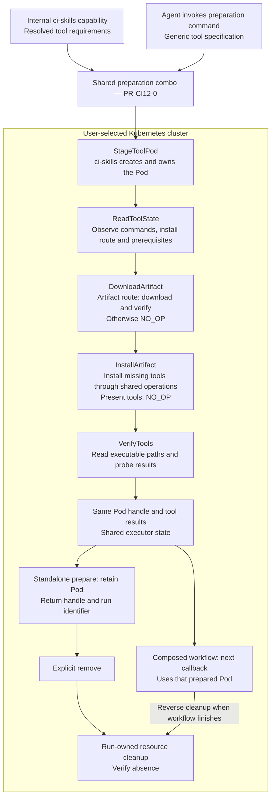
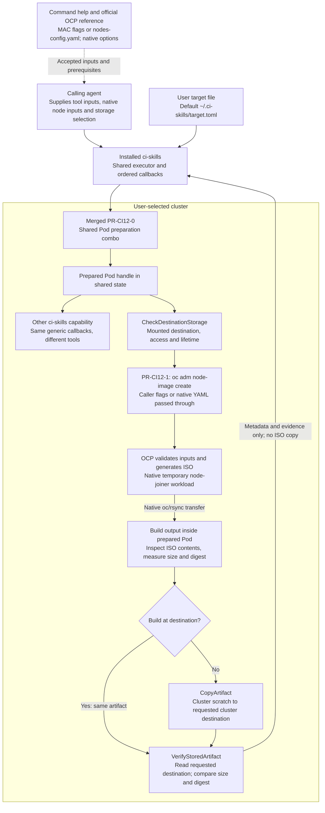
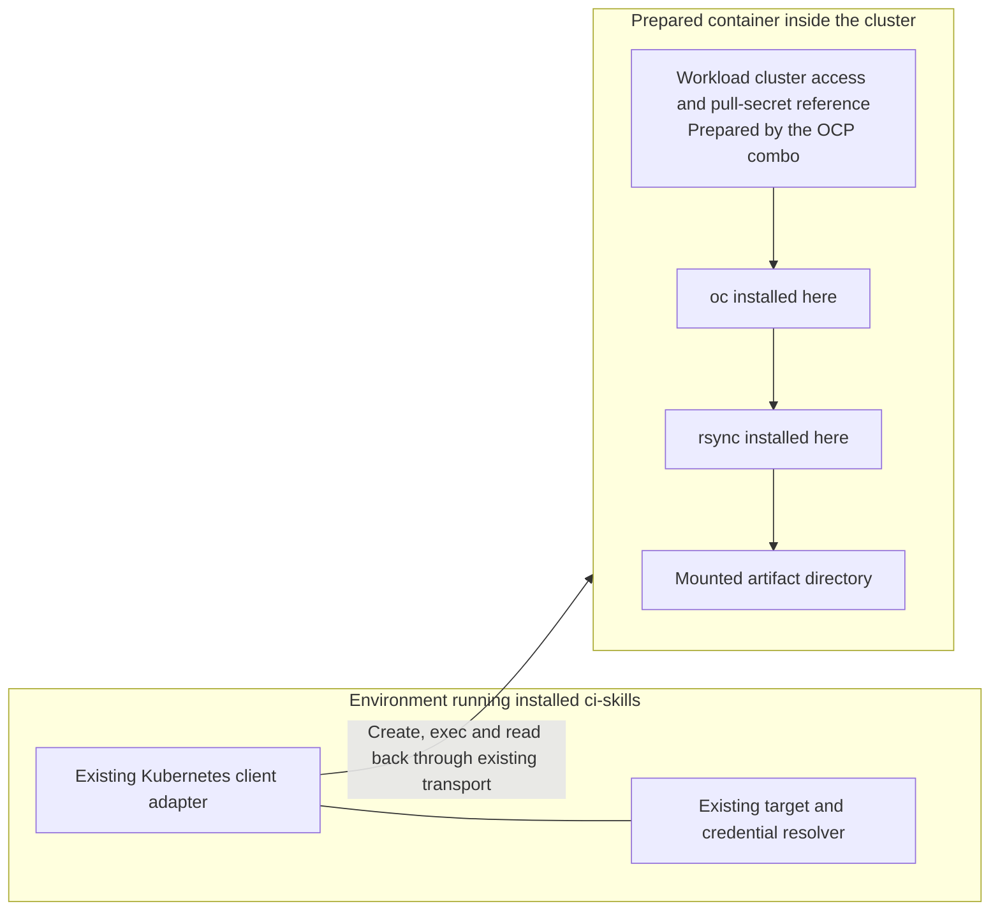

# IMPLEMENTED: CI12 — Prepare reusable cluster tooling, then build and use an OpenShift node ISO

- grounding: GROUNDED
- verification: PARTIALLY_VERIFIED
- planningStage: PLANNED

## Authority

Delivery status at main `788b9e9`, 2026-10-18: CI12.0 merged in [PR84](https://github.com/spyroot/ci-skills/pull/84),
CI12.1 in [PR85](https://github.com/spyroot/ci-skills/pull/85), and CI12.2 in
[PR90](https://github.com/spyroot/ci-skills/pull/90). Captured proof and its limits are under
[Live Smoke Evidence](#live-smoke-evidence); CSR/join acceptance remains mocked.

Delivery revision, 2026-10-17: reusable download/install operations and the ci-skills-owned tool Pod land as
PR-CI12-0 before the ISO combo. Native OCP MAC flags or a native YAML file are passed to `oc`; ci-skills
validates only its invocation and execution inputs, not the OCP document. ISO artifacts stay in caller-selected
or temporary cluster storage. CI12.1 checks that destination before building and reads the delivered ISO back
from it before reporting success; a build exit code or an ISO left only in scratch space is insufficient.
These operator-selected changes replace the earlier custom machine-schema and
workstation-fetch design in this phase. Existing join selection and its mocked-live exception remain.

The phase identity `CI12` continues the project's `CI01` to `CI11` numbering. The delivery revision above records
the operator-selected order. Earlier descriptions of a custom machine schema or local ISO fetch are superseded
by this revision; they are not alternate implementation paths. This document plans from:

- the owner's direction of 2026-10-15, recorded in [`docs/combos.md`](../combos.md) chain 2 ("OpenShift node
  from one spec"): a user who installed ci-skills asks their agent to onboard a new host, the agent passes one
  native node configuration, and the combo carries it to a joined, Ready node, ending with the served ISO removed.
  That catalogue's earlier custom-input details are superseded by this delivery revision;
- the owner's directions of 2026-10-15 on run-scoped names and agent-chosen locations, on CI12 checking the
  generated ISO against the specification with the supported tooling for the selected image, on the certificate
  approval and the node join being the one part of the chain that cannot be tested live (it needs a real host to
  join), so CSR handling and joining are mocked in GitHub tests without a required live pending-request read,
  and on adding no new gate and no separate plan; all recorded with their dates in the
  [ExecPlan's Decision Log](../exec-plans/completed/ci12-node-onboarding.md#decision-log); the catalogue does not yet
  carry them, so the Decision Log is the cited authority for `R-CI12-004` and `R-CI12-008`;
- the project motivation in [`README.md`](../../README.md#motivation): one combo instead of many hand-rolled
  calls, less context, the same result in one go;
- the tool catalogue [`CI11-TOOLS`](CI11-TOOLS.md), rows `ocp_machine.py` (owner `core/ocp_machines.py`, which
  compares the cluster's machines against a declared specification), `ocp_iso.py` (`core/ocp_iso.py`, verbs
  `rhcos-report`, `rhcos-download`, `rhcos-serve`, `node-build`, `node-serve`, `delete`, whose source builds and
  serves in one Pod and whose
  confirmed plan names the namespace, the ClusterRoleBinding, the pull-secret copy and the NodePort) and
  `ocp_csr.py` (`core/ocp_csr.py`), which already plan the machine comparison, the ISO verbs and certificate
  approval as single commands; none of the three modules exists at main `e5fb154`;
- the six-row evidence model in
  [`docs/exec-plans/active/gitlab-toolbelt-plan.md`](../exec-plans/active/gitlab-toolbelt-plan.md) block 7, which
  defines how a chain is proven, and the owner's rule that only a live-tested head merges;
- the [contribution guide](../contribution_guide.md), sections 2 (one atomic callback), 3 (compose a thin
  workflow; for a domain other than the toolbox, reuse that domain's action adapter) and 4 (declare the command in
  `core/catalog.py`, pair a result schema, regenerate `tools.json`), which every step below is written against;
- the shared command contract every installed command exposes through `--describe`: the shared options
  (`--binding`, `--json`, `--yaml`, `--human`, `--dry-run`, `--revision`, `--log-*`, `--run-id`, `--output-dir`),
  the status values and the exit codes, as `ci-skills/lib/python/core/catalog.py` declares them;
- the live-acceptance gate as it exists: the policy
  [`inventory/ci/live-acceptance.json`](../../inventory/ci/live-acceptance.json) and the checker
  [`tools/check_live_acceptance.py`](../../tools/check_live_acceptance.py); how this command's evidence enters that
  gate follows the existing registration contract; this document does not add a gate or silently widen it;
- the shared standards pinned by `standards-binding.yaml` at revision `56a579c`. The architecture and plan formats
  this document follows are taken from standards revision `cae52b2`, the `main` the owner named on 2026-10-15; the
  selected architecture format does not add or replace a pinned validation gate.

<!-- markdownlint-configure-file {"MD046": {"style": "fenced"}} -->
<!-- markdownlint-disable MD046 -->
<!-- architecture-map:v1 -->
    requirements:
      - id: R-CI12-001
        authority: [docs/combos.md, docs/phases/CI11-TOOLS.md, README.md]
        phaseId: CI12
        classification:
          grounding: GROUNDED
          implementation: IMPLEMENTED
          verification: VERIFIED
        deliverable: The calling agent selects native MAC-address flags or a nodes-config.yaml file. ci-skills validates its invocation wrapper and stages referenced native files unchanged; oc owns native input validation and errors. No custom OCP machine schema or mandatory machine-pool comparison is introduced.
        owner: ci-skills/lib/python/core/kubernetes/ocp_onboard.py
        preserve: [The target and credential resolver, the result envelope, the exit-code contract]
        prIds: [PR-CI12-1]
        gateIds: [G-CI12-STATIC, G-CI12-LIVE]
        evidence: [tests/acceptance/evidence/ocp-node-image-final/yaml/02-build.json, tests/acceptance/evidence/ocp-node-image-final/mac/02-build.json, tests/acceptance/evidence/ocp-node-image/rejection/02-result.json]
      - id: R-CI12-002
        authority: [docs/phases/CI11-TOOLS.md, docs/combos.md]
        phaseId: CI12
        classification:
          grounding: GROUNDED
          implementation: IMPLEMENTED
          verification: VERIFIED
        deliverable: The combo resolves release-compatible tooling through native cluster/provider data and prepares workload access plus the pull-secret file reference required by oc. Native oc fetches the matching release. Credentials never appear in reports.
        owner: ci-skills/lib/python/core/kubernetes/ocp_boot_image.py
        preserve: [Credential references never become values in reports or receipts]
        prIds: [PR-CI12-1]
        gateIds: [G-CI12-STATIC, G-CI12-LIVE]
        evidence: [tests/acceptance/evidence/ocp-node-image-final/yaml/02-build.json, tests/acceptance/evidence/ocp-node-image-final/mac/02-build.json]
      - id: R-CI12-003
        authority: [docs/phases/CI11-TOOLS.md, docs/combos.md]
        phaseId: CI12
        classification:
          grounding: GROUNDED
          implementation: IMPLEMENTED
          verification: VERIFIED
        deliverable: The ISO combo consumes the reusable prepared Pod and runs oc adm node-image create with caller-supplied native inputs. A shared storage callback checks the caller-selected destination; native oc/rsync writes there directly or writes to cluster scratch followed by a shared copy callback. Destination read-back proves the generated ISO is at the requested location with matching size and digest. The result returns evidence, never an ISO copy on the agent computer.
        owner: ci-skills/lib/python/core/kubernetes/ocp_iso.py
        preserve: [Native OCP behavior, Caller-selected storage, Metadata-only return to the agent]
        prIds: [PR-CI12-1]
        gateIds: [G-CI12-STATIC, G-CI12-LIVE]
        evidence: [tests/acceptance/evidence/ocp-node-image-final/yaml/02-build.json, tests/acceptance/evidence/ocp-node-image-final/mac/02-build.json, tests/acceptance/evidence/ocp-node-image/storage/callback-proof.json]
      - id: R-CI12-004
        authority: [docs/exec-plans/completed/ci12-node-onboarding.md]
        phaseId: CI12
        classification:
          grounding: GROUNDED
          implementation: IMPLEMENTED
          verification: VERIFIED
        deliverable: Run-owned resources use the existing run identifier and ResourceSet ownership. Successful standalone preparation or build retains its requested Pod or artifact until removal; failure cleans resources created by that run, except the sole verified ISO copy retained for recovery after a delivery failure. Remove verifies absence of owned resources and preserves caller-owned storage.
        owner: ci-skills/lib/python/core/kubernetes/run_scope.py
        preserve: [ResourceSet ownership semantics and its operation label; the executor's reverse cleanup order; the shared --run-id option's existing meaning as a correlation identifier]
        prIds: [PR-CI12-0, PR-CI12-1, PR-CI12-2]
        gateIds: [G-CI12-STATIC, G-CI12-LIVE]
        evidence: [tests/acceptance/evidence/ci12-tool-pod/12-remove.json, tests/acceptance/evidence/ocp-node-image-final/cleanup/scoped-readback.json, tests/acceptance/evidence/ocp-node-image/storage/callback-proof.json]
      - id: R-CI12-005
        authority: [docs/phases/CI11-TOOLS.md, docs/combos.md]
        phaseId: CI12
        classification:
          grounding: GROUNDED
          implementation: IMPLEMENTED
          verification: VERIFIED
        deliverable: A joining node's certificate signing requests are approved by a digest-stable selector (the exact node identity supplied for join and the two signers) over the pending list, re-collected until the joiner's serving request reads back approved and issued and the node reads Ready within a deadline; any other signer is reported, never approved.
        owner: ci-skills/lib/python/core/kubernetes/ocp_csr.py
        preserve: [Plan, apply and read-back with the shared APPLIED and NO_OP values]
        prIds: [PR-CI12-2]
        gateIds: [G-CI12-STATIC, G-CI12-LIVE]
        evidence: [https://github.com/spyroot/ci-skills/actions/runs/39133469190, tests/python/test_ocp_csr.py]
      - id: R-CI12-006
        authority: [docs/combos.md]
        phaseId: CI12
        classification:
          grounding: GROUNDED
          implementation: IMPLEMENTED
          verification: VERIFIED
        deliverable: After the user boots the host, the join combo consumes the run identifier and caller-selected node identity, drives the existing selected approval sequence, reads back Ready state and hostname/role, and releases the owned build scope. Hardware boot and node deletion remain outside this phase.
        owner: ci-skills/lib/python/core/kubernetes/ocp_join.py
        preserve: [No interaction with the host's management controller is implemented; the boot is the user's action; a joined node is never deleted]
        prIds: [PR-CI12-2]
        gateIds: [G-CI12-STATIC, G-CI12-LIVE]
        evidence: [https://github.com/spyroot/ci-skills/actions/runs/39133469190, tests/python/test_ocp_join.py]
      - id: R-CI12-007
        authority: [docs/combos.md, README.md, docs/contribution_guide.md]
        phaseId: CI12
        classification:
          grounding: GROUNDED
          implementation: IMPLEMENTED
          verification: VERIFIED
        deliverable: One thin main composes the callbacks through an OpenShift action adapter over WorkflowExecutor, declares the command in the catalogue source with a paired result schema and regenerates tools.json, routes in SKILL.md, and renders the shared report, so the agent invokes it like every other installed command and reads the same envelope.
        owner: ci-skills/bin/ocp_node_onboard.py
        preserve: [The shared options, status values and exit codes; --describe and --help work without credentials; the existing gate's required operations and freshness policy]
        prIds: [PR-CI12-1, PR-CI12-2]
        gateIds: [G-CI12-STATIC, G-CI12-LIVE, G-CI12-GATE]
        evidence: [tests/acceptance/evidence/ocp-node-image-final/03-proposition.json, tests/acceptance/evidence/ocp-node-image-final/06-help.txt, https://github.com/spyroot/ci-skills/actions/runs/39133469190]
      - id: R-CI12-008
        authority: [docs/exec-plans/completed/ci12-node-onboarding.md, docs/combos.md]
        phaseId: CI12
        classification:
          grounding: GROUNDED
          implementation: IMPLEMENTED
          verification: PARTIALLY_VERIFIED
        deliverable: The generated ISO is inspected inside the cluster with supported tooling for the selected image. Return artifact identity and actual embedded-configuration evidence so declared inputs can be checked against the generated result. This is output verification, not a replacement validator for native OCP input. Verify also consumes a cluster artifact reference.
        owner: ci-skills/lib/python/core/kubernetes/ocp_iso_verify.py
        preserve: [The ISO is inspected without rewriting it, No input-schema policy is introduced by output verification]
        prIds: [PR-CI12-1]
        gateIds: [G-CI12-STATIC, G-CI12-LIVE]
        evidence: [tests/acceptance/evidence/ocp-node-image-final/yaml/03-verify.json, tests/acceptance/evidence/ocp-node-image-final/mac/03-verify.json]
      - id: R-CI12-009
        authority: [This document's delivery revision of 2026-10-17, docs/contribution_guide.md]
        phaseId: CI12
        classification:
          grounding: GROUNDED
          implementation: IMPLEMENTED
          verification: VERIFIED
        deliverable: One shared implementation downloads and installs tools for internal Pod staging and agent-facing combos. The installed prepare/remove capability stages a ci-skills-owned Pod, reads tools back, exposes its live handle to another callback and verifies owned-resource cleanup without requiring an ISO build.
        owner: ci-skills/lib/python/core/kubernetes/tool_pod.py
        preserve: [Existing callback and state interfaces, Existing dependency schema, Toolbox behavior through the extracted implementation]
        prIds: [PR-CI12-0]
        gateIds: [G-CI12-STATIC, G-CI12-LIVE]
        evidence: [tests/acceptance/evidence/ci12-tool-pod/README.md]
    pullRequests:
      - id: PR-CI12-0
        requirementIds: [R-CI12-004, R-CI12-009]
        dependsOn: []
        waveId: W-CI12-0
        owns: [ci-skills/lib/python/core/tooling/, ci-skills/lib/python/core/toolbox.py, ci-skills/lib/python/core/kubernetes/tool_pod.py, ci-skills/lib/python/core/kubernetes/tool_pod_resources.py, ci-skills/lib/python/core/kubernetes/run_scope.py, ci-skills/lib/python/core/kubernetes/kubernetes.py, ci-skills/lib/bash/kubernetes/, ci-skills/bin/prepare_tool_pod.py, ci-skills/schemas/tool-pod.schema.json, ci-skills/schemas/results/tool-pod.schema.json, ci-skills/lib/python/core/catalog.py, ci-skills/tools.json, tests/python/test_tool_pod.py]
      - id: PR-CI12-1
        requirementIds: [R-CI12-001, R-CI12-002, R-CI12-003, R-CI12-004, R-CI12-007, R-CI12-008]
        dependsOn: [PR-CI12-0]
        waveId: W-CI12-1
        owns: [ci-skills/lib/python/core/action_modes.py, ci-skills/lib/python/core/gitlab/gitlab_action.py, ci-skills/lib/python/core/kubernetes/artifact_storage.py, ci-skills/lib/python/core/kubernetes/ocp_boot_image.py, ci-skills/lib/python/core/kubernetes/ocp_iso_verify.py, ci-skills/lib/python/core/kubernetes/ocp_iso.py, ci-skills/lib/python/core/kubernetes/ocp_onboard.py, ci-skills/lib/python/core/catalog.py, ci-skills/bin/ocp_node_onboard.py, ci-skills/schemas/artifact-destination.schema.json, ci-skills/schemas/results/ocp-node-onboard.schema.json, ci-skills/references/ocp-node-image.md, ci-skills/tools.json, ci-skills/SKILL.md, tests/python/test_run_scope.py, tests/python/test_action_modes.py, tests/python/test_ocp_node_onboard.py, tests/acceptance/receipts/, tests/acceptance/runner-tag/, tests/acceptance/runner-lifecycle/, .github/workflows/validate.yml, lib/bash/automation/bless.bash]
      - id: PR-CI12-2
        requirementIds: [R-CI12-005, R-CI12-006, R-CI12-007]
        dependsOn: [PR-CI12-1]
        waveId: W-CI12-2
        owns: [ci-skills/lib/python/core/kubernetes/ocp_csr.py, ci-skills/lib/python/core/kubernetes/ocp_join.py, ci-skills/lib/python/core/kubernetes/ocp_onboard.py, ci-skills/lib/python/core/catalog.py, ci-skills/bin/ocp_node_onboard.py, ci-skills/schemas/results/ocp-node-onboard.schema.json, ci-skills/tools.json, ci-skills/SKILL.md, tests/python/test_ocp_join.py, tests/acceptance/receipts/, tests/acceptance/runner-tag/, tests/acceptance/runner-lifecycle/]
    waves:
      - id: W-CI12-0
        prIds: [PR-CI12-0]
        after: []
        gateIds: [G-CI12-STATIC, G-CI12-LIVE, G-CI12-GATE]
      - id: W-CI12-1
        prIds: [PR-CI12-1]
        after: [W-CI12-0]
        gateIds: [G-CI12-STATIC, G-CI12-LIVE, G-CI12-GATE]
      - id: W-CI12-2
        prIds: [PR-CI12-2]
        after: [W-CI12-1]
        gateIds: [G-CI12-STATIC, G-CI12-LIVE, G-CI12-GATE]
    gates:
      - id: G-CI12-STATIC
        requirementIds: [R-CI12-001, R-CI12-002, R-CI12-003, R-CI12-004, R-CI12-005, R-CI12-006, R-CI12-007, R-CI12-008, R-CI12-009]
        command: ./bless.sh --all locally; the validate workflow on the pull request head (static gate, docstrings, manifests and schemas including the catalogue render check, unit tests, installer fixtures, endpoint gate, aggregated required result)
        environment: GitHub Actions on the pull request head; ruleset "protected" (id 25130553) on main requires the ci-skills/required status with the strict up-to-date policy
        enforcement: Existing
        evidence: [Exact head SHA, validate run URL, every job green, ci-skills/required SUCCESS, the new schemas listed in the metaschema step per the existing pairing rule, tools.json regenerated from the catalogue source]
      - id: G-CI12-LIVE
        requirementIds: [R-CI12-001, R-CI12-002, R-CI12-003, R-CI12-004, R-CI12-005, R-CI12-006, R-CI12-007, R-CI12-008, R-CI12-009]
        command: Installed tool preparation and ISO build/verify/remove operations described below; each live operation records actual evidence through the existing report writer
        environment: The user's live test cluster for preparation/build/verify/remove; CSR handling and join remain mocked in GitHub tests
        enforcement: Applicable installed live proof before merge; attach reports to the PR and reuse the existing committed-receipt contract without adding a new gate
        evidence: [Installed functional checksum, BEFORE and AFTER, Same-Pod tool consumption, Native input pass-through, In-cluster artifact inspection, Requested destination read-back, Source and destination size and digest, Verified retention and cleanup, CSR and join cases marked mocked]
      - id: G-CI12-GATE
        requirementIds: [R-CI12-007]
        command: python tools/check_live_acceptance.py --root . --json
        environment: The live_acceptance step of the validate job, on the committed receipts
        enforcement: Existing required operation set remains unchanged; attach new capability reports to the PR until their kinds are registered through the existing contract, and keep current required receipts valid for the functional checksum
        evidence: [Checker PASS on the pull request head after the README rerun refreshes the existing receipt set at this head's functional checksum]
<!-- /architecture-map:v1 -->
<!-- markdownlint-enable MD046 -->

## Consumer

A user installs ci-skills and creates their target file (default `~/.ci-skills/target.toml`) with Kubernetes
configuration. The existing resolver preserves project-before-user selection and relative credential paths.
Other providers remain optional. The calling agent supplies tool preparation inputs and the native OpenShift
node inputs. ci-skills prepares the execution environment and performs the native procedure; OpenShift owns
the interpretation and validation of its node configuration.

Delivery is ordered: reusable tool Pod first, ISO build second, node join third. The first delivery works and
has its own live proof without generating an ISO. The merged deliveries and captured acceptance are recorded
under [Live Smoke Evidence](#live-smoke-evidence); the requirements below retain their approved scope.

**Delivery boundary:** PR-CI12-0 contains the complete reusable preparation capability, its thin installed
command and its own live evidence. PR-CI12-1 starts from that merged capability. Schemas or helper functions
alone do not complete PR-CI12-0, and the ISO implementation must not absorb its downloader or installer.

## Motivation

Downloading and installing a tool is reusable independently of OpenShift. Preparing `oc` and `rsync` inside a
Pod must use the same generic dependency operations that another combo can use for different tools. An ISO
callback consumes that prepared environment; it must not also implement a downloader, package manager,
credential resolver, OCP input schema and workstation artifact transfer.

Internal use means any ci-skills workflow that pre-stages a Pod for subsequent work. Agent-facing use means an
installed capability, such as toolbox preparation or the ISO combo, composes the same operations. These are two
consumers of one implementation, not separate internal/external downloaders or installers.

The caller supplies the right values. ci-skills executes the correct native procedure and reports its actual
outcome. It neither invents missing MAC/network/disk values nor repairs a rejected native configuration.

## Diagram

The first diagram is the complete first delivery. Internal workflows and the installed preparation command
enter the same composition; ci-skills creates the Pod before any download or installation callback uses it.



The chain uses the dependency's declared route. Already-present tools skip installation; package-manager
routes use the same installation operation without a separate artifact download. `oc` and `rsync` are tool
entries for the OCP consumer, not special cases inside the generic preparation callbacks.

The second diagram shows the later ISO consumer and where its artifact remains:



The tool-location diagram makes the execution boundary explicit:



The agent environment uses the existing Kubernetes client. Tool download and installation happen inside the
selected Pod/container. `oc` and `rsync` used by `oc adm node-image create` run there. The generated ISO remains
in cluster storage. Installing these tools on the agent's computer is not part of this delivery.

## Implementation Plan

### Existing code and reuse boundary

The current source supplies these facilities. Extend them rather than introduce a parallel framework:

- **Responsibility:** Ordered callbacks and shared state
  - **Existing owner:** `core/abstract/`, `core/executor.py`, `core/delivery_state.py`
  - **Required work:** Preserve interfaces and serialization.

- **Responsibility:** Provider configuration and transport
  - **Existing owner:** `core/kubernetes/kubernetes.py`
  - **Required work:** Reuse `K8SAuth`, `K8SCallback`, `KubernetesService`; add shared Pod exec only if needed.

- **Responsibility:** Apply, read-back and cleanup ownership
  - **Existing owner:** `core/kubernetes/resources.py`
  - **Required work:** Reuse `ResourceSet`.

- **Responsibility:** Run naming and recovery
  - **Existing owner:** `core/kubernetes/run_scope.py` in the unmerged draft
  - **Required work:** Deliver the reusable scope in PR-CI12-0; do not grant a role merely to install tooling.

- **Responsibility:** Dependency types and installation operations
  - **Existing owner:** `core/toolbox.py`: `Dependency`, `LinuxInstall`
  - **Required work:** Extract shared tool operations; keep toolbox behavior using that same implementation.

- **Responsibility:** Dependency input contract
  - **Existing owner:** `ci-skills/schemas/toolchain-dependencies.schema.json`
  - **Required work:** Reference its existing dependency definition; do not copy it.

- **Responsibility:** CLI, modes, output and evidence
  - **Existing owner:** `core/cli.py`, `core/action_modes.py`, `core/portable.py`, `core/provenance.py`
  - **Required work:** Reuse current options, result envelope and functional checksum.

The `core/` paths above are relative to `ci-skills/lib/python/`. Existing `LinuxInstall._artifact_operation()`
combines download, checksum verification, installation and temporary-file removal for Containerfile output.
PR-CI12-0 separates those operations once so both toolbox rendering and in-Pod callbacks use them. Existing
package-manager handling and command-presence probes also stay shared. No OCP import belongs in this layer.
The generic layer builds the ordered dependency operations; the toolbox adapter renders them for a Containerfile
and the Kubernetes adapter executes those same operations in the prepared Pod.

### Phase CI12.0 — reusable tool Pod (PR-CI12-0)

**Observable delivery:** installed `prepare_tool_pod.py prepare` creates a usable Pod with the requested tools;
`remove` releases its owned resources. Another callback or a later invocation can consume its returned Pod
reference. The command and callbacks are delivered together with their input/result contracts and live proof.

Proposed implementation locations, all within the same feature PR:

```text
ci-skills/bin/prepare_tool_pod.py                 thin prepare/remove composition
ci-skills/lib/python/core/tooling/                existing dependency models and separated shared operations
ci-skills/lib/python/core/kubernetes/tool_pod.py   actions, Pod handle and atomic K8s callbacks
ci-skills/lib/python/core/kubernetes/tool_pod_resources.py
                                                Pod/input resource rendering if needed for decomposition
ci-skills/lib/bash/kubernetes/                   independently linted Pod-side scripts when needed
ci-skills/schemas/tool-pod.schema.json            ci-skills invocation wrapper; reuses dependency definition
ci-skills/schemas/results/tool-pod.schema.json    existing envelope with Pod/tool/read-back records
tests/python/test_tool_pod.py                    focused mocked behavior in existing GitHub test job
```

The standalone invocation wrapper contains `image` (the selected execution image) and `dependencies` (the
existing dependency objects). An internal workflow supplies the same typed inputs from its action or provider
discovery; it does not ask the calling agent to repeat already-resolved values. ci-skills owns the Pod manifest,
creation, readiness and cleanup. The caller does not supply a Pod YAML just to use this capability.

`ci-skills-pod` names the internal role, not a global fixed Pod name. The shared run scope supplies generated
names and ownership labels. An internal consumer can pass an existing namespace in its typed Pod action;
`RunScope.new(namespace=...)` reads and uses that namespace without claiming ownership of it. With no namespace
selection, the scope creates and owns a generated namespace. The Pod and other resources created by the run
remain run-owned in either case. `remove` deletes only those resources, never a selected existing namespace.
A later run lookup resolves labeled resources and observed ownership from the API, rather than deriving an
existing namespace name from the run identifier. `StageToolPod` renders the selected image, container command
and required volume mounts through the Kubernetes resource owner. Downstream callbacks consume its live Pod
handle from the same
state. Kubernetes validates the resulting native resource; no Kubernetes schema is copied into ci-skills.
The dependency schema remains ours because it describes our installation inputs, not OCP inputs.

The execution image must support the preparation route: a shell and a long-lived command keep the selected
container available for exec. Use the existing shared script mechanism for that process. `ReadToolState` reads
the image's OS/package manager, executable availability and effective write permissions before installing.
For the existing artifact route, inspect `curl` and `sha256sum`, plus `tar` or the selected installer when that
route needs them; package routes inspect their native manager. Verify the declared destination is writable.
Report the actual missing prerequisite or permission with the selected route; do not assume root access,
silently switch images or add an OCP-specific bootstrap installer.

Reference `toolchain-dependencies.schema.json#/$defs/dependency` for each dependency. Preserve its `probe` field
when extracting the typed model; use the declared probe to read a tool's version rather than assuming every
executable accepts the same version flag. Reject no native OCP fields here: none are part of this input.

The caller flow is `prepare_tool_pod.py prepare --spec TOOL_POD_INPUT --dry-run`, then the same command with
`--apply --confirm-plan DIGEST --json`. `TOOL_POD_INPUT` is the wrapper described above; `DIGEST` is returned by
the existing planning path. The result includes the run identifier, Pod handle and tool observations. A later
consumer supplies that returned `--run-id` to resolve the same live scope; it re-probes required tools before
using the selected container. The identifier correlates the scope, not its current readiness.
`prepare_tool_pod.py remove --run-id RUN_ID` uses the existing plan/apply
confirmation path and verifies absence. Every mode also uses the existing shared logging and output options.

For each dependency, the existing input already names its commands and either native package names or a Linux
installation route. Artifact routes carry source URL, expected checksum and installation destination. Package
routes use the package manager actually available in the Pod. Values come from caller inputs or a provider's
published release metadata; do not pin the smoke machine's values in production code. Already-present tools
are observed and reused. A missing package or failed install is reported with the underlying tool error.

Use a concrete `PodHandle(namespace, name, uid, container)` and `ArtifactHandle(pod, path, sha256, size)`.
Actions inherit `SkillAction`; Kubernetes callbacks inherit `K8SCallback[ActionT]`. Their shared state retains
these handles, tool observations and the existing results. Collections initialize empty; hooks return
`SkillResult`, including `{}` for unused hooks. A producer assigns its concrete handle before a consumer runs;
there is no nullable callback action or result and no second state/serialization mechanism.

- **Callback:** `StageToolPod`
  - **Input and one responsibility:** Selected image and workflow execution/storage requirements; render/create through
    `ResourceSet`, wait for usable container.
  - **Shared result and ownership:** Exact Pod UID/container; owns created Pod and staging resources.

- **Callback:** `ReadToolState`
  - **Input and one responsibility:** Declared dependencies and Pod handle; read installed commands and available
    package manager.
  - **Shared result and ownership:** Observed commands and installation routes; no installation.

- **Callback:** `DownloadArtifact`
  - **Input and one responsibility:** Artifact source, checksum and destination inside the Pod; transfer and verify.
  - **Shared result and ownership:** Artifact handle; owns only its staging download. No installation or OCP behavior.

- **Callback:** `InstallArtifact`
  - **Input and one responsibility:** Dependency and downloaded artifact, or native package route; install only when
    needed.
  - **Shared result and ownership:** Installed paths and operation outcome; no independent downloader.

- **Callback:** `VerifyTools`
  - **Input and one responsibility:** Declared commands and prepared Pod; execute probes and read back the result.
  - **Shared result and ownership:** Required-versus-observed tools and versions for that Pod/container.

- **Callback:** `RemoveToolPod`
  - **Input and one responsibility:** Returned run identifier; remove the run-owned resources through shared cleanup.
  - **Shared result and ownership:** Verified absence; repeated removal is `NO_OP`.

The small composition helper expands the selected dependencies in order. An artifact dependency uses
`DownloadArtifact → InstallArtifact`; a native package route uses `InstallArtifact`, whose package manager performs its
normal package retrieval. A consumer may omit `InstallArtifact`, but `DownloadArtifact` requires the live
`PodHandle` already produced by `StageToolPod` in shared state. The shared operations know nothing
about ISO files, host MAC addresses, node roles, GitLab or Harbor. Kubernetes transport belongs only in the
Kubernetes adapter, so toolbox rendering consumes the same installation operations without creating a Pod.

```python
# Compose only; hooks perform provider reads, creation and installation.
scope = RunScope.new(namespace=pod_action.namespace, run_id=pod_action.run_id)
callbacks = [K8SAuth(target)]
if pod_action.run_id is not None:
    callbacks.append(ResolveRunScopes(ResolveRunScopeAction(pod_action.run_id)))
callbacks.extend([
    OpenRunScope(RunScopeAction(scope)),
    StageToolPod(pod_action),
    ReadToolState(tools_action),
])
callbacks.extend(tool_callbacks(tools_action))
callbacks.append(VerifyTools(tools_action))
return WorkflowExecutor(context=state, callbacks=Callbacks(callbacks)).run()
```

The removal chain is `K8SAuth → ResolveRunScopes → RemoveToolPod → RemoveScope`: the tool callback removes
its Pod and ConfigMap; shared scope removal handles only owned namespaces. The
[shared scope interface](../exec-plans/completed/ci12-node-onboarding.md#interfaces-and-dependencies) defines
lookup, ambiguity and recovery behavior for both preparation and later consumers.

Configuration checks during binding concern Kubernetes only. Downloads are not performed by `read_config()` or
`is_configured()`. Preparation uses the existing plan/confirm/apply path. The same executor can run downstream
callbacks before reverse cleanup. It stages the execution Pod once; subsequent callbacks reuse the state handle
instead of creating a private Pod or repeating download/install logic. A successful standalone `prepare`
deliberately retains its requested Pod and returns its run identifier; `remove` is its recovery/cleanup
operation. Shared state starts with an empty set of retained resource identities. Before reverse cleanup,
successful standalone preparation records the returned Pod and any owned resources needed to keep it usable
in that set. `StageToolPod.cleanup` and scope cleanup skip exactly those retained identities; other owned
resources are removed normally. Explicit `remove` releases retention and removes the owned scope. The executor's
hook order stays unchanged. Failure before preparation succeeds removes resources created by that run. A later
command resolves the run from live resources and checks the Pod
UID and container, then runs the required tool probes again. A container restart can lose installed tools
without changing the Pod UID, so an old receipt never substitutes for that read-back.

Required delivery proof, using the installed candidate against the configured cluster:

1. Capture BEFORE: selected image/tool availability and absence of the run-owned Pod.
2. Exercise a declared missing-tool route so the download/install callbacks actually run; record artifact digest
   and installation result inside the Pod. Also exercise the existing-tool `NO_OP` route.
3. Prepare `oc` and `rsync`, then independently read their paths and versions in the same Pod/container.
4. A separate consumer callback uses that Pod: copy a small fixture with `rsync` and verify the copied bytes.
   Tool versions alone do not establish the reusable execution claim.
5. Capture AFTER, remove the owned resources, and verify absence. Repeat removal is `NO_OP`.

GitHub mocked tests cover command order, shared-state identity, no duplicate installation, failed transfer or
checksum, native package-manager errors, restarted-container re-probing, downstream callbacks not running after
failure, and cleanup. Existing
toolbox tests must continue to pass after extraction. Tests, schemas, help/catalog entries and scripts accompany
this runnable capability; they are not separate forward PRs. No ISO build or node join is required for PR-CI12-0.

The extraction is incomplete if toolbox rendering and the Pod callbacks retain separate transfer/checksum or
installation algorithms. Their focused tests exercise the same extracted operations through both consumers.

### Phase CI12.1 — native OCP ISO combo (PR-CI12-1)

Depends on merged PR-CI12-0 and its live evidence. `ocp_node_onboard.py build` composes the prepared tool Pod with
the native OCP operation. It must not restore the earlier custom `MachineSpec` validator or a downloader inside
the OCP build callback. OCP-specific callbacks belong under `core/kubernetes/ocp_*.py`.

#### Caller input and schema boundary

The ci-skills invocation schema describes our execution/storage wrapper and native input selection.
`--destination FILE` reads the destination wrapper below. `--tool-pod-spec FILE` optionally overrides the
CI12.0 tool inputs. Without that override, the internal consumer resolves compatible tool inputs through the
provider/release discovery in `core/kubernetes/ocp_boot_image.py` (R-CI12-002). That ISO adapter resolves the
selected cluster release into CI12.0's typed image and dependency inputs; it does not ask the agent to repeat
already-resolved values. An unresolved
tool prerequisite is reported before mutation, not replaced with an invented image or download URL.
Native node input uses one of these routes:

- **Native path:** Single node with flags
  - **Caller supplies:** `--mac-address MAC`; optional `--network-config-path FILE`
  - **What ci-skills does:** Preserve native argument values; stage the referenced file unchanged and adjust only its
    execution path.

- **Native path:** Native node configuration
  - **Caller supplies:** `--spec FILE`, a `nodes-config.yaml` file
  - **What ci-skills does:** Stage the exact bytes as `nodes-config.yaml` in the Pod's asset directory and invoke `oc`
    there.

The calling agent owns the correct MAC, NIC/network settings, disk hints and any other native values. Help must
say this explicitly and link the native reference. Pass supported argument values as tokens without shell
interpolation. The combo supplies its cluster asset-directory and credential-file paths; this specification
does not introduce an arbitrary native flag-forwarding interface. No copied MAC regex, hostname rules,
NMState schema, disk allowlist, required role/architecture policy or per-host JSON model is introduced.

ci-skills checks its own invocation shape, that a named file can be read/staged and that its execution/storage
references are usable. Before provider execution it does not parse, normalize, rewrite or validate the OCP/NMState
YAML. Invalid native input reaches `oc`; a nonzero result returns the provider's sanitized error and exit status
through the shared report. After a successful build, output verification compares supported caller fields with
their native embedded representations and binds the non-secret comparison outcome to the ISO digest. Unsupported
or unavailable mappings remain explicitly unverified. The caller corrects rejected or mismatched values and invokes
again. Missing MAC in the flags route is a usage error, not a reason to invent a value. The file route does not
require a redundant MAC flag.

The result schema describes our evidence. It is not a schema for an OCP node or an Ignition document.
Do not deliver `machine-spec.schema.json` or a custom native YAML loader for this flow. A separate machine-pool
comparison capability is not an unconditional preflight for building an ISO.

#### Agent discovery control check

The user-visible goal is simple: build an ISO from the caller's native node specification and save it where the
caller asks. Booting that ISO is the caller's decision. `--help` and `--describe` must expose the input choices,
required destination and a pointer to the installed `references/ocp-node-image.md`, delivered in CI12.1. That
reference owns the worked input/output examples and links the official OCP procedure for the selected version.
Other skill docs point there instead of duplicating a second native field specification.

The help summary must convey these three inputs in one short view:

```text
Build an OpenShift node ISO inside your cluster and verify it at your chosen destination.
Node input: --spec nodes-config.yaml OR --mac-address MAC [--network-config-path FILE]
Save to:    --destination destination.json (cluster storage; temporary storage is explicit)
Examples:   references/ocp-node-image.md (native YAML, destination, build/verify/remove)
```

The reference includes this illustrative native `nodes-config.yaml`. Replace the node name, NIC/MAC, disk and
network settings with the intended host's values; this is an example, not a ci-skills schema or defaults. The
interface mapping and network definition refer to the same NIC, as the
[OCP cluster configuration reference](https://docs.redhat.com/en/documentation/openshift_container_platform/4.19/html/nodes/working-with-nodes)
requires. For the single-MAC flags route, show that separate native invocation too.

```yaml
hosts:
  - hostname: worker-01
    rootDeviceHints:
      deviceName: /dev/sda
    interfaces:
      - name: ens3
        macAddress: "02:00:00:10:00:01"
    networkConfig:
      interfaces:
        - name: ens3
          type: ethernet
          state: up
          mac-address: "02:00:00:10:00:01"
          mtu: 9000
          ipv4:
            enabled: true
            dhcp: true
          ipv6:
            enabled: false
```

Acceptance of discovery: an agent starting with only the installed skill can find that example, identify which
host/MAC and destination values it still needs, ask the user for those values, and construct a plan without
reading implementation source. Missing destination is an actionable usage result; the command does not choose
storage for the user. Native YAML is passed unchanged to OCP; native rejection tells the agent what to correct.
The final report confirms where the actual ISO was saved. This is part of existing command/help and live
acceptance, not another gate.

#### Destination input and lifetime

`--destination FILE` names a ci-skills JSON document describing cluster storage. It is separate from `--spec`,
which remains the untouched native OCP YAML. The destination is explicit: the caller chooses existing storage
or temporary storage; there is no implicit laptop path or substitution when a selected destination fails.

This planned input has five required fields:

| Field | Meaning |
| --- | --- |
| `namespace` | Namespace for the prepared Pod and any referenced namespaced volume. |
| `volumeSource` | Native Kubernetes VolumeSource passed to the Pod API; Kubernetes validates it. |
| `mountPath` | Absolute container path at which the selected volume is mounted. |
| `artifactPath` | Exact final ISO path within that mount, including its filename. |
| `buildOutput` | `destination` writes there directly; `scratch` builds in run-owned cluster scratch first. |

The ci-skills wrapper validates these fields and their path relationship. It does not clone the Kubernetes
volume schema or restrict the caller to a new storage-provider allowlist. The prepared Pod declares this mount
before creation; storage checking does not try to add a volume to a running Pod. Existing namespaces, PVCs and
other caller resources remain caller-owned. Ownership is derived from the shared resource set, never from an
input claiming permission to delete existing storage.

`CheckDestinationStorage` runs before the native build, in the prepared container. Its checks answer:

1. Which protocol and mounted volume actually back the requested path? Confirm the selected mount, not a
   container-directory fallback, and record its protocol/access route and observed identity.
2. Can this workload write there? Write and read a small uniquely named run-owned probe, then remove only that
   probe. A declared RWX access mode alone is not proof of a successful write.
3. Does the exact output path already contain a file? Report a conflict before building rather than overwrite
   unrelated data; the caller decides how to resolve the destination.

Return these observations, the selected path and lifetime through the typed `StorageHandle`. Available capacity
may be reported for the caller's decision; do not invent a fixed ISO-size threshold. Reuse existing Kubernetes
transport, storage inventory and resource ownership. API rejection, a read-only mount or failed I/O returns an
actionable result before the build starts. Later storage failures are reported by the operation encountering them.

Persistent storage keeps the final ISO after the tool Pod is removed. For an `emptyDir` destination, successful
build retains the prepared Pod until explicit removal. The result states that Pod removal or loss destroys the
ISO; it must not describe `emptyDir` as durable storage. Caller-owned artifact deletion is outside scope removal.
`VerifyNodeImage` records retention of the verified source and its backing resources in shared state before
another callback can fail. After successful copy and destination verification, `VerifyStoredArtifact` releases
scratch retention; it retains final Pod-backed output when that is the selected destination. On copy/read-back
failure, reverse cleanup therefore preserves the sole verified source and reports its recovery handle. Explicit
`remove` releases retained run-owned resources. Caller-owned storage never enters the deletion set.

#### Concrete caller examples

These are planned installed-command examples, not claims that CI12.1 is already implemented. This illustrative
destination uses an existing PVC named `iso-store` in namespace `node-build`; those names are examples, not defaults.

```json
{
  "namespace": "node-build",
  "volumeSource": {"persistentVolumeClaim": {"claimName": "iso-store"}},
  "mountPath": "/mnt/iso",
  "artifactPath": "/mnt/iso/run-42/node.x86_64.iso",
  "buildOutput": "destination"
}
```

Save that wrapper as `destination.json`. The agent discovers the command with `--help`/`--describe`, supplies
MAC or native YAML and destination, then uses the existing plan/confirmation flow with resolved tools:

```bash
conda run -n ci-skills python "$CI_SKILLS_ROOT/bin/ocp_node_onboard.py" build \
  --destination destination.json \
  --mac-address 02:00:00:10:00:01 --live-plan --json

conda run -n ci-skills python "$CI_SKILLS_ROOT/bin/ocp_node_onboard.py" build \
  --destination destination.json \
  --mac-address 02:00:00:10:00:01 \
  --apply --confirm-plan "$PLAN_DIGEST" --json
```

Use `CI_SKILLS_ROOT` and the `ci-skills` conda environment established by the
[installation steps](../../README.md#install-and-first-run). `PLAN_DIGEST` is the digest returned by that live
plan. It binds the supplied input contents, destination and target using the existing action contract. The MAC is
illustrative; the caller must supply the joining host's actual NIC address. For the native YAML route, replace
`--mac-address ...` with `--spec nodes-config.yaml` in both invocations; ci-skills stages that file unchanged.
The tool Pod uses the caller's Kubernetes target through the existing resolver; no GitLab, Harbor or GitHub
configuration is needed.

**Optional tool override when discovery cannot resolve inputs.** Add `--tool-pod-spec tool-pod.json` to both
plan and apply. The file uses the CI12.0 contract. For a selected image already containing the tools, its complete
shape is:

```bash
jq -n --arg image "$TOOL_IMAGE" '{
  image: $image,
  dependencies: [
    {name: "oc", commands: ["oc"], probe: ["oc", "version", "--client"]},
    {name: "rsync", commands: ["rsync"], probe: ["rsync", "--version"]},
    {name: "coreos-installer", commands: ["coreos-installer"],
     probe: ["coreos-installer", "--version"]}
  ]
}' > tool-pod.json
```

Set `TOOL_IMAGE` to the selected image reference before rendering this input. The example uses `coreos-installer`
for native ISO inspection; verify its support for the selected image. Missing tools use the dependency object's
existing package or artifact installation fields described in CI12.0, not a second OCP installer.

For **scratch then copy**, use the same destination document with `"buildOutput": "scratch"`. The ISO is built
and inspected on run-owned storage, copied to `/mnt/iso/run-42/node.x86_64.iso`, then read back there. Both paths
produce the same caller-visible destination. Direct output skips the copy callback.

For **temporary final storage**, replace `volumeSource` with `{"emptyDir": {}}` and use `buildOutput: destination`.
The same `artifactPath` is now a path in the retained Pod, not in `iso-store`. The result names the Pod UID,
container, volume and path, with lifetime `until Pod removal or loss`. The caller can consume that mounted
artifact through another in-cluster callback before calling `remove`; no local ISO download is added.

`verify --run-id RUN_ID` resolves that run's artifact reference from its live labeled resources and performs
cluster-side inspection. `remove --run-id RUN_ID` uses the same scope lookup and the existing plan/apply flow:

```bash
conda run -n ci-skills python "$CI_SKILLS_ROOT/bin/ocp_node_onboard.py" \
  verify --run-id "$RUN_ID" --json
conda run -n ci-skills python "$CI_SKILLS_ROOT/bin/ocp_node_onboard.py" \
  remove --run-id "$RUN_ID" --live-plan --json
conda run -n ci-skills python "$CI_SKILLS_ROOT/bin/ocp_node_onboard.py" \
  remove --run-id "$RUN_ID" --apply --confirm-plan "$REMOVE_PLAN_DIGEST" --json
```

`RUN_ID` is returned by build; `REMOVE_PLAN_DIGEST` is returned by the removal plan. The live run resources carry
only non-secret artifact location/ownership metadata needed to resolve this handle. For persistent output,
removal reads the delivered ISO back before and after releasing the build Pod, using an owned temporary reader
if necessary, then cleans that reader. For temporary output it verifies removal of the backing Pod. Repeated
scope removal is `NO_OP`; it does not require an already-deleted run record. No hidden local state file is used.

The report always returns a typed cluster artifact reference: observed namespace, Pod UID/container when
applicable, volume identity, exact artifact path, byte size, SHA-256, delivery route and lifetime. A caller that
requests serving also receives the address read back from its selected serving resources. Do not claim a private
Pod path is a boot URL. The caller chooses how its boot consumer accesses the retained artifact.

#### Native procedure and callback composition

Use the [OCP 4.19 node-image procedure](https://docs.redhat.com/en/documentation/openshift_container_platform/4.19/html/nodes/working-with-nodes),
sections 6.4.1–6.4.3, as the provider reference. Ship a short pointer and both input examples in the installed
skill's references and link it from command discovery; do not copy its field table as a ci-skills specification.
The release-compatible `oc` help is the native option reference. Record the selected tool/release versions.

1. Resolve Kubernetes target/access using the existing resolver and `K8SAuth`.
2. Prepare the tool Pod through CI12.0 with the selected destination mount and optional scratch mount. Read back
   `oc`, `rsync` and the selected inspection tools inside its container; check destination storage there.
3. Establish workload cluster access and resolve the pull secret through existing provider facilities.
   Give `oc` a registry-config file or `REGISTRY_AUTH_FILE` reference; never put credential values in the report.
   Caller kubeconfig authentication does not establish the Pod's permissions. Read back the selected workload
   identity's required native operations. The workload credential/role choice belongs to the ISO delivery;
   generic preparation neither grants `cluster-admin` nor treats a running Pod as permission to grant it.
4. Stage the caller's native input unchanged in the build asset directory. For direct output, derive `--dir`
   and `--output-name` from the selected artifact path. For scratch output, those paths refer to run-owned
   cluster scratch; the final destination stays unchanged. Track staged native files as run-owned artifacts.
   A different pre-existing `nodes-config.yaml` at that path is a staging conflict, reported before building;
   identical existing bytes can be reused without claiming ownership. Remove only files staged by this run on
   success, failure or explicit removal, preserving the final ISO and caller files.
5. Run the native command in the prepared Pod:

   ```bash
   oc adm node-image create --mac-address="$MAC_ADDRESS" \
     --dir="$ASSET_DIRECTORY" --output-name="$ISO_FILENAME"
   ```

   For the file route, omit `--mac-address` and place the supplied `nodes-config.yaml` in that directory.
   `--registry-config` or `REGISTRY_AUTH_FILE` supplies the resolved pull-secret file. The optional native network
   file uses `--network-config-path` with its staged path. The native command performs its own workload creation
   and rsync transfer into this Pod's asset directory.
6. Inspect the generated ISO with supported native tooling and record actual embedded-configuration evidence,
   size and digest. This verifies output; it does not introduce an OCP input validator.
7. If scratch was selected, copy the verified ISO to the exact requested cluster destination. Read the final
   destination back and compare size and SHA-256 with the verified build output. For direct output, use the
   same observed artifact; no redundant copy or repeated ISO-content inspection is needed.
8. Return the final location, lifetime, run identifier and evidence. Release build scratch only after verified
   delivery. Retain the requested final artifact for the caller. No ISO is transferred to the agent computer.

The thin combo composes these responsibilities in order:

```text
CI12.0 tool preparation (destination mount declared before Pod creation)
  -> CheckDestinationStorage
  -> ResolvePullSecret
  -> StageNodeInput
  -> BuildNodeImage
  -> VerifyNodeImage
  -> CopyArtifact             [only when build output differs from destination]
  -> VerifyStoredArtifact
  -> optional requested serving
```

`CheckDestinationStorage`, `CopyArtifact` and `VerifyStoredArtifact` are reusable Kubernetes storage callbacks
in `core/kubernetes/artifact_storage.py`, delivered with CI12.1 and usable independently of OCP. Extend existing
storage inventory, transport and `ResourceSet` facilities; do not duplicate them. `ResolvePullSecret` uses shared
credential facilities and remains reusable. OCP-specific staging, build and embedded-image verification stay in
`core/kubernetes/ocp_*.py`. `BuildNodeImage` only executes/waits for the provider operation; it does not install
tools, validate native YAML, copy the final artifact, serve it or approve certificates.

Shared typed state carries the prepared Pod, storage handle, build artifact and delivered artifact. A successful
build result requires verified delivery, not just successful generation. `verify` consumes the cluster artifact
reference and inspects it there. `remove` uses existing run ownership: it removes owned temporary resources,
reads their absence back, and preserves the caller's destination storage and delivered ISO. Workload credentials
and permissions remain the ISO implementation's explicit native prerequisite; storage selection does not grant
any cluster rights or change credential resolution.

### Phase CI12.2 — monitor and join (PR-CI12-2)

This remains the existing separate join delivery, after PR-CI12-1. The user boots the host from the cluster-held
ISO. The command consumes the run identifier and caller-selected node identity, monitors the join, approves the
selected node's certificate requests, reads back Ready state and releases the owned build scope. It never boots
hardware or deletes a joined node.

Use the native `oc adm node-image monitor --ip-addresses ...` and `oc adm certificate approve ...` operations.
When reverse DNS is unavailable, the native monitor can skip its CSR checks; use an explicit CSR read for this
production path. Preserve the existing hostname/two-signer selection and bounded client-then-serving approval
loop; never widen it to every pending request. Repeat join of an already Ready node is `NO_OP`. Keep these in
`WaitForJoiner`, `ApproveJoinRequests` and `ReadNodeState`, with shared scope removal last.

CSR handling and node joining remain the operator's sole live-test exception: they require a real joining host,
so their acceptance is mocked on GitHub, including missing reverse DNS, the two-request sequence, unrelated
requests, expiry and already-Ready repetition. No live CSR read or approval is required as acceptance evidence.
This exception does not cover tool preparation, ISO generation, artifact inspection or cleanup.

## PR Order

- **Phase / PR:** CI12.0 / PR-CI12-0
  - **Runnable delivery:** `prepare_tool_pod.py prepare/remove` and shared download/install callbacks
  - **Dependency:** Existing framework
  - **Acceptance before advancing:** Installed live tool preparation, same-Pod consumer, no-op and cleanup.

- **Phase / PR:** CI12.1 / PR-CI12-1
  - **Runnable delivery:** `ocp_node_onboard.py build/verify/remove` using native OCP inputs
  - **Dependency:** PR-CI12-0
  - **Acceptance before advancing:** Live MAC and native-file routes, ISO inspection, exact destination read-back
    for direct and copied output, retained temporary output, and ownership-aware cleanup.

- **Phase / PR:** CI12.2 / PR-CI12-2
  - **Runnable delivery:** `ocp_node_onboard.py join`
  - **Dependency:** PR-CI12-1
  - **Acceptance before advancing:** GitHub mocked CSR/join exception; preserve prior live evidence when functional
    checksum is unchanged.

Each PR includes its production command, shared callbacks, help/discovery, own input/result schema where needed,
focused tests and applicable live evidence. The command catalogue in `core/catalog.py` remains the single source;
regenerate `tools.json`. Unimplemented verbs stay unavailable. Do not create schema-only or gate-only deliveries.

## Gates

Reuse `G-CI12-STATIC`, `G-CI12-LIVE` and `G-CI12-GATE` below and the existing GitHub validation jobs. No new gate,
workflow job, credential policy or target requirement is introduced by this delivery split. GitHub runs static
checks and mocked tests. Live proof runs the installed candidate against the user's selected test target.

The installer package checksum remains separate from functional evidence. The existing functional checksum over
`ci-skills/bin`, `lib` and `schemas` binds live reports to executed behavior. Documentation/test-only changes do
not require live reruns. After a functional correction, review the corrected candidate and refresh the affected
proof before merge under the existing acceptance rules; never fabricate or hand-edit a successful receipt.

The existing committed-receipt gate remains unchanged. Until a Kubernetes receipt kind is registered through its
existing contract, attach these capability reports to the PR rather than placing an unsupported kind in a declared
GitLab receipt directory. Existing required evidence remains required. This is not permission to bypass a gate.

## Live Smoke Evidence

[Tool Pod evidence](../../tests/acceptance/evidence/ci12-tool-pod/README.md) records preparation, reuse and removal.
[Final ISO evidence](../../tests/acceptance/evidence/ocp-node-image-final/README.md) records MAC/direct and
YAML/copied output, independent inspection and cleanup with the shared PVC preserved. Earlier
[storage callbacks](../../tests/acceptance/evidence/ocp-node-image/storage/callback-proof.json) and
[native rejection](../../tests/acceptance/evidence/ocp-node-image/rejection/02-result.json) retain their own revision.
[PR90 validation](https://github.com/spyroot/ci-skills/actions/runs/39133469190) covers mocked CSR/join.
ISO inspection observed hostname, MACs and NIC MTUs; root-device hints were digest-only and role was unobserved.
These captures identify their tested revisions; they do not claim a fresh run of the current complete package.

Required evidence: PR-CI12-0 produces linked BEFORE/AFTER, download/install/read-back, downstream consumption
and cleanup records for one actual prepared Pod. PR-CI12-1 exercises both native input routes and records provider
execution, native inspection output and requested-versus-observed destination evidence. Cover direct output,
scratch-to-destination transfer and explicit temporary final storage without rebuilding for unrelated docs edits.
For copied output, read source and destination sizes/digests independently and show equality; for direct output,
record the one actual destination observation. Read persistent output back after build-scope cleanup. For temporary
output, prove it remains consumable until removal, then verify Pod/artifact absence. A failed destination check
must show that native build never started; a failed transfer must expose the retained source recovery handle.
A bad native input case must reach `oc` and return its rejection to the caller;
it must not be intercepted by an invented OCP validator.

Use existing portable reports and the shared `--log-level`, `--log-format` and `--log-file` options. Trace artifacts
identify the actual operations and outcomes without credentials. Reports carry the installed functional checksum,
run identifier, target identity and evidence pointers. For the positive persistent-storage test in this delivery,
use the operator-selected existing NFS export, which exposes a PVC containing shared data. Resolve the export
and backing claim from live configuration; no lab address or path becomes a product default. The test caller
selects an isolated run-specific subdirectory and exact ISO path on that export. Preserve the NFS service/export,
backing PVC/PV and every pre-existing file. Limit probes and staged-file cleanup to identities created by the run;
never recursively clean the shared export. Keep the delivered ISO available and read it back after build-Pod
removal. Native acceptance/ISO inspection is distinct from successful node joining; CSR/join rows are marked as
mocked. The captures above do not establish semantic verification of every native input field.

## End-to-End Test

Install the candidate as a user would. Supply only Kubernetes configuration in the selected target file. Prepare
the tools in a Pod and prove a different callback can use that same Pod; remove it and verify absence. Then run the
ISO combo with a real caller MAC and native network input for the test environment, keeping the ISO in cluster
storage. Inspect the ISO and read it back at the caller's exact requested destination; return metadata/evidence
only. Repeat with native `nodes-config.yaml` input, exercising the other delivery route. Use the shared storage
callbacks to cover temporary output and transfer failure without unnecessary ISO rebuilds. Remove the owned scope,
read persistent output back again, preserve caller-owned storage, and verify actual cleanup. Complete the join
coverage in
GitHub using the existing mock exception. No GitLab, Harbor or GitHub target configuration is required for these
Kubernetes-only operations.
