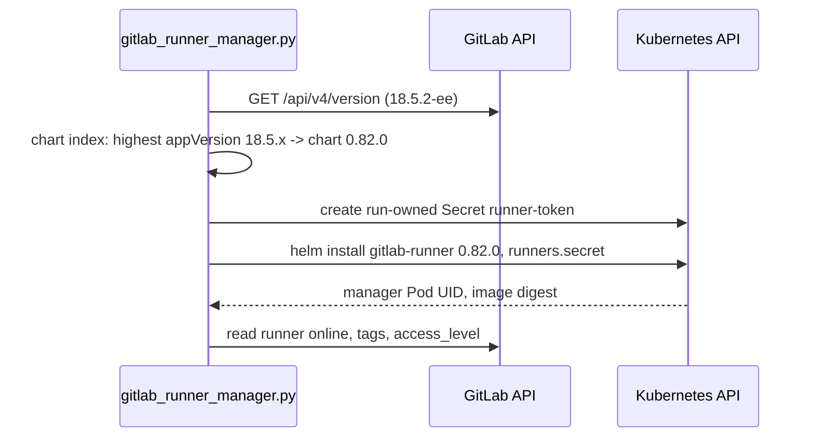

# PARTIALLY_IMPLEMENTED: CI15 — Consistent runner workflows and owned scopes

- grounding: GROUNDED
- verification: PARTIALLY_VERIFIED
- planningStage: PLANNED
- reconciled: 2026-11-25 — PR-001 (identity, scope, aliases, protection) is delivered in main with bounded
  live proof (PR #127: one GitHub persistent consumer job and one GitLab shell/Podman job, same-ID NO_OP and
  exact-owned cleanup); follow-up #132 is closed; the approved `--project-name` override is delivered in PR #145.
  Remaining open work: #131, PR-002 Conda qualification on the current candidate, PR-003 ARC fleet,
  PR-004 Kubernetes executor and PR-005 GitLab.com qualification.

## Authority

The operator requests one consistent CI-Skills interface for runner workflows,
namespace selection and cleanup, a Conda-capable toolbox on selected Debian or
Ubuntu bases, a GitLab Kubernetes executor, the GitHub self-hosted runner use
case, and public GitLab.com coverage. This proposal uses `main` at
`77b481224a52a1e842d811656abe45c1e8543384` and its pinned Standards
revision `5bd31f103621dcd7e49ec6e6af55583de7056d7d`. CI11 owns runner
operations; CI13 owns the GitLab image-build chain. CI14 owns GitLab mirroring
and Agent installation. This phase assigns no priority rank to other work.
The input decisions below govern the architecture, PR plan and acceptance
criteria in this document. Their specification does not claim implementation
or live verification.

## Consumer

A user installs CI-Skills and asks an agent to prepare or inspect a runner for
the selected repository or project. The catalog directs the agent to an
installed command. The command reads the selected target and live resources,
returns a plan, applies only a confirmed plan, and reports bounded JSON with
the actual namespace, provider runner identity, retained resources and cleanup.
The selected target supplies access; operation inputs select the toolbox and
workload. Credential values stay out of reports. No target key is added here.

## Motivation

Three installed command paths currently use two runner implementations; the
GitLab Kubernetes executor is the planned third type. Their
namespace and CLI conventions differ, so an agent can select the wrong scope
or mistake a Podman job container for a separate runner. A common owned-scope
contract makes creation, retention and cleanup observable. The existing
single GitHub runner does not replenish an ephemeral fleet. GitLab.com has no
installed-candidate live proof.

## Diagram

```text
Request + target + ToolboxSpec
  -> catalog / schema / help -> existing WorkflowExecutor
       -> shared scope and toolbox lifecycle
          -> GitHub callbacks -> Kubernetes runner -> GitHub read-back
          -> GitLab callbacks -+-> shell manager + nested Podman -> GitLab read-back
                              +-> Kubernetes executor + job Pods -> GitLab read-back
          -> CI13 chain -> toolbox + GitLab shell manager (reuses callbacks)
       -> image, OS, environment and scope read-back
  -> bounded report to the agent

Temporary owned resources -> cleanup -> absence read-back
Persistent runner resources -> retain on success -> explicit owned delete
```

Provider services own API calls. Shared callbacks own sequencing and resource
lifetime. Command mains parse inputs and render the common result.
Python paths below are under `ci-skills/lib/python/`; schema paths are under
`ci-skills/`.

## Implementation Plan

### IMPLEMENTED: three paths, two runner implementations

`create_selfhosted_runner.py create|update|delete` builds and deploys one
persistent GitHub runner in Kubernetes. `gitlab_runner_manager.py deploy|delete`
hosts a GitLab shell executor in OpenShift; its Pod runs nested Podman jobs.
`image_build_readiness.py chain` already builds and publishes a toolbox,
creates a GitLab runner record, and deploys that same manager. Preserve these
paths. Project/group are GitLab runner scopes, not new executors. The requested
GitLab Kubernetes executor is not installed yet.

### NOT_IMPLEMENTED: repository-derived default names

**CI15-IDENTITY-001 — Derive repository-scoped names from the caller's repository.**
`REPO` means the repository or project selected by the caller's operation context;
it is not the CI-Skills installation directory or a new mandatory environment
variable. Reuse the selected provider repository/project identity and existing
project binding. When it is known, use its repository name for omitted
repository-scoped runner names/descriptions, workload names, namespaces and
repository-specific tags/labels. Do not substitute the literal `ci-skills`
unless that is the selected repository's actual name.

Resolve inputs in this order:

1. Keep the working directory at the calling project root, as required by
   [the installed skill](../../ci-skills/SKILL.md). The known caller `REPO`
   supplies the operation's repository context; never discover it from the
   installed skill directory.
2. Reuse `core/project_binding.py:resolve_target` and the existing
   [target-selection contract](../../ci-skills/references/access.md): explicit
   `--target` or `--binding`, then `K8S_ADMIN_DIAGNOSTICS_BINDING` or
   `CI_SKILLS_TARGET`, then the calling project's `.ci-skills/target.toml`, then
   the user target. Conflicting selectors or an invalid selected source are
   errors; do not merge sources or fall through after a selected-source error.
3. Forward the known operation repository through the command's declared
   interface. GitLab `--project` overrides `gitlab.project` in the selected
   target. GitHub uses that target's `github.repository`; the current command
   has no `--repo` option. Preserve the existing interface and expose any new
   selector through the approved shared catalog/schema, never a private flag.
4. For each object, use its explicit name input first, then its independently
   verified existing identity on reuse/update/delete, then derive a new default
   from the selected repository name. A numeric project ID requires provider
   read-back of its name before deriving a name; offline intent must say when
   that read-back remains pending.

Derivation is unavailable only when no repository is selected in either the
caller context or selected target, a group scope identifies no single
repository, or a selected numeric ID still lacks its provider name. Request
the missing declared repository selection or explicit object-name argument
before planning that name or applying the operation. For a group-wide resource,
accept an explicit name without inventing a repository. Invalid/conflicting
inputs and failed provider reads report their actual errors; they never select
a substitute identity. Do not silently fall back to a toolbox name/namespace
or the CI-Skills installation name. Protection remains a separate caller
choice; provider-assigned IDs and provider/system labels are not repository
names.

Use one shared resolver and the existing resource-specific validation and
normalization. Preserve the generator's uniqueness and ownership guarantees;
derive its human-readable name component from the repository. Do not infer
ownership from a matching name. Plans and results report the selected repository,
the resolved name and its source. Generated examples and toolbox inputs use the
same resolved repository. A known `REPO=payments` must produce payments-derived
names, including when CI-Skills is installed in a directory named `ci-skills`.

### PARTIALLY_IMPLEMENTED: namespace selection and ownership

**CI15-NS-001 — Explicit and omitted namespace selection.** Both cases are
supported. Explicit namespaces are independent of runner naming and tags; callers
are not required to follow an invented namespace naming convention. Generated
repository-scoped defaults follow CI15-IDENTITY-001.

- **Explicit `--namespace NAME` on initial deployment:** Use that exact existing namespace. The caller
  controls its creation, reuse and cleanup. Preserve it on success, failure and runner deletion. A missing
  selected namespace blocks before runner mutation.
- **Omitted on GitHub create/update:** Preserve a previously resolved scope. For a new runner, derive the
  default from the selected repository under CI15-IDENTITY-001; if derivation lacks its required input,
  request the explicit repository or namespace selection before proceeding. Read the selected namespace before
  creation; reuse it when present or plan creation when absent.
- **Omitted on GitLab manager deploy / CI13 chain:** Use the operation's existing scope identity to find one
  matching live `RunScope`; reuse that scope. With no match, plan one namespace through the shared generator,
  using the resolved repository name component under CI15-IDENTITY-001; request missing input before
  generating it. Multiple matches block.

GitHub delete still requires explicit `--namespace` and `--name`; it has no
toolbox fallback. GitLab manager delete resolves existing resources by its
recorded scope identity and validates `--namespace` when supplied; it never
creates a namespace. Missing or ambiguous ownership blocks deletion.

Selection and ownership are separate. Namespaces predating the original
operation remain borrowed even when selected by a default. A namespace created
by the operation remains operation-owned across updates and deletion; supplying
its name later does not transfer ownership. Extend `RunScope`'s existing generator with the repository name component
under CI15-IDENTITY-001. Use the repository for its human-readable component;
runner names, tags and operation IDs do not replace that component. An opaque
hash of operation identity may supply the uniqueness suffix. Generate the
candidate once, retain the exact name through plan, apply and cleanup, and
rediscover existing namespaces through live ownership labels. Report selection
and ownership separately, including when the
selection source is the repository, explicit input or existing
run scope. Resolve retries through recorded identity and
live ownership; ambiguous discovery blocks rather than guessing a name.

Current implementation and remaining delta:

`schemas/toolbox.schema.json` already requires `spec.build.namespace`.
`WorkflowAction._workload` accepts `--namespace` or that build namespace.
`EnsureNamespace` creates missing namespaces and cleans its creations after
dependent failure. GitLab manager and Podman probe paths already use
`RunScope` ownership. The GitHub delete path removes its Deployment and
Secrets but has no matching owned-namespace deletion; its default also joins
runner placement to the build namespace.

Use `core/kubernetes/run_scope.py` and `ResourceSet` for shared resolution,
ownership and UID-checked deletion. CI15 changes the GitHub explicit
`--namespace` path from creating a missing namespace to reporting the missing
caller prerequisite. For omitted runner namespaces, CI15 replaces the
build-namespace fallback with the explicit resolution order in CI15-IDENTITY-001;
a missing identity requires input instead of a substitute default.
Independent toolbox builds and temporary tool-Pod workflows retain their own
contracts; this decision governs runner placement.

Keep build/probe resources temporary and prove cleanup on every exit. Retain
a successful persistent runner and its operation-owned namespace until
explicit confirmed deletion. Remove only resources whose ownership and UID
match independent live read-back, then verify absence. Always preserve
borrowed namespaces. Failed operations clean only their own creations.
Podman containers, volumes and storage inside a runner Pod have separate
cleanup evidence; namespace deletion alone does not establish that cleanup.

### PARTIALLY_IMPLEMENTED: consistent agent interface

**CI15-ARGS-001 — One declared interface for each shared input.** Reuse
`core/catalog.py`, shared parsers and `WorkflowExecutor`. Catalog declarations,
generated `tools.json`, `--help`, `--describe`, schemas, examples and result
reports must agree on names, aliases, cardinality, requiredness and omission.

The following PR-001 interface binding preserves existing accepted names:

- **Runner namespace:** `--namespace NAME`; one value. Omission: Per-command create/update/deploy/chain and
  delete rules in CI15-NS-001.
- **GitHub runner/workload name:** Existing `--name NAME`; do not apply its naming contract to namespaces.
  Omission: CI15-IDENTITY-001; request missing repository/name input; delete still requires its declared
  identity.
- **GitLab runner description:** `--description TEXT`; add it to the chain and retain `--runner-description`
  as its alias. Omission: CI15-IDENTITY-001; request missing repository/description input for create, manager
  deploy and chain.
- **GitLab runner tags:** Repeatable `--tag TAG`; manager retains `--label`; chain gains `--tag` and retains
  `--runner-label`. Omission: Derive repository-specific defaults under CI15-IDENTITY-001; request explicit
  tags when required and no repository is selected.
- **GitHub runner labels:** Existing repeatable `--label LABEL`; remains a GitHub provider concept. Omission:
  Derive repository-specific defaults under CI15-IDENTITY-001; request explicit labels when no repository is
  selected.
- **GitLab runner protection:** Proposed `--protected true|false`, defined below. Omission:
  CI15-PROTECTION-001.

GitLab manager `--label` is only a legacy alias for GitLab `--tag`; GitHub
`--label` retains its separate provider meaning. Mixed repeatable GitLab
aliases append to one tag list in argument order. Reject blank, comma-containing
or duplicate tags across the combined list using shared GitLab validation;
do not silently deduplicate. Reject conflicting singular aliases before
mutation. Forward the same tags
from record creation through manager deployment and verify them from the
provider. Do not derive tags from namespace or runner names. Provider runner
description, numeric runner ID and Kubernetes workload name remain distinct
identities; report each instead of treating them as interchangeable.

Plans and reports distinguish requested inputs, resolved defaults and observed
values. Confirmed apply binds the canonical requested inputs, concrete selected
namespace and its source/ownership, runner identity, combined tags and explicit
protection to the plan fingerprint. A generated namespace is a planned candidate,
not an observed object until creation and read-back. If resolution changes any
bound value, require a new plan and confirmation; offline plans must not claim
live observations. Scope evidence includes purpose, namespace, UID, ownership,
retention and cleanup; failed or offline reads must not fabricate observations.
Retain the existing result envelopes and callback records. PR-001 must propose
one shared typed scope definition and reference it from both
`schemas/results/toolbox-workflow.schema.json` and
`schemas/results/image-build-readiness.schema.json`; their current extensible
records do not enforce this shape. The exact JSON diff and examples require
approval before implementation under [CI07-SCHEMA](CI07-SCHEMA.md).

### NOT_IMPLEMENTED: caller-selectable GitLab runner protection

**CI15-PROTECTION-001 — Caller selects protected or unprotected.** Protection
is independent of project/group scope and shell/Kubernetes executor selection.
Current `core/gitlab/gitlab_runners.py` reads and filters `access_level`, but
record creation and the CI13 chain do not accept a protection selection.

PR-001 proposes one optional `--protected true|false` input for GitLab record
creation, chain creation and manager deployment. Explicit `true` maps to the
existing provider value `ref_protected`; explicit `false` maps to
`not_protected`. Do not conflate unprotected with running untagged jobs.
Creation passes the selected value through the shared provider service. A
manager deploying an existing runner verifies the requested value and blocks
on mismatch; it does not silently change that runner's access policy.

When omitted during creation, preserve the existing provider-default behavior
and report the actual value returned by independent read-back. When omitted
for an existing runner, preserve and report its current value. The plan must
identify explicit selection, provider default or preservation; omission must
not be reported as an explicit `false`. Include explicit protection in the
confirmation fingerprint. Reuse `access_level` in observed runner results,
add expected-value verification to shared read-back, and block on mismatch
or missing evidence for an explicit choice. Malformed values fail before
mutation. This GitLab setting has no implicit GitHub equivalent.

### PARTIALLY_IMPLEMENTED: Debian/Ubuntu and Conda toolbox

`ToolboxSpec` already selects `baseImage`, dependencies and optional `conda`;
the build fingerprints the Conda environment file. The environment creation step requires `conda` after
the declared dependencies run. A checksum-pinned installer dependency supplied it for the
[historical Debian jobs][conda-proof]. The selected base must resolve to an immutable digest.
Read its actual OS identity, use the existing dependency mechanism to provide Conda when absent,
and verify the requested environment's interpreter
and tools inside the resulting image and consuming runner. The agent selects
Debian or Ubuntu only through `baseImage`; read-back reports the actual OS.
Do not add a separate OS-flavor input. Qualify the same toolbox contract in
the nested Podman path and the Kubernetes-hosted private runner path.

### NOT_IMPLEMENTED: GitLab Kubernetes executor

Extend `gitlab_runner_manager.py` with one typed executor selection in its
catalog and schema; keep the shell/Podman variant and its accepted inputs.
Reuse GitLab registration and token handling, `RunScope`, toolbox publication
and `DeployRunner`. Current bootstrap fixes `--executor shell`, while the
manager action requires a Podman node and privileged SCC. Separate shared
identity and scope from executor-specific prerequisites: the Kubernetes
variant omits Podman setup and uses the existing `RunnerAction.podman=None`
deployment path. Its executor callback owns native runner configuration and
scoped Kubernetes permissions; both variants share workload and report logic.
The shared Deployment currently disables ServiceAccount token mounting, so
its inputs must support executor-specific API authentication. D-002 resolves
the exact credential and permission mechanism.

Keep the manager in its retained namespace selected under CI15-NS-001.
Manager and job workloads must have proven ownership; their namespaces can
be borrowed or operation-owned. Job cleanup removes owned resources and only
operation-owned job namespaces, preserving borrowed namespaces. D-002 selects
the supported runner configuration and required permissions before apply;
confirmed plans show any namespace-create/delete permission. Independently
read back the exact job, Pod, namespace and toolbox digest. A prefix or shared
manager namespace does not prove job ownership. Verify owned job-resource
removal and borrowed-namespace preservation while the manager remains;
explicit manager deletion then verifies owned resources are absent. Unknown
ownership or failed cleanup returns bounded `BLOCKED` evidence. Report the distinct manager image and job toolbox image.

### PROPOSED: GitHub ephemeral fleet

The current GitHub workload is one persistent replica and its registration is
not ephemeral. Extend its existing provider and workload boundary for unique
one-job registrations, replenishment, desired capacity and owned deletion.
Choose the lifecycle mechanism before implementation: extend current
workloads or compose GitHub Actions Runner Controller. Preserve the persistent
command. Repository versus organization scope, registration versus JIT,
capacity and credential delivery are open decisions.

### UNVERIFIED: GitLab.com qualification

The existing GitLab API and CI13 chain use the selected host, so qualify the
shell chain and new Kubernetes executor on an approved GitLab.com project and
supported cluster. Read back runner registration, manager workload and a
separately requested consumer job. Record any demonstrated defect against its
existing owner; do not create a GitLab.com-specific provider or assume
GitLab-hosted compute provides the toolbox.

### Open decisions

CI15-NS-001, CI15-ARGS-001, CI15-PROTECTION-001 and CI15-IDENTITY-001
record settled behavior.
Do not reopen those choices because source code or older planning text differs.
The exact interface binding proposed above and the corresponding JSON/schema
artifacts still require exact-content approval; that is an artifact review,
not an undecided namespace or protection policy.

D-001: The GitHub fleet lifecycle mechanism, scope, capacity and credential
delivery need approval before PR-003. D-002: The Kubernetes executor's exact
configuration and scoped permissions need approval before PR-004, within
CI15-NS-001; it must not redefine caller namespace ownership. D-003: GitLab.com
qualification needs an approved project and cluster target before PR-005.
These choices do not block independent PR-001 contract preparation or toolbox
design. No default for these unresolved choices is implied.

## PR Order

Planning IDs are not forge PR numbers. Each PR is a coherent increment and
merges after its listed dependencies and applicable evidence.

- **PR-001 / W-001:** Shared scope lifecycle, repository-derived defaults, argument parity and GitLab
  protection choice. Dependency: Exact interface/schema artifacts for the four decisions.
- **PR-002 / W-002:** Conda-capable Debian/Ubuntu toolbox and consuming-runner read-back. Dependency: PR-001
  scope lifecycle.
- **PR-003 / W-003:** GitHub ephemeral fleet using existing provider services. Dependency: PR-001/002; fleet
  decisions.
- **PR-004 / W-004:** GitLab Kubernetes executor and job namespace ownership. Dependency: PR-001/002; executor
  decisions.
- **PR-005 / W-005:** GitLab.com qualification and only demonstrated corrections. Dependency: PR-001/002/004;
  approved target.

PR-003 and PR-004 have no runtime dependency; merge them in listed order.

## Gates

G-001 is the existing catalog, parser, schema and static validation route.
PR-001 extends its focused checks for canonical flags and legacy aliases,
mixed repeated aliases, repository-derived defaults, omission rules, invalid inputs, protection values,
confirmation binding and schema conformance. Test setup generates a consumer
repository name distinct from the installed skill root and retains the same
names and observed UIDs through the operation and cleanup. Test bodies use
shared constants or enums for contract strings. Include explicit overrides,
missing/group-only repository selection, numeric-ID read-back, selector errors,
normalization, uniqueness and existing-resource
identity preservation. The new cases are not implemented yet.

G-002 through G-006 are proposed acceptance checks, not enforced passes:

- G-002 proves explicit namespace reuse and preservation, missing explicit
  namespace rejection, omitted selection and rediscovery, ambiguous lookup
  rejection, delete input rules, ownership retention across updates, owned
  creation/deletion, UID read-back, retention and Podman cleanup. For GitLab it also
  proves explicit protected/unprotected creation, omitted-value read-back and
  rejection of a manager protection mismatch before workload mutation.
- G-003 builds one toolbox and reads OS, Conda and consuming-job evidence.
- G-004 reads back one separately requested ephemeral GitHub job,
  replenishment and cleanup.
- G-005 reads back one separately requested Kubernetes-executor job, Pod,
  image and owned-resource cleanup while its manager and borrowed namespaces
  remain. Verify the selected runner protection and actual tags.
- G-006 reads back a separately requested GitLab.com consumer job, runner and
  manager for each variant, including the selected tags and protection.

G-007 is the existing exact-head GitHub required result. Focused checks cover
complex edge cases. Consumer jobs are separate acceptance actions, not
workflow callbacks. Passing static checks alone does not satisfy live gates.

- **R-001 Existing callers / CI11, CI13:** IMPLEMENTED / VERIFIED. Delivery: PR-001/W-001 (PR #127 bounded
  live proof). Gate and gap: G-001/007; compatibility.
- **R-002 Namespace selection / CI15-NS-001:** IMPLEMENTED / VERIFIED for the tested scenarios. Delivery: PR-001/W-001;
  RunScope, ResourceSet, WorkflowAction. Gate and gap: G-002; explicit/omitted selection, UID and cleanup proven for
  the PR #127 scenarios; the remaining explicit/default selection and borrowed-namespace matrix is open.
- **R-003 Podman cleanup / CI15:** IMPLEMENTED / VERIFIED for the tested scenarios. Delivery: PR-001/W-001. Gate and gap:
  G-002; retention proven by the PR #127 cleanup read-back.
- **R-004 Interface parity / CI15-ARGS-001:** IMPLEMENTED / VERIFIED. Delivery: PR-001/W-001;
  catalog, parsers, shared result schemas. Gate and gap: G-001/007; names, aliases, repetition and omission.
- **R-005 OS and Conda / CI15:** PARTIALLY_IMPLEMENTED / PARTIALLY_VERIFIED. Delivery: PR-002/W-002. Gate and gap:
  G-003; [historical Debian jobs][conda-proof] passed on both runner paths. Current-candidate qualification remains open.
- **R-006 GitHub fleet / CI15:** NOT_IMPLEMENTED / UNVERIFIED. Delivery: PR-003/W-003. Gate and gap: G-004;
  one-job fleet.
- **R-007 K8s executor / CI15:** NOT_IMPLEMENTED / UNVERIFIED. Delivery: PR-004/W-004. Gate and gap: G-005;
  job cleanup.
- **R-008 GitLab.com / CI15:** PARTIALLY_IMPLEMENTED / UNVERIFIED. Delivery: PR-005/W-005. Gate and gap:
  G-006; SaaS job.
- **R-009 Runner protection / CI15-PROTECTION-001:** IMPLEMENTED / VERIFIED for the tested scenarios. Delivery: PR-001/W-001;
  gitlab_runners.py, chain, manager, shared read-back. Gate and gap: G-001/002/005/006; caller choice and
  observed access_level proven for the PR #127 scenarios.
- **R-010 Repository-derived names / CI15-IDENTITY-001:** IMPLEMENTED / VERIFIED. Delivery:
  PR-001/W-001; shared identity and scope resolver, catalog and parsers. Gate and gap: G-001/002; caller
  repository, explicit overrides, missing-input handling and identity preservation. The approved optional
  `--project-name` consumer override is delivered in PR #145.

Earlier DCloud receipts do not prove this CI-Skills candidate or GitLab.com
behavior. G-007 must pass for each actual PR head.

## Proposed D-001/D-002 resolution — pending approval

This section proposes the D-001 and D-002 choices. It is not approved and nothing in it is implemented. Product
facts live in the skill references [github-arc.md](../../ci-skills/references/github-arc.md) and
[gitlab-runner-helm.md](../../ci-skills/references/gitlab-runner-helm.md); this section records only the choices.

Two earlier statements change. The Kubernetes executor installs the official `gitlab-runner` chart instead of
extending `DeployRunner` with `RunnerAction.podman=None`. The ARC keys below add a target table, although this
phase's Consumer section says "No target key is added here".

The ARC keys also conflict with the target contract. `ci-skills/lib/python/core/endpoints.py` limits target keys to
endpoints and access and says namespaces are read from the live system at run time; `tools/skillkit/endpoint_gate.py`
rule `VALUE_INTRODUCED` refuses a new value key. `[github.arc].token_file` is an access key and fits the contract;
`controller_namespace` and `controller_release` are value keys and do not. Implementation needs one of two
decisions: change the contract to admit these two keys, or take the controller as an operation input
(`--arc-controller-namespace`, `--arc-controller-release`) and keep only `token_file` in the target.

### D-001: GitHub ephemeral fleet (PR-003)

- **Selection:** `create_selfhosted_runner.py --runner-mode ephemeral` installs an ARC scale set; the default
  `persistent` keeps the current Deployment. Basis: DEC-CI15-02.
- **Charts:** `gha-runner-scale-set-controller` and `gha-runner-scale-set`, default `0.15.1`; `--chart-version`
  overrides. With a borrowed controller the scale set uses the controller's chart version, and a different
  `--chart-version` returns `BLOCKED`. Basis: team decision; ARC keeps both chart versions equal.
- **Controller:** `[github.arc]` keys `controller_namespace` and `controller_release` name it. When present, the
  command borrows it and the scale set uses its chart version. When absent, the command installs the selected version
  there as run-owned. Without the table the command returns `BLOCKED`. Basis: team decision that the target names
  the controller.
- **Credential:** `[github.arc].token_file` names a token with `repo` and `workflow` scopes and without
  `delete_repo`. The command copies it into a run-owned Secret with key `github_token`. `[github].token_file` stays
  unchanged because mirror cleanup needs `delete_repo`. Basis: team decision.
- **Scope and name:** `githubConfigUrl` comes from the selected repository; `runnerScaleSetName` comes from
  CI15-IDENTITY-001 and `--project-name`.
- **Runner image:** the retained `test-self-runner-toolbox` digest from the
  [smoke inventory](../2026-10-31/live-smoke-inventory.md), runner command `/opt/actions-runner/run.sh`,
  `containerMode` unset. Basis: inventory reuse rule; ARC custom image contract.
- **Capacity:** `minRunners=0`, `maxRunners=1`, two sequential two-minute jobs, 20-minute observation. Basis: smoke
  inventory run budget.
- **Cleanup:** the command uninstalls the scale set, deletes the run-owned Secret, removes the controller only when
  this run installed it, then reads absence. Basis: CI15-NS-001 ownership.

G-004 passes when both consumer jobs succeed on the scale set, their runner names and Pod UIDs differ, and no runner
Pod remains after the jobs.

### D-002: GitLab Kubernetes executor (PR-004)



- **Selection:** `gitlab_runner_manager.py --executor kubernetes`; the default `shell` keeps the Podman
  Deployment. `image_build_readiness.py chain --executor` passes the same value to its manager deploy step. Basis:
  DEC-CI15-02 and the ExecPlan's "through manager and build chain".
- **Install:** `helm install` of the official chart through the selected `[kubernetes]` authority. Basis: GitLab Helm
  install guide.
- **Agent route:** not used. GitLab deprecated pull-based agent deployment in 16.2 and announced its removal for
  17.0. Basis: GitLab deprecations.
- **Version:** the command reads the selected instance's `/api/v4/version`, keeps `MAJOR.MINOR` and selects the
  highest chart whose `appVersion` matches, else the highest lower minor in the same major. `--chart-version`
  overrides; the plan reports both. Basis: GitLab runner version rule; team decision.
- **Runner record and token:** `gitlab_runner.py create --token-out` creates the record before deploy, as today;
  deploy keeps `--runner-id` and `--token-file`. A run-owned Secret holds key `runner-token`; chart value
  `runners.secret` names it. Basis: current manager contract; chart values; the Helm contract keeps secrets out of
  values.
- **Permissions:** the chart Role with GitLab's rule list for default executor settings and
  `rbac.clusterWideAccess: false`. Basis: GitLab chart configuration.
- **Job namespace:** the release namespace (`runners.jobNamespace` unset), selected under CI15-NS-001. Basis: chart
  default.
- **Images:** UBI `gitlab-runner-ocp:v<appVersion>` and `gitlab-runner-helper-ocp:x86_64-v<appVersion>`,
  `useTini: true`, `runAsNonRoot`, no fixed user ID. Basis: GitLab non-root guide; `restricted-v2`.
- **Job image:** the retained `ci13-runner-toolbox` digest from the smoke inventory, pulled with
  `image_pull_secrets`. Basis: inventory reuse rule.
- **Concurrency:** `concurrent = 1`. Basis: smoke inventory bounded execution.
- **Delete:** the command pauses the runner, waits for running jobs within `--timeout`, runs `helm uninstall`,
  deletes the token Secret, then reads absence. It preserves the runner record; `gitlab_runner.py delete` removes it,
  as today. Basis: GitLab uninstall guide; current manager contract.

G-005 passes when one consumer job runs in a job Pod in the selected namespace, the read-back shows that Pod's UID,
the job image digest, the runner ID, tags and `access_level`, the job Pod is absent afterwards while the manager
remains, and the delete removes the release and the Secret while the runner record stays until
`gitlab_runner.py delete`.

[conda-proof]: ../exec-plans/active/ci15-runner-workflows.md#historical-debian-conda-proof
