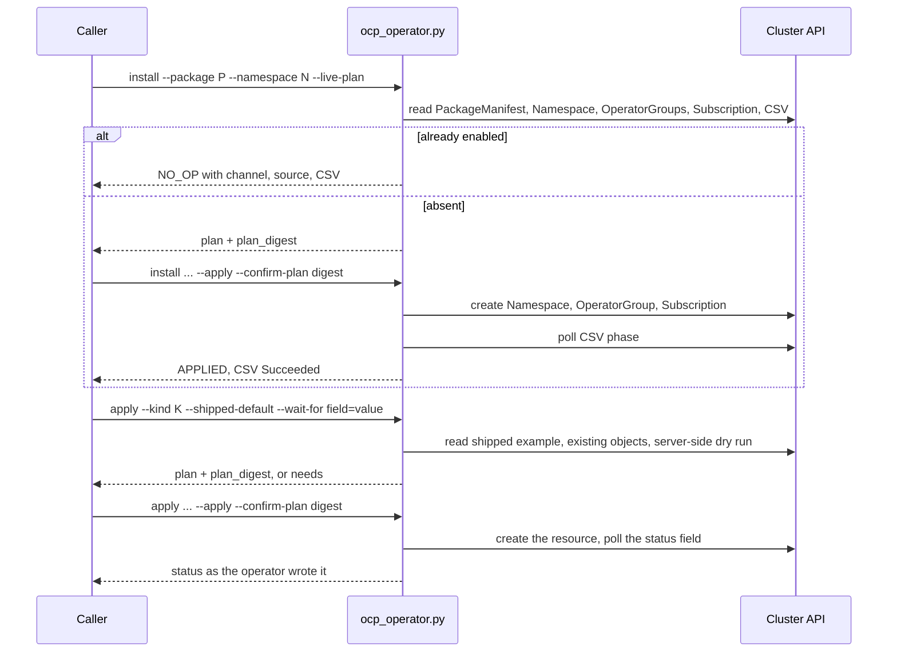

# NOT_IMPLEMENTED: CI16 — Enable an OLM operator on OpenShift and apply its shipped resources

- grounding: GROUNDED
- verification: UNVERIFIED
- planningStage: PLANNED

## Authority

Main at `92ce002` has the shared Kubernetes callbacks and no code for the OpenShift Operator Lifecycle Manager (OLM):
a search of `ci-skills/` for `subscription` and `operatorgroup` returns nothing. The team requests (A1) one command
that enables the NVIDIA Network Operator on an OpenShift cluster in any state and applies the resource the package
ships so the operator works, (A2) the same command for any other OLM package with no code change, and (A3) an answer
that states what is needed whenever only the caller can decide. [The capability model](../capability-model.md) and
[the contribution guide](../contribution_guide.md) govern reusable Python ownership, the command contract and result
schemas (A4). The [live-smoke inventory](../2026-10-31/live-smoke-inventory.md) governs live runs (A5). The
[ExecPlan][exec] holds the decisions, interfaces and steps.

## Consumer

An administrator installs ci-skills, selects the OpenShift cluster through the `[kubernetes]` table of
`~/.ci-skills/target.toml`, and tells an agent "enable the network operator". The agent finds the command in
`ci-skills/tools.json`, reads the worked-example reference, and runs the golden path. The package name and the
namespace come from the request. Channel, catalog source, install mode and the resource to apply come from the
cluster. A value only the caller knows comes from the caller, as a flag or a file.

## Motivation

OpenShift ships without a network operator. Without this command an agent finds out by trial and error whether the
package is already there, which catalog and channel to use, when the install is finished and what to create next.
One command with a plan, a confirmed apply and an independent read-back lets the agent report `APPLIED`, `NO_OP`,
`PARTIAL` or `BLOCKED`, and a `BLOCKED` answer says what is needed and how to supply it.

## Diagram

## Implementation Plan

### NOT_IMPLEMENTED: OLM operator command

Proposed `ci-skills/bin/ocp_operator.py` with the actions `install`, `apply` and `remove`. Library code goes in
`ci-skills/lib/python/core/kubernetes/olm_models.py`, `olm_callbacks.py`, `olm_resources.py` and `olm_cli.py`, and is
generic over package, namespace and kind. It reuses `K8SAuth`, `KubernetesService` and `ResourceSet`.

| Step | Action | What it creates | Needed for a working operator |
| --- | --- | --- | --- |
| enable | `install` | Namespace, OperatorGroup, Subscription | yes |
| install | `apply --kind <Kind> --shipped-default` | the resource the package ships as its example | yes |
| use | `apply --kind <Kind> --spec <file>` | a resource with the caller's site values | no |

Three rules decide every case. The command reads the cluster and holds no cluster value. It does the least that
works with what the package ships and does not re-implement the operator. Where only the caller can decide, it
states the need and stops.

### Contracts and open decisions

Declare the command in `core/catalog.py`, regenerate `ci-skills/tools.json`, and add the result schema
`ci-skills/schemas/results/olm-operator.schema.json`. The phase adds one target table, `[registry.<name>]`, with the
keys and rules of `[harbor]`, declared in `TARGET_CONTRACT`. Two references are registered: "OLM package install"
and "NVIDIA Network Operator".

Open until the live install step runs: whether the shipped `NicClusterPolicy` reaches `status.state: ready`,
whether its driver image needs a registry login, and which policy name the operator accepts. Open before coding:
whether the endpoint gate accepts a named table under `registry`; the contract already supports one named child
through `named_profiles`.

## PR Order

Planning PR IDs are not forge PR numbers.

| PR / wave | Coherent deliverable | Dependency |
| --- | --- | --- |
| PR-001 / W-001 | This phase document, the ExecPlan and the index row | none |
| PR-002 / W-002 | Target table, schema, models, resolve callbacks, `--live-plan` (CI16-M1) | PR-001 |
| PR-003 / W-003 | `install` chain, qualified names, wait refactor, catalog entry (CI16-M2) | PR-002 |
| PR-004 / W-004 | `apply` and `remove` chains, registry Secret callback (CI16-M3, CI16-M4) | PR-003 |
| PR-005 / W-005 | Two references with the golden path, evidence and receipts (CI16-M5) | PR-004 |

## Gates

The gates are proposed and are defined once, in the [ExecPlan gates table][exec-gates]: `G-CI16-01` unit and contract
tests, `G-CI16-02` live enable read-back, `G-CI16-03` live apply of the shipped policy, `G-CI16-04` live remove of
the applied object.

[exec]: ../exec-plans/active/ci16-olm-operator.md
[exec-gates]: ../exec-plans/active/ci16-olm-operator.md#verification-gates
