# NOT_IMPLEMENTED: CI17 — NVIDIA GPU Operator atomic `Nvidia*` callbacks and chain combos on OpenShift

- grounding: GROUNDED
- verification: UNVERIFIED
- planningStage: PLANNED

## Authority

Main at `1ad150e` and [CI16][ci16] introduce generic OLM package management (`ocp_operator.py`) with NVIDIA Network
Operator as the initial consumer, and have no code for NVIDIA GPU Operator lifecycle operations on OpenShift. This
phase is grounded in the official [NVIDIA GPU Operator on OpenShift documentation][nvidia-ocp-docs] (including
[Cleanup][nvidia-ocp-cleanup]) and live read-only inspection of `clusterpolicies.nvidia.com`,
`nvidiadrivers.nvidia.com`, and OpenShift `MachineConfig` resources. The team requests (A1) **atomic, domain-semantic
`Nvidia*` callbacks built first**, each modeling one NVIDIA OpenShift procedure with accurate CRD, `MachineSet`, and
`MachineConfig`/`MachineConfigPool` semantics (`NvidiaPrerequisite`, `NvidiaClusterPolicy`, `NvidiaCudaUpgrade`,
`NvidiaContainerToolkit`, `NvidiaEnableFeatureDiscovery`, `NvidiaEnableMonitoring`, `NvidiaTimeSlicing`,
`NvidiaMachineSetLabel`, `NvidiaMachineConfig`, `NvidiaUpgradePolicy`, `NvidiaHealthCheck`, `NvidiaCleanup`), and
(A2) **chain combos composed strictly from those callbacks** plus CI16's OLM callbacks with zero duplicated logic.
[The capability model](../capability-model.md) and [the contribution guide](../contribution_guide.md) govern reusable
Python ownership, command contracts and schemas (A3). The [ExecPlan][exec] holds the live observations, callback
specifications, decisions, interfaces and gates.

## Consumer

An administrator installs ci-skills, selects the OpenShift cluster through the `[kubernetes]` table of
`~/.ci-skills/target.toml`, and asks an agent to prepare prerequisites (private registry pull secret, NLS licensing
secret, NFD), create/patch `ClusterPolicy`, run `NvidiaHealthCheck`, upgrade CUDA/drivers across the cluster
(`node="*"`) or a node pool, configure time-slicing via ConfigMap + `MachineSet`, align `NvidiaContainerToolkit` with
OpenShift CRI-O/`MachineConfigPool`, enable GFD/monitoring, or run ordered `NvidiaCleanup`. Every mutating action
plans with `--live-plan` (server-side dry-run + `plan_digest` + `needs`), writes only on
`--apply --confirm-plan <sha256>`, and verifies via independent read-back.

## Motivation

Managing the NVIDIA GPU Operator on OpenShift spans OLM (`nfd`, `gpu-operator-certified`), registry/licensing secrets,
`ClusterPolicy` (`nvidia.com/v1`), per-pool `NVIDIADriver` CRs (`nvidia.com/v1alpha1`), OpenShift `MachineSet`
templates (`openshift-machine-api`), `MachineConfig`/`MachineConfigPool`, and Upgrade Controller node labels. Prefixing
every atomic callback with `Nvidia*` gives one clear, discoverable abstraction where each NVIDIA OpenShift doc
procedure maps 1:1 to a reusable `K8SCallback` instead of hand-edited JSON manifests or ad-hoc `oc` commands.

## Diagram

```mermaid
flowchart LR
    subgraph Atomics["Atomic Nvidia* Callbacks (K8SCallback: collect / run / update / cleanup)"]
        PR["NvidiaPrerequisite"]
        CP["NvidiaClusterPolicy / NvidiaDriverPool"]
        CU["NvidiaCudaUpgrade(node, driver)"]
        CT["NvidiaContainerToolkit"]
        GFD["NvidiaEnableFeatureDiscovery"]
        MON["NvidiaEnableMonitoring"]
        TS["NvidiaTimeSlicing + NvidiaMachineSetLabel"]
        MC["NvidiaMachineConfig"]
        UP["NvidiaUpgradePolicy"]
        HC["NvidiaHealthCheck"]
        CL["NvidiaCleanup"]
    end
    subgraph Shared["Shared Support Modules"]
        D["discovery.py"]
        P["preflight.py"]
        W["waits.py"]
    end
    Atomics --> Shared
```

## Implementation Plan

### NOT_IMPLEMENTED: Atomic `Nvidia*` callbacks and chain combos

Proposed `ci-skills/bin/nvidia_gpu_operator.py` backed by `ci-skills/lib/python/core/kubernetes/nvidia_gpu/`. OLM
install/removal of `nfd` and `gpu-operator-certified` reuses CI16's `olm_callbacks` and `olm_resources` directly.

| Atomic Callback | Scope / Args | Grounded NVIDIA OpenShift & CRD Semantics |
| --- | --- | --- |
| `NvidiaPrerequisite` | registry, NLS, NFD | Verifies NFD; creates registry pull secret & NLS licensing secret |
| `NvidiaClusterPolicy` | driver/spec fields | Creates/patches `ClusterPolicy` (repo, image, version, secrets, NLS) |
| `NvidiaDriverPool` | `NVIDIADriver` CR | Creates/patches per-pool `NVIDIADriver` (`nodeSelector`, precompiled, tag) |
| `NvidiaCudaUpgrade` | `node`, `driver` | Cluster (`"*"`) or node/pool driver/CUDA upgrade + upgrade-state wait |
| `NvidiaContainerToolkit` | `enabled`, `cdi` | Aligns `spec.toolkit`/`cdi`/`runtimeClass` with OCP CRI-O & MCP |
| `NvidiaEnableFeatureDiscovery` | `enabled`, tag | Checks NFD, patches `/spec/gfd/enabled`, checks `nvidia.com/gpu.*` |
| `NvidiaEnableMonitoring` | namespace, DCGM | Labels `openshift.io/cluster-monitoring=true` + `dcgmExporter` monitor |
| `NvidiaTimeSlicing` | profiles ConfigMap | Creates `small`/`medium`/`large` time-slicing ConfigMap + binds plugin |
| `NvidiaMachineSetLabel` | `MachineSet`, label | Patches `machineset` in `openshift-machine-api` template labels |
| `NvidiaMachineConfig` | `role`, preset | Plans/verifies NVIDIA `MachineConfig` (MOK, IOMMU, CDI) & MCP |
| `NvidiaUpgradePolicy` | CR, `drain`, `skip` | Updates `upgradePolicy` and `skip` / `upgrade-required` recovery |
| `NvidiaHealthCheck` | `node="*"` or pool | Out-of-the-box sanity check: all DaemonSets, validator Pods, drift, MCP |
| `NvidiaCleanup` | `policy`..`full` | Ordered teardown per NVIDIA `clean-up.html` (`--delete-crds` opt-in) |

Chain combos in `chains.py` compose strictly from these `Nvidia*` callbacks plus CI16 OLM callbacks:

- `install-gpu-operator`: CI16 NFD → `NvidiaPrerequisite` → CI16 GPU Op → `NvidiaClusterPolicy` →
  `NvidiaEnableMonitoring` → `NvidiaContainerToolkit` → `NvidiaEnableFeatureDiscovery` → `NvidiaHealthCheck`.
- `upgrade-cuda`: `NvidiaHealthCheck` → optional `NvidiaUpgradePolicy` → `NvidiaCudaUpgrade(node, driver)` →
  `NvidiaHealthCheck`.
- `enable-time-slicing`: `NvidiaHealthCheck` → `NvidiaTimeSlicing` → optional `NvidiaMachineSetLabel` →
  `NvidiaHealthCheck`.
- `align-toolkit-ocp`: `NvidiaHealthCheck` → `NvidiaMachineConfig` → `NvidiaContainerToolkit` → `NvidiaHealthCheck`.
- `recover-failed-upgrade`: `NvidiaHealthCheck` → `NvidiaUpgradePolicy` (clear skip / retry) →
  `NvidiaCudaUpgrade(wait_only)` → `NvidiaHealthCheck`.
- `cleanup-gpu-operator`: `NvidiaHealthCheck` → `NvidiaCleanup` → `NvidiaHealthCheck`.

### Contracts and open decisions

No JSON contract or schema file is created in this planning PR. Before implementation begins, present and obtain
explicit operator approval for `ci-skills/schemas/results/nvidia-gpu-operator.schema.json` and the generated
`ci-skills/tools.json` entry registered from `core/catalog.py`.

Open until Wave 2/3 live runs: whether `GPUCluster` (shipped in `gpu-operator-certified` channel `v26.7`) needs its
own callback alongside `NvidiaClusterPolicy` and `NvidiaDriverPool`, and whether OpenShift Console GPU dashboard
plugin enablement sits inside `NvidiaEnableMonitoring` or a separate `NvidiaEnableConsole` callback.

## PR Order

Planning PR IDs are not forge PR numbers.

| PR / wave | Coherent deliverable | Dependency |
| --- | --- | --- |
| PR-001 / W-001 | This phase document, the ExecPlan and the index row | none |
| PR-002 / W-002 | Approved schema, shared helpers, `NvidiaHealthCheck` (`CI17-M1`) | PR-001, CI16-M1 |
| PR-003 / W-003 | `NvidiaPrerequisite`, `NvidiaClusterPolicy`, `NvidiaDriverPool`, monitoring (`CI17-M2`) | PR-002 |
| PR-004 / W-004 | GFD, toolkit, MCO, `NvidiaTimeSlicing`, `NvidiaMachineSetLabel` (`CI17-M3`) | PR-003 |
| PR-005 / W-005 | `NvidiaCudaUpgrade`, `NvidiaUpgradePolicy`, `NvidiaCleanup` (`CI17-M4`) | PR-004 |
| PR-006 / W-006 | Chain combos, references, live evidence and acceptance receipts (`CI17-M5`) | PR-005, CI16-M3 |

## Gates

The gates are proposed and defined once in the [ExecPlan verification gates][exec-gates]: `G-CI17-01` unit and contract
tests per `Nvidia*` callback, `G-CI17-02` live read-only `NvidiaHealthCheck`, `G-CI17-03` live `--live-plan` dry-run,
`G-CI17-04` bounded atomic write and restore, and `G-CI17-05` chain combo acceptance.

[ci16]: CI16-OLM-OPERATOR.md
[exec]: ../exec-plans/active/ci17-nvidia-gpu-operator.md
[exec-gates]: ../exec-plans/active/ci17-nvidia-gpu-operator.md#verification-gates
[nvidia-ocp-docs]: https://docs.nvidia.com/datacenter/cloud-native/openshift/latest/index.html
[nvidia-ocp-cleanup]: https://docs.nvidia.com/datacenter/cloud-native/openshift/latest/clean-up.html
