# NOT_IMPLEMENTED: CI17 — NVIDIA GPU Operator atomic primitives and chain combos on OpenShift

- grounding: GROUNDED
- verification: UNVERIFIED
- planningStage: PLANNED

## Authority

Main at `1ad150e` and [CI16][ci16] introduce generic OLM package management (`ocp_operator.py`) with NVIDIA Network
Operator as the initial consumer, and have no code for NVIDIA GPU Operator day-2 lifecycle operations (`ClusterPolicy`,
`NVIDIADriver`, driver/CUDA version upgrades, component tag rollouts, upgrade policy control, node label management, or
upgrade-state waits). The team requests (A1) NVIDIA GPU Operator coverage grounded in the official NVIDIA GPU Operator
documentation for OpenShift, (A2) **atomic single-responsibility primitives built first** as a **partitioned callback
list**, and (A3) **chain combos composed strictly from those atomic callbacks** and CI16's OLM callbacks with zero
duplicated logic. [The capability model](../capability-model.md) and [the contribution guide](../contribution_guide.md)
govern reusable Python ownership, the command contract and result schemas (A4). The [ExecPlan][exec] holds the live
cluster observations, partitioned callback inventory, decisions, interfaces and steps.

## Consumer

An administrator installs ci-skills, selects the OpenShift cluster through the `[kubernetes]` table of
`~/.ci-skills/target.toml`, and asks an agent to inspect GPU Operator health, upgrade the CUDA/driver version on a node
pool, set a component image tag, adjust `upgradePolicy`, or recover a node stuck in `upgrade-failed`. The agent finds
`nvidia_gpu_operator.py` in `ci-skills/tools.json`, runs read-only `status` or a `--live-plan`, reviews the exact
before/after diff and `plan_digest`, confirms with `--apply --confirm-plan <sha256>`, and receives independent
read-back evidence (`APPLIED`, `NO_OP`, `PARTIAL`, or `BLOCKED` with `needs`).

## Motivation

Managing the NVIDIA GPU Operator on OpenShift involves coordinated state across OLM (`nfd`, `gpu-operator-certified`),
`ClusterPolicy` (`nvidia.com/v1`), optional per-pool `NVIDIADriver` CRs (`nvidia.com/v1alpha1`), and the Upgrade
Controller node-label state machine (`nvidia.com/gpu-driver-upgrade-state`, `nvidia.com/gpu-driver-upgrade.skip`,
`nvidia.com/cuda.driver-version.full`, `nvidia.com/cuda.runtime-version.full`). Without atomic primitives and
partitioned callbacks, an agent can silently patch `ClusterPolicy.spec.driver.version` when `useNvidiaDriverCRD: true`
is active, trigger unthrottled node drains, or miss stuck `upgrade-failed` nodes. Partitioning every concern into small
atomic callbacks makes each primitive independently testable and lets every combo compose cleanly through
`WorkflowExecutor`.

## Diagram

```mermaid
flowchart LR
    subgraph P1["Partition 1: Discovery (Read-Only)"]
        D1["DiscoverGPUOperatorStack"]
        D2["ReadClusterPolicy"]
        D3["ReadNVIDIADrivers"]
        D4["ReadGPUNodes"]
        D5["ReadGPUValidators"]
    end
    subgraph P2["Partition 2: Preflight & Confirm"]
        G1["ValidateGPUTargetContract"]
        G2["ServerSideDryRunPatch"]
        G3["ConfirmGPUPlan"]
    end
    subgraph P3["Partition 3: Atomic Mutations"]
        M1["PatchComponentTag"]
        M2["PatchUpgradePolicy"]
        M3["LabelGPUNode"]
        M4["PatchGPUSharing"]
    end
    subgraph P4["Partition 4: Wait & Read-Back"]
        W1["WaitClusterPolicyReady"]
        W2["WaitDriverUpgradeState"]
        W3["VerifyCUDAReadback"]
    end
    P1 --> P2 --> P3 --> P4
```

## Implementation Plan

### NOT_IMPLEMENTED: Partitioned NVIDIA GPU Operator callbacks and CLI

Proposed `ci-skills/bin/nvidia_gpu_operator.py` backed by modular libraries under
`ci-skills/lib/python/core/kubernetes/nvidia_gpu/` (`models.py`, `discovery.py`, `preflight.py`, `mutations.py`,
`waits.py`, `chains.py`, `cli.py`). OLM install/upgrade of `nfd` and `gpu-operator-certified` reuses CI16's
`olm_callbacks` and `olm_resources` directly without copying OLM logic.

| Layer | Action | Partitioned callbacks composed |
| --- | --- | --- |
| Atomic (read) | `status` | `K8SAuth` → P1 (all 5 discovery callbacks) |
| Atomic (mutate) | `set-tag` | `K8SAuth` → P1 reads → P2 → `PatchComponentTag` → P1 read-back |
| Atomic (mutate) | `set-upgrade-policy` | `K8SAuth` → P1 reads → P2 → `PatchUpgradePolicy` → P1 read-back |
| Atomic (mutate) | `set-node-label` | `K8SAuth` → `ReadGPUNodes` → P2 → `LabelGPUNode` → `ReadGPUNodes` |
| Atomic (mutate) | `set-sharing` | `K8SAuth` → `ReadClusterPolicy` → P2 → `PatchGPUSharing` → P1 |
| Atomic (wait) | `wait-upgrade` | `K8SAuth` → P4 (policy, upgrade-state, CUDA read-back) |
| Chain combo | `enable-gpu-operator` | CI16 NFD → `VerifyNFDLabels` → CI16 GPU Op → P4 ready → P1 |
| Chain combo | `upgrade-driver` | `K8SAuth` → P1 → P2 → opt `PatchUpgradePolicy` → `PatchComponentTag` → P4 |
| Chain combo | `rollout-component-tag` | `K8SAuth` → `ReadClusterPolicy` → P2 → `PatchComponentTag` → P4 → P1 |
| Chain combo | `recover-failed-upgrade` | `K8SAuth` → `ReadGPUNodes` → P2 → `LabelGPUNode` (`upgrade-required`) → P4 |

### Contracts and open decisions

No JSON contract or schema file is created in this planning PR. Before implementation begins, present and obtain
explicit operator approval for `ci-skills/schemas/results/nvidia-gpu-operator.schema.json` and the generated
`ci-skills/tools.json` entry registered from `core/catalog.py`.

Open until Wave 2/3 live runs: whether `upgrade-driver` should allow explicit `--allow-skip-nodes` to continue past
nodes marked `nvidia.com/gpu-driver-upgrade.skip=true` (default: respect skip and report them separately), and whether
the optional `GPUCluster` kind shipped in `gpu-operator-certified` channel `v26.7` requires a dedicated read callback.

## PR Order

Planning PR IDs are not forge PR numbers.

| PR / wave | Coherent deliverable | Dependency |
| --- | --- | --- |
| PR-001 / W-001 | This phase document, the ExecPlan and the index row | none |
| PR-002 / W-002 | Approved schema, models, P1 read-only callbacks and `status` (`CI17-M1`) | PR-001, CI16-M1 |
| PR-003 / W-003 | P2 preflight/confirm, P3 atomic mutations and P4 waits (`CI17-M2`) | PR-002 |
| PR-004 / W-004 | Chain combos composed from CI17 atomics and CI16 OLM (`CI17-M3`) | PR-003, CI16-M3 |
| PR-005 / W-005 | References, golden-path live evidence and acceptance receipts (`CI17-M4`) | PR-004 |

## Gates

The gates are proposed and defined once in the [ExecPlan verification gates][exec-gates]: `G-CI17-01` unit and contract
tests per callback partition, `G-CI17-02` live read-only `status` read-back, `G-CI17-03` live `--live-plan` dry-run for
atomic mutations, `G-CI17-04` bounded live atomic mutation and read-back, and `G-CI17-05` chain combo verification.

[ci16]: CI16-OLM-OPERATOR.md
[exec]: ../exec-plans/active/ci17-nvidia-gpu-operator.md
[exec-gates]: ../exec-plans/active/ci17-nvidia-gpu-operator.md#verification-gates
