# NOT_IMPLEMENTED: CI17 — NVIDIA GPU Operator atomic callbacks and chain combos on OpenShift

- grounding: GROUNDED
- verification: UNVERIFIED
- planningStage: PLANNED

## Authority

Main at `1ad150e` and [CI16][ci16] introduce generic OLM package management (`ocp_operator.py`) with NVIDIA Network
Operator as the initial consumer, and have no code for NVIDIA GPU Operator day-2 lifecycle operations on OpenShift.
This phase is grounded in the official [NVIDIA GPU Operator on OpenShift documentation][nvidia-ocp-docs] (including
[Cleanup][nvidia-ocp-cleanup]) and live read-only inspection of `clusterpolicies.nvidia.com`,
`nvidiadrivers.nvidia.com`, and OpenShift `MachineConfig` resources. The team requests (A1) **atomic, domain-semantic
callbacks built first**, each modeling one NVIDIA OpenShift operational procedure with accurate CRD and OpenShift
`MachineConfig`/`MachineConfigPool` semantics (for example `CudaUpgrade(node, driver)`, `ContainerToolkit`,
`EnableFeatureDiscovery`, `MachineConfigSync`, `Cleanup`), and (A2) **chain combos composed from those callbacks** plus
CI16's OLM callbacks with zero duplicated logic. [The capability model](../capability-model.md) and
[the contribution guide](../contribution_guide.md) govern reusable Python ownership, command contracts and schemas
(A3). The [ExecPlan][exec] holds the live observations, callback specifications, decisions, interfaces and gates.

## Consumer

An administrator installs ci-skills, selects the OpenShift cluster through the `[kubernetes]` table of
`~/.ci-skills/target.toml`, and asks an agent to inspect GPU state, run a CUDA/driver upgrade across the cluster
(`node="*"`) or a single node/pool, align `ContainerToolkit` with OpenShift CRI-O/CDI/`MachineConfig`, toggle GPU
Feature Discovery (`EnableFeatureDiscovery`), or run ordered `Cleanup`. Each mutating action plans with `--live-plan`
(server-side dry-run + `plan_digest` + `needs`), writes only on `--apply --confirm-plan <sha256>`, and reads back
independently.

## Motivation

On Red Hat OpenShift, NVIDIA GPU Operator state spans OLM (`nfd`, `gpu-operator-certified`), `ClusterPolicy`
(`nvidia.com/v1`), optional per-pool `NVIDIADriver` CRs (`nvidia.com/v1alpha1`), OpenShift `MachineConfig` /
`MachineConfigPool` (for CRI-O/CDI, MOK keys, and kernel arguments), and Upgrade Controller node labels. Keeping CRD
fields and OpenShift machine semantics aligned by hand is error-prone (for example patching `ClusterPolicy` when
`useNvidiaDriverCRD: true` is active, using stale `/spec/gfd/enable` instead of the CRD's `/spec/gfd/enabled`, or
leaving `MachineConfigPool` degraded). Partitioning the workflow into named, domain-semantic atomic callbacks lets
each concern be tested and invoked standalone, then chained into repeatable combos via `WorkflowExecutor`.

## Diagram

```mermaid
flowchart LR
    subgraph Atomics["Atomic Domain Callbacks (each K8SCallback: collect / run / update / cleanup)"]
        S["GpuOperatorStatus"]
        CU["CudaUpgrade(node, driver)"]
        CT["ContainerToolkit"]
        GFD["EnableFeatureDiscovery"]
        MC["MachineConfigSync"]
        UP["ManageUpgradePolicy"]
        SH["ConfigureGpuSharing"]
        CL["Cleanup"]
    end
    subgraph Helpers["Shared Partitioned Support Modules"]
        P1["discovery.py (OLM, CRD, MCO, Nodes)"]
        P2["preflight.py (Contract, Dry-Run, Confirm)"]
        P4["waits.py (CRD, Upgrade State, MCP, CUDA)"]
    end
    Atomics --> Helpers
```

## Implementation Plan

### NOT_IMPLEMENTED: Domain-semantic atomic callbacks and chain combos

Proposed `ci-skills/bin/nvidia_gpu_operator.py` backed by `ci-skills/lib/python/core/kubernetes/nvidia_gpu/`. OLM
install/removal of `nfd` and `gpu-operator-certified` reuses CI16's `olm_callbacks` and `olm_resources` directly.

| Atomic Callback | Scope / Args | Grounded NVIDIA OpenShift & CRD Semantics |
| --- | --- | --- |
| `GpuOperatorStatus` | `node="*"` or pool | Read-only: NFD, OLM CSV, `ClusterPolicy`, `NVIDIADriver`, MCO, drift |
| `CudaUpgrade` | `node`, `driver` | Driver/CUDA upgrade (`ClusterPolicy` or `NVIDIADriver`) + wait + verify |
| `ContainerToolkit` | `enabled`, `cdi` | Aligns `spec.toolkit`/`cdi`/`runtimeClass` with OCP CRI-O & MCP |
| `EnableFeatureDiscovery` | `enabled`, tag | Verifies NFD, patches `/spec/gfd/enabled`, checks `gpu.*` labels |
| `MachineConfigSync` | `role`, preset | Plans/verifies NVIDIA `MachineConfig` (MOK, IOMMU, CDI) & MCP |
| `ManageUpgradePolicy` | CR, `drain`, `skip` | Updates `upgradePolicy` and `skip` / `upgrade-required` recovery |
| `ConfigureGpuSharing` | `mig`, `mps`, slice | Updates `spec.mig`, `migManager`, `devicePlugin.config` + labels |
| `Cleanup` | `policy`..`full` | Ordered teardown per NVIDIA `clean-up.html` (`--delete-crds` opt-in) |

Chain combos in `chains.py` compose strictly from these atomic callbacks plus CI16 OLM callbacks:

- `enable-gpu-operator`: CI16 NFD → `MachineConfigSync` (verify) → CI16 GPU Op → `ContainerToolkit` →
  `EnableFeatureDiscovery` → `GpuOperatorStatus`.
- `upgrade-cuda`: `GpuOperatorStatus` → optional `ManageUpgradePolicy` → `CudaUpgrade(node, driver)` →
  `GpuOperatorStatus`.
- `align-toolkit-ocp`: `GpuOperatorStatus` → `MachineConfigSync` → `ContainerToolkit` → `GpuOperatorStatus`.
- `recover-failed-upgrade`: `GpuOperatorStatus` → `ManageUpgradePolicy` (clear skip / retry) →
  `CudaUpgrade` wait/verify → `GpuOperatorStatus`.
- `cleanup-gpu-operator`: `GpuOperatorStatus` → `Cleanup` → `GpuOperatorStatus`.

### Contracts and open decisions

No JSON contract or schema file is created in this planning PR. Before implementation begins, present and obtain
explicit operator approval for `ci-skills/schemas/results/nvidia-gpu-operator.schema.json` and the generated
`ci-skills/tools.json` entry registered from `core/catalog.py`.

Open until Wave 2/3 live runs: whether `GPUCluster` (shipped in `gpu-operator-certified` channel `v26.7`) requires its
own read/apply callback alongside `ClusterPolicy` and `NVIDIADriver`, and which `MachineConfig` presets (`mok-key`,
`iommu`, `crio-cdi`) are delivered first.

## PR Order

Planning PR IDs are not forge PR numbers.

| PR / wave | Coherent deliverable | Dependency |
| --- | --- | --- |
| PR-001 / W-001 | This phase document, the ExecPlan and the index row | none |
| PR-002 / W-002 | Approved schema, shared helpers, `GpuOperatorStatus` (`CI17-M1`) | PR-001, CI16-M1 |
| PR-003 / W-003 | `EnableFeatureDiscovery`, `ContainerToolkit`, `MachineConfigSync` (`CI17-M2`) | PR-002 |
| PR-004 / W-004 | `CudaUpgrade`, `ManageUpgradePolicy`, `ConfigureGpuSharing`, `Cleanup` (`CI17-M3`) | PR-003 |
| PR-005 / W-005 | Chain combos, references, live evidence and receipts (`CI17-M4`) | PR-004, CI16-M3 |

## Gates

The gates are proposed and defined once in the [ExecPlan verification gates][exec-gates]: `G-CI17-01` unit and contract
tests per atomic callback, `G-CI17-02` live read-only `GpuOperatorStatus`, `G-CI17-03` live `--live-plan` dry-run,
`G-CI17-04` bounded atomic write and restore, and `G-CI17-05` chain combo acceptance.

[ci16]: CI16-OLM-OPERATOR.md
[exec]: ../exec-plans/active/ci17-nvidia-gpu-operator.md
[exec-gates]: ../exec-plans/active/ci17-nvidia-gpu-operator.md#verification-gates
[nvidia-ocp-docs]: https://docs.nvidia.com/datacenter/cloud-native/openshift/latest/index.html
[nvidia-ocp-cleanup]: https://docs.nvidia.com/datacenter/cloud-native/openshift/latest/clean-up.html
