# NOT_IMPLEMENTED: CI17 — NVIDIA GPU Operator atomic `Nvidia*` callbacks and chain combos on OpenShift

- grounding: GROUNDED
- verification: UNVERIFIED
- planningStage: PLANNED

## Authority

Main at `1ad150e` and [CI16][ci16] introduce generic OLM package management (`ocp_operator.py`) with NVIDIA Network
Operator as the initial consumer, and have no code for NVIDIA GPU Operator lifecycle operations on OpenShift. This
phase is general-purpose for any OpenShift cluster (zero site-specific assumptions) and is grounded in the official
[NVIDIA GPU Operator on OpenShift documentation][nvidia-ocp-docs] — including [Install][nvidia-ocp-install],
[DRA (`GPUCluster`)][nvidia-ocp-dra], [Precompiled Drivers][nvidia-ocp-precompiled],
[GPU Monitoring Dashboard][nvidia-ocp-dashboard], [Driver Upgrades][nvidia-driver-upgrades], and
[Cleanup][nvidia-ocp-cleanup] — plus live read-only inspection of OpenShift CRDs and `MachineConfig` resources and a
multi-model design brainstorm.

The team requests (A1) **atomic, domain-semantic `Nvidia*` callbacks built first**, covering OpenShift special cases
(Secure Boot / MOK `MachineConfig`, pausing/resuming operator reconciliation and MCPs, non-standard precompiled driver
health checks, OpenShift Console dashboard, `MachineSet` labeling, Device Plugin and DRA modes), (A2) **staged
confirmed chain combos** composed strictly from those callbacks plus CI16's OLM callbacks with zero duplicated logic,
and (A3) **paired skill references** (`ci-skills/references/nvidia-gpu-operator.md`) mapping every callback to its
official NVIDIA OpenShift doc page. MIG profile mutations and MPS are explicitly deferred to a later phase (low
priority). [The capability model](../capability-model.md) and [the contribution guide](../contribution_guide.md) govern
reusable Python ownership, command contracts and schemas (A4). The [ExecPlan][exec] holds all observations, callback
specs, decisions, interfaces and gates.

## Consumer

An administrator installs ci-skills, selects any OpenShift cluster through `[kubernetes]` in `~/.ci-skills/target.toml`,
and asks an agent to run `NvidiaHealthCheck` (including non-standard/precompiled driver and Secure Boot/MOK status),
pause operator/node/MCP reconciliation (`NvidiaPauseOperator`) during complex maintenance, manage `ClusterPolicy`,
`GPUCluster` (DRA), or `NVIDIADriver` pools, run a scoped `NvidiaCudaUpgrade(node, driver)` (one governing driver CR
per confirmed apply), align `NvidiaContainerToolkit` + `NvidiaMachineConfig`, enable GFD/monitoring/OpenShift Console
dashboard, configure time-slicing via ConfigMap + `MachineSet`, or run mode-specific `NvidiaCleanup`. Every mutating
stage plans with `--live-plan` (server-side dry-run + `plan_digest` + `needs`), writes only on
`--apply --confirm-plan <sha256>`, and verifies via independent read-back.

## Motivation

OpenShift GPU clusters frequently run complex states that break naive automation: Secure Boot nodes needing MOK
signing keys via `MachineConfig`, custom/non-standard precompiled driver images not shipped in stock OpenShift Driver
Toolkit, nodes paused or skipped during upgrades, heterogeneous `NVIDIADriver` pools, and mutually exclusive Device
Plugin (`ClusterPolicy`) vs DRA (`GPUCluster`) modes. Prefixing every atomic procedure as a reusable `Nvidia*`
`K8SCallback` — executed in staged, server-validated plans — gives operators safe pause/resume, accurate non-standard
health checks, and deterministic composition without hand-editing raw manifests.

## Diagram

```mermaid
flowchart LR
    subgraph Atomics["Atomic Nvidia* Callbacks (K8SCallback; cleanup() is temp-only)"]
        HC["NvidiaHealthCheck (Standard + Non-Standard/MCO/DRA)"]
        PA["NvidiaPauseOperator (Node / Policy / MCP Pause & Resume)"]
        PR["NvidiaPrerequisite"]
        CP["NvidiaClusterPolicy / NvidiaDraCluster / NvidiaDriverPool"]
        CU["NvidiaCudaUpgrade(node, driver)"]
        CT["NvidiaContainerToolkit + NvidiaMachineConfig"]
        GFD["NvidiaEnableFeatureDiscovery"]
        MON["NvidiaEnableMonitoring + NvidiaEnableConsole"]
        TS["NvidiaTimeSlicing + NvidiaMachineSetLabel"]
        UP["NvidiaUpgradePolicy"]
        CL["NvidiaCleanup (Device Plugin & DRA Modes)"]
    end
    subgraph Shared["Shared Support Modules"]
        D["discovery.py"]
        P["preflight.py"]
        W["waits.py"]
    end
    Atomics --> Shared
```

## Implementation Plan

### NOT_IMPLEMENTED: Atomic `Nvidia*` callbacks and staged chain combos

Proposed `ci-skills/bin/nvidia_gpu_operator.py` backed by `ci-skills/lib/python/core/kubernetes/nvidia_gpu/`. OLM
install/removal of `nfd` and `gpu-operator-certified` reuses CI16's `olm_callbacks` and `olm_resources`. Note:
`WorkflowExecutor` invokes `K8SCallback.cleanup()` after both success and failure, so `cleanup()` is reserved strictly
for temporary invocation-owned objects; operator teardown lives exclusively in `NvidiaCleanup`.

| Atomic Callback | Scope / Args | Grounded NVIDIA OpenShift & CRD Semantics |
| --- | --- | --- |
| `NvidiaHealthCheck` | `node="*"` or pool | Pods, DaemonSets, DRA `DeviceClass`/`ResourceSlice`, non-std/MOK/MCP |
| `NvidiaPauseOperator` | node, policy, MCP | Pause/resume `gpu.deploy.*`, `upgrade.skip`, `autoUpgrade`, `MCP.paused` |
| `NvidiaPrerequisite` | registry, NLS, NFD | Verifies NFD; creates registry pull & NLS secrets ([Install][nvidia-ocp-install]) |
| `NvidiaClusterPolicy` | driver/spec fields | `ClusterPolicy` (Device Plugin; blocks if `GPUCluster` exists) |
| `NvidiaDraCluster` | `GPUCluster` CR | `GPUCluster` + `gpu.nvidia.com` `DeviceClass` ([DRA][nvidia-ocp-dra]) |
| `NvidiaDriverPool` | `NVIDIADriver` CR | Per-pool `NVIDIADriver` (stock DTK or custom precompiled; [Pre][nvidia-ocp-precompiled]) |
| `NvidiaCudaUpgrade` | `node`, `driver` | Fleet plan, 1 governing driver CR per confirmed apply ([Up][nvidia-driver-upgrades]) |
| `NvidiaContainerToolkit` | `enabled`, `cdi` | Aligns `spec.toolkit`/`cdi`/`runtimeClass` with OCP CRI-O & MCP |
| `NvidiaMachineConfig` | `role`, preset | Confirmed separately: MOK/Secure Boot, IOMMU, CDI + MCP wait |
| `NvidiaEnableFeatureDiscovery` | `enabled`, tag | Verifies NFD, patches `/spec/gfd/enabled`, checks `gpu.*` labels |
| `NvidiaEnableMonitoring` | namespace, DCGM | Labels `openshift.io/cluster-monitoring=true` + DCGM monitor |
| `NvidiaEnableConsole` | OCP Console | Enables/verifies OCP Console GPU dashboard ([Dash][nvidia-ocp-dashboard]) |
| `NvidiaTimeSlicing` | ConfigMap profiles | Multi-profile time-slicing ConfigMap (`small`/`medium`/`large`) |
| `NvidiaMachineSetLabel` | `MachineSet`, label | Patches `machineset` in `openshift-machine-api` template labels |
| `NvidiaUpgradePolicy` | CR, `drain`, retry | Updates `upgradePolicy` and separately confirmed failed-node retry |
| `NvidiaCleanup` | mode, scope | Mode-specific teardown (`clean-up.html` vs `dra-gpu-ocp.html#uninstall`) |

Chain combos in `chains.py` use **staged confirmed plans** (each stage server-validated before apply):

- `install-gpu-operator`: CI16 NFD → `NvidiaPrerequisite` → CI16 GPU Op → `NvidiaClusterPolicy` →
  `NvidiaEnableMonitoring` → `NvidiaEnableConsole` → `NvidiaContainerToolkit` → `NvidiaEnableFeatureDiscovery` →
  `NvidiaHealthCheck`.
- `install-gpu-dra`: CI16 NFD → `NvidiaPrerequisite` → CI16 GPU Op (`v26.7+`) → `NvidiaDraCluster` →
  `NvidiaDriverPool` → `NvidiaEnableMonitoring` → `NvidiaHealthCheck`.
- `upgrade-cuda`: `NvidiaHealthCheck` → optional `NvidiaPauseOperator` / `NvidiaUpgradePolicy` →
  `NvidiaCudaUpgrade(node, driver)` (one governing driver CR) → `NvidiaHealthCheck`.
- `secure-boot-driver-prep`: `NvidiaHealthCheck` → `NvidiaPauseOperator(pause)` → `NvidiaMachineConfig(mok)` (separate
  confirmation + MCP convergence) → `NvidiaDriverPool(precompiled)` → `NvidiaPauseOperator(resume)` →
  `NvidiaHealthCheck`.
- `enable-time-slicing`: `NvidiaHealthCheck` → `NvidiaTimeSlicing` → optional `NvidiaMachineSetLabel` →
  `NvidiaHealthCheck`.
- `recover-failed-upgrade`: `NvidiaHealthCheck` (report failed state, no self-blocking healthy precheck) → separately
  confirmed `NvidiaPauseOperator` / `NvidiaUpgradePolicy(retry)` → `NvidiaCudaUpgrade(wait_only)` → `NvidiaHealthCheck`.
- `cleanup-gpu-operator`: `NvidiaHealthCheck` → mode-specific `NvidiaCleanup` → `NvidiaHealthCheck`.

### Contracts and open decisions

No JSON contract or schema file is created in this planning PR. Before implementation begins, present and obtain
explicit operator approval for `ci-skills/schemas/results/nvidia-gpu-operator.schema.json` and the generated
`ci-skills/tools.json` entry registered from `core/catalog.py`. A paired skill reference
`ci-skills/references/nvidia-gpu-operator.md` will be registered in `reference.py`.

Explicitly deferred out of CI17: MIG profile mutation workflows (`mig-ocp.html`), MPS tuning, automatic driver rollback,
multi-pool simultaneous driver upgrades in one apply, and disconnected mirror creation (CI17 consumes existing cluster
mirror configuration).

## PR Order

Planning PR IDs are not forge PR numbers.

| PR / wave | Coherent deliverable | Dependency |
| --- | --- | --- |
| PR-001 / W-001 | This phase document, the ExecPlan and the index row | none |
| PR-002 / W-002 | Approved schema, helpers, `NvidiaHealthCheck`, `NvidiaPauseOperator` (`CI17-M1`) | PR-001, CI16-M1 |
| PR-003 / W-003 | `NvidiaPrerequisite`, policy, `NvidiaDraCluster`, `NvidiaDriverPool` (`CI17-M2`) | PR-002, CI16-M3 |
| PR-004 / W-004 | GFD, monitoring, console, toolkit, MCO, time-slicing, `MachineSet` (`CI17-M3`) | PR-003 |
| PR-005 / W-005 | `NvidiaCudaUpgrade` (1 CR), `NvidiaUpgradePolicy`, `NvidiaCleanup` (`CI17-M4`) | PR-004, CI16-M4 |
| PR-006 / W-006 | Staged chain combos, references, live evidence and acceptance receipts (`CI17-M5`) | PR-005 |

## Gates

The gates are proposed and defined once in the [ExecPlan verification gates][exec-gates]: `G-CI17-01` unit and contract
tests per `Nvidia*` callback, `G-CI17-02` live read-only `NvidiaHealthCheck` (standard + non-standard/MCO),
`G-CI17-03` live `--live-plan` dry-run, `G-CI17-04` bounded atomic write and restore (including pause/resume), and
`G-CI17-05` staged chain combo and live full-teardown read-back acceptance.

[ci16]: CI16-OLM-OPERATOR.md
[exec]: ../exec-plans/active/ci17-nvidia-gpu-operator.md
[exec-gates]: ../exec-plans/active/ci17-nvidia-gpu-operator.md#verification-gates
[nvidia-ocp-docs]: https://docs.nvidia.com/datacenter/cloud-native/openshift/latest/index.html
[nvidia-ocp-install]: https://docs.nvidia.com/datacenter/cloud-native/openshift/latest/install-gpu-ocp.html
[nvidia-ocp-dra]: https://docs.nvidia.com/datacenter/cloud-native/openshift/latest/dra-gpu-ocp.html
[nvidia-ocp-precompiled]: https://docs.nvidia.com/datacenter/cloud-native/openshift/latest/gpu-operator-with-precompiled-drivers.html
[nvidia-ocp-dashboard]: https://docs.nvidia.com/datacenter/cloud-native/openshift/latest/enable-gpu-monitoring-dashboard.html
[nvidia-driver-upgrades]: https://docs.nvidia.com/datacenter/cloud-native/gpu-operator/latest/gpu-driver-upgrades.html
[nvidia-ocp-cleanup]: https://docs.nvidia.com/datacenter/cloud-native/openshift/latest/clean-up.html
